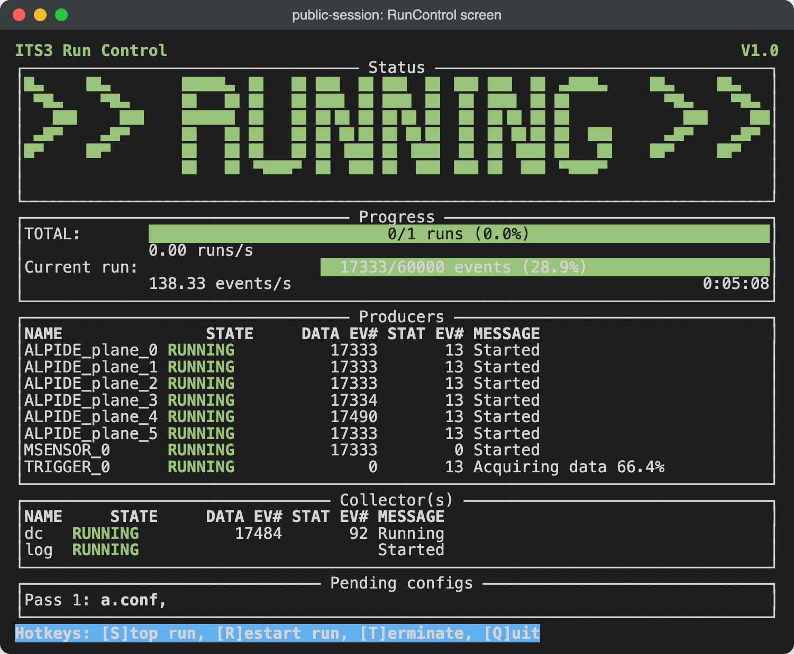
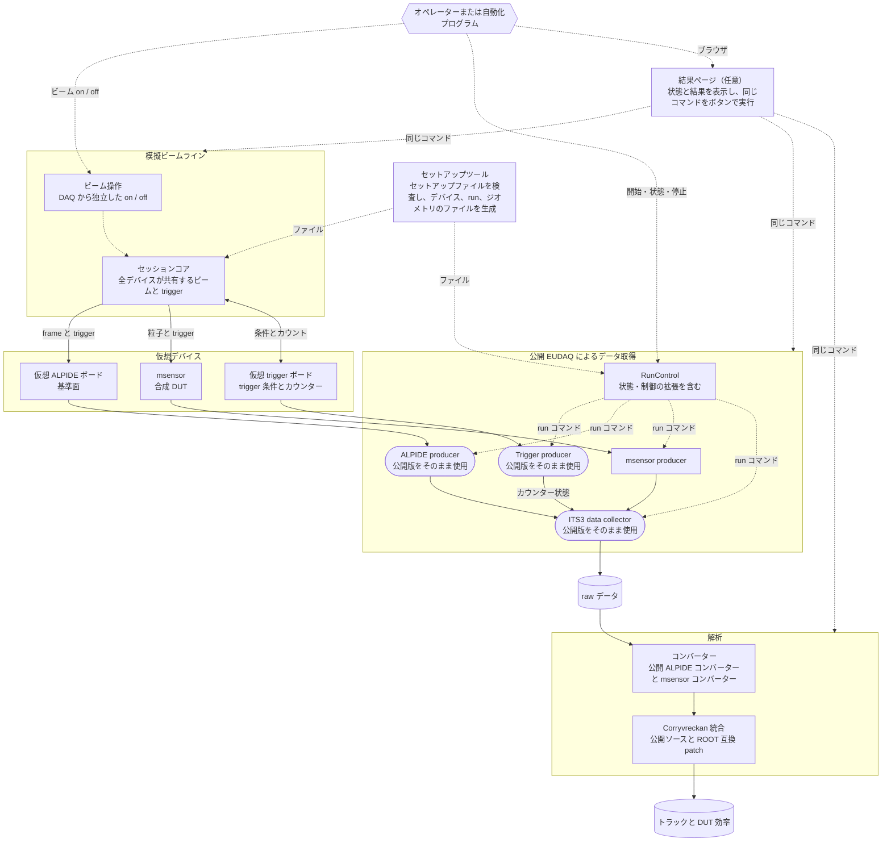

[English](README.md) | [한국어](README.ko.md) | [日本語](README.ja.md)

# Test-beam sandbox

このリポジトリはビームテストのデータ取得と解析を練習する環境です。模擬ビームは仮想ピクセルセンサーの telescope（基準面）と、試験対象の合成ピクセルセンサー（msensor、DUT: 試験対象デバイス）を通過します。公開データ取得ソフトウェア EUDAQ が変更なしでデータを記録し、公開解析ソフトウェア Corryvreckan が粒子のトラックを再構成して DUT がそれをどの程度効率よく検出するかを測定します。ビームはデータ取得と独立してオンとオフにでき、デバイス、その設定、ビームを一つのセットアップファイルで指定します。

オペレーターがデータ取得と解析のフローを習得する用途だけでなく、取得を制御する自動化プログラムの開発・テストにも利用できます。すべての応答はシミュレーションによる合成データであり、実機の測定値ではありません。


## 動作環境

Linux コンテナーを実行する Docker が動いている Linux または macOS、Python 3、40 GiB 以上の空き容量が必要です。ビルドにはインターネットが必要で、セッションはネットワークなしで動きます。ビルドは Docker デーモンのアーキテクチャ（arm64 または amd64）を選び、最大 4 ジョブと 8 GiB のメモリを使います。

## クイックスタート

コードを取得し、イメージを一度ビルドします。コマンドはすべてリポジトリの最上位ディレクトリで実行します:

```sh
# コードを取得します。
git clone https://github.com/BongHwi/test-beam-sandbox.git
cd test-beam-sandbox

# 公開ベースイメージとセッションイメージをビルドします（一度だけ）。
scripts/build_session.sh
```

最初のビルドは EUDAQ と Corryvreckan をコンパイルするため時間がかかります。以後のセッションはイメージを再利用します。

次にターミナルまたはブラウザの方法を使います。どちらも `public-session` という一つのセッションコンテナーを使い、ブラウザの各ボタンはターミナルと同じコマンドを実行するため、二つの方法を組み合わせられます。

### ターミナルで

#### 1. 取得

既定のセットアップでセッションを開始します。他のセットアップは `configs/setups/` にあり、[セットアップファイルの説明](docs/ja/setup-file.md)を参照します。RunControl、producer、data collector と模擬ビームは `public-session` という一つのコンテナーで動き、このターミナルに公開 RunControl 画面が表示されます。

```sh
# セッションを開始し、公開 RunControl 画面を表示します。
scripts/start_session.sh --setup configs/setups/default.ini --name public-session
```

セッションはビームがオフの状態で始まります。二つ目のターミナルで模擬ビームをオンにすると、RunControl 画面のイベント数が増え始めます。

```sh
# 模擬ビームをオンにします。
scripts/session_control.sh public-session on
```

run が終わると、`T` で一連の処理を終了するまで RunControl は次の run を開始します。何も止めずに画面を離れるには `Ctrl-b`、次に `d` を押します。`scripts/attach_session.sh public-session` で画面を再表示できます。



実行中のセッションの RunControl 画面です。セッションは [EUDAQ の ITS3 RunControl](https://github.com/eudaq/eudaq/blob/bfe26c7b73844344b2cbfa37ab853f2a0cb1f23e/user/ITS3/python/ITS3RunControl.py) を使います。ウィンドウのキーは[操作画面ガイド](docs/ja/operator-screen.md)にあります。

#### 2. 解析

セットアップファイルの位置は測量した値です。実際の位置は設置後のように最大 `5` mm ずれていて隠されているため、QA が Corryvreckan でトラックを再構成して DUT の効率を測る前に、アライメントがデータから位置を求めます。その間も取得は続きます（[アライメントガイド](docs/ja/alignment.md)）。アライメントは現在の run のデータイベントが `3000` に達するまで待ちます。

```sh
# 現在の run のデータからデバイスの位置を求めます。
scripts/align_session.sh public-session

# 現在の run を解析します: イベント、トラック、DUT の効率。
scripts/analyze_session.sh public-session
```

QA は次のような行で終わります（数値は変わります）:

```text
  Events: Ev: 53.9k Px: 599.9k Tr: 37.9k (0.704/ev) t = 258.73s
  [F:AnalysisEfficiency:MSENSOR_6] Total efficiency of detector MSENSOR_6: 98.3425(+0.0715373 -0.0746357)%, measured with 31387/31916 matched/total tracks
```

アライメントは求めた補正量と、アライメントの前後のイベントあたりのトラック数を表示します。QA はイベント数、トラック数、DUT ごとの効率を表示します。最初の行はコンテナー内の結果ディレクトリを示し、その中の `analysis/output/histograms.root` にヒストグラムがあります。どちらも使った Corryvreckan の設定を示します（[操作画面ガイド](docs/ja/operator-screen.md)）。DUT は DAQ では producer 名に従って `MSENSOR_0`、解析では plane 番号に従って `MSENSOR_6` と呼ばれます。

#### 3. 終了

RunControl 画面で `T` を押して一連の処理を終え、次に `Q` を押して RunControl を抜けます。別のターミナルから `scripts/session_control.sh public-session terminate` を実行すると `T` と同じ要求を送ります。画面の再描画中に押したキーが公開 RunControl を停止させることがあるため、プログラムはこのコマンドを使うべきです（[操作画面ガイド](docs/ja/operator-screen.md)）。

```sh
# 出力をホストにコピーします。
docker cp public-session:/tmp/session-run ./session-output

# セッションのコンテナーとその中のすべてを削除します。
docker rm -f public-session
```

ウィンドウを移るキー、`S` と `R`、切り離しと再接続、ビームの履歴は[操作画面ガイド](docs/ja/operator-screen.md)に、run の長さは[セットアップファイルの説明](docs/ja/setup-file.md)にあります。

### ブラウザで

```sh
# ページサーバーを起動し、結果ページを開きます（セッションはまだありません）。
scripts/qa_page.sh
```

1. セットアップタブで `default.ini` を選び、"セッションを開始" を押します（`scripts/start_session.sh --setup configs/setups/default.ini --name public-session --no-attach`）。
2. 実験タブで "ビームをオン" を押すと（`scripts/session_control.sh public-session on --id page-on`）、イベント数が増え始めます。
3. QA タブで "アライメント"（`scripts/align_session.sh public-session`）、次に "QA を実行"（`scripts/analyze_session.sh public-session`）を押します。
4. 実験タブで "データ取得を終了"（`scripts/session_control.sh public-session terminate --id page-terminate`）、次に "RunControl を終了 (Q)"（`docker exec public-session tmux send-keys -t ITS3:rc Q`）を押します。
5. 同じカードで "出力をコピー"（`docker cp public-session:/tmp/session-run outputs/public-session-UTCTIME`）、次に "コンテナーを削除"（`docker rm -f public-session`）を押します。DAQ 画面タブでも同じ手順を実行できます。
6. `scripts/qa_page.sh --stop` でページサーバーを停止します。

ターミナルで開始したセッションを見るには `scripts/qa_page.sh public-session` を実行します。ページは実験タブで開きます。各タブは[結果ページガイド](docs/ja/qa-page.md)に説明されています。

## 実際のテストビームでは

| 段階 | サンドボックスでは | 実際のテストビームでは |
|---|---|---|
| セットアップ | セットアップファイル一つ | デバイスを設置し、EUDAQ の設定ファイルを用意します |
| 取得 | `scripts/start_session.sh` が公開 RunControl 画面を表示します | RunControl と producer を起動し、その画面で操作します |
| ビーム | `scripts/session_control.sh NAME on`、`off` | 加速器から来ます |
| Trigger | セットアップファイルのシンチレーターと条件、仮想ボードと公開 trigger producer | trigger ボード付きシンチレーター、trigger producer が条件を設定します |
| アライメントと解析 | `scripts/align_session.sh`、`scripts/analyze_session.sh` | Corryvreckan を設定ファイルで実行します |
| 結果 | QA が書いた `histograms.root` | ROOT ファイルを開きます |

## 動いているもの

| 何 | 起動するもの | 止めるもの | 残るもの |
|---|---|---|---|
| イメージ | `scripts/build_session.sh`（動くものはありません） | | 再びビルドするまで残ります |
| セッション: RunControl、producer、data collector と模擬ビームを含むコンテナー一つ | `scripts/start_session.sh` | `docker rm -f NAME` | 削除の前に `docker cp` で取り出していない出力はなくなります |
| ビーム | `scripts/session_control.sh NAME on`（セッションはビームがオフの状態で始まります） | `scripts/session_control.sh NAME off` | |
| ページサーバー: コンテナーの外、このコンピューターのプロセス | `scripts/qa_page.sh` | `scripts/qa_page.sh --stop` | セッションを削除しても動き続けます |

- `docker ps -a` は動いているものと止まったものを含めてセッションのコンテナーを表示します。
- `pgrep -f session_setup.webpage` はページサーバーのプロセス番号を表示します。

## スクリプト

| 役割 | スクリプト | すること |
|---|---|---|
| セットアップ | `scripts/setup_session.sh` | セットアップファイルを作り、表示し、確認します |
| セッション | `scripts/build_session.sh` | イメージをビルドします |
| セッション | `scripts/start_session.sh` | セットアップファイルでセッションを開始します |
| セッション | `scripts/attach_session.sh` | 動いているセッションの RunControl 画面をもう一度表示します |
| ビームと run | `scripts/session_control.sh` | ビームをオンとオフにし、run を止め、繰り返し、終え、次の run の設定を変更し、停止した producer を終了し、状態を表示します |
| 解析 | `scripts/align_session.sh` | 解析のジオメトリをデータに合わせます |
| 解析 | `scripts/analyze_session.sh` | 現在の run か閉じた run の QA をします |
| 結果ページ | `scripts/qa_page.sh` | ページサーバーを起動し、止めます |
| 自動化 | `scripts/wait_session.sh` | 有限の例が終わるか、セッションが終わるまで待ちます |

## 動作の仕組み



四角形はこのリポジトリの構成要素、角丸の四角形は変更を加えずに使用する公開ソフトウェアを示します。実線はデータの流れ、破線は制御の流れを表します。結果ページは任意です。状態と結果を表示し、ターミナルと同じコマンドを実行します。セットアップファイルもセットアップツールと同じ検査を通して編集します。

ビルドは公開ソフトウェアのバージョンを固定します。その中には EUDAQ commit `bfe26c7` と Corryvreckan master commit `22fca3e` が含まれます。すべてのバージョンと patch は[公開スタックとソースのバージョン](docs/ja/public-stack.md)にあります。

### リポジトリの構成

- `configs/`: セットアップファイル、配置とセッションジオメトリの例。
- `scripts/`: この README のコマンド。
- `session_setup/`: セットアップツール、セッション開始、解析コマンドと結果ページ。
- `session_core/`: 模擬ビームライン: ビーム、タイミングとデバイス間の調整。
- `virtual_alpide/`: 仮想 ALPIDE ボード。
- `virtual_trigger/`: 仮想 trigger ボード。
- `msensor/`: msensor デバイスとその producer。
- `runcontrol/`: RunControl 拡張と EUDAQ に適用する patch。
- `eudaq_module/`: EUDAQ 用 msensor コンバーター。
- `integration/`: 配置と Corryvreckan モジュール。
- `tracksim/`: セッションコアが使う粒子輸送。
- `docker/`: イメージのビルド。
- `docs/`: ドキュメント。
- `tests/`: 検査。
## ドキュメント

### 操作

- [操作画面](docs/ja/operator-screen.md): ウィンドウとキー、ビームと run のコマンド、QA の出力と結果ファイル。
- [セットアップファイル](docs/ja/setup-file.md): デバイス、設定、run の長さ、ビームと `scripts/setup_session.sh`。
- [アライメント](docs/ja/alignment.md): デバイスの位置をなぜ、どう求めるか。
- [結果ページ](docs/ja/qa-page.md): ブラウザのページ。
- [trigger](docs/ja/trigger.md): trigger シンチレーターと trigger 条件。
- [msensor](docs/ja/msensor.md): オフにできるタイルに分かれた合成 DUT と、そのデータ形式およびストリーム形式。既定のタイル配置は `6 x 2` タイル、タイルごとに `156 x 444` ピクセル、ピッチ `22.8 x 20.8` µm です。
- [自動実行の例](docs/ja/automation.md): プログラム向けの、画面なしで動くセッション、および状態ファイルの状態。
- [プログラムとエージェント](docs/ja/programs-and-agents.md): プログラムやエージェントが接続できるもの。

### 内部構成

- [セッションソースとビーム制御](docs/ja/session-core.md): 共有の模擬ビーム、タイミング、デバイス間の連携と独立した on/off 操作。
- [仮想 ALPIDE ボード](docs/ja/virtual-alpide-board.md): 公開版 producer 向けのボードインターフェース。
- [仮想 trigger ボード](docs/ja/trigger-board-surface.md): 公開 producer の条件とカウンター。
- [公開ボードの呼び出し範囲](docs/ja/alpide-board-surface.md): 公開 producer が使うボードインターフェース。
- [RunControl の拡張](docs/ja/runcontrol-hook.md): 状態ファイルと制御 socket。
- [セッションの取得と解析](docs/ja/session-run.md): 配置、作られるファイル、解析。
- [tracksim](docs/ja/tracksim.md): セッションコアの粒子輸送。
- [公開スタックとソースのバージョン](docs/ja/public-stack.md): 公開ソフトウェアのバージョンと patch。

## ライセンス

Copyright (C) 2026 Bong-Hwi Lim (CNS, the University of Tokyo)

このリポジトリは `LGPL-3.0-or-later` ライセンスのもとで配布されています。LGPL は GPL の本文に追加条件を定めるライセンス形態であるため、ライセンス全文は [COPYING.LESSER](COPYING.LESSER) および [COPYING](COPYING) にあります。EUDAQ（`LGPL-3.0`）および Corryvreckan（`MIT`）はビルド時に外部から取得されるため、このリポジトリにはそれらのソースコードのコピーは含まれていません。`runcontrol/ITS3RunControl.patch` と `runcontrol/ITS3start.patch` が EUDAQ に、`docker/base/corry-root-eigen.patch` が Corryvreckan にそれぞれ適用されます（各パッチファイルには適用先ソフトウェアの該当箇所のコードが含まれています）。結果ページは JSROOT `7.5.2`（`MIT`）で描画し、実験画面の 3D はその JSROOT に含まれる three.js `r155`（`MIT`）で描画します。JSROOT はセッションのイメージに ROOT とともに含まれ、ページサーバーがイメージから取り出して使います。このリポジトリにはそのコピーは含まれていません。
