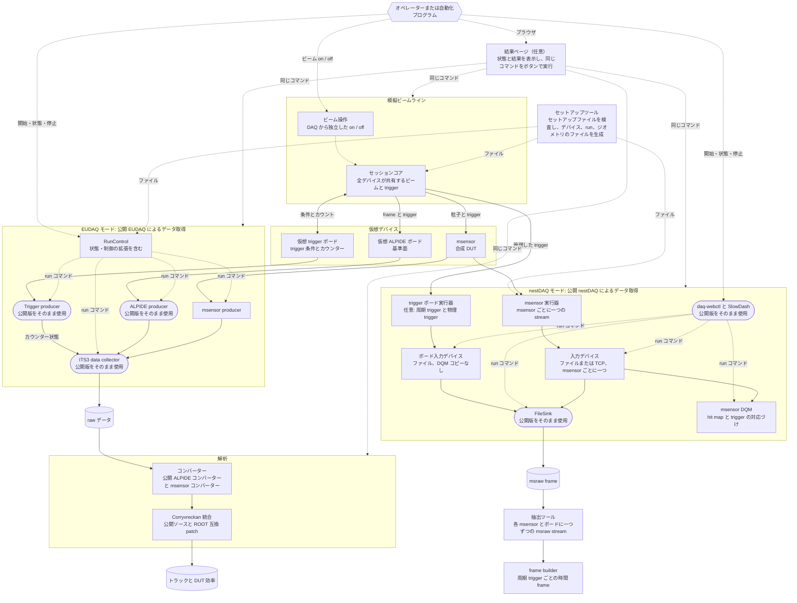

[English](README.md) | [한국어](README.ko.md) | [日本語](README.ja.md)

# Test-beam sandbox

このリポジトリはビームテストのデータ取得と解析を練習する環境です。模擬ビームは仮想ピクセルセンサーの telescope（基準面）と、試験対象の合成ピクセルセンサー（msensor、DUT: 試験対象デバイス）を通過します。デバイス、その設定、ビームを一つのセットアップファイルで指定し、ビームはデータ取得と独立してオンとオフにできます。

セッションはセットアップファイルで選んだ二つの公開データ取得フレームワークの一つでデータを取得します:
- EUDAQ（`[run] daq = eudaq`、既定）は公開 EUDAQ で仮想 ALPIDE 基準面、msensor、仮想 trigger ボードを読みます。ALPIDE producer、trigger producer、data collector はそのまま使い、RunControl はこのリポジトリの状態・制御の拡張とともに動きます。[公式リポジトリ](https://gitlab.cern.ch/corryvreckan/corryvreckan)の master commit `22fca3e43ceec7ba6263a5cf179cd57d5fff42fe` からビルドした公開解析ソフトウェア Corryvreckan が面をアライメントし、粒子のトラックを再構成して DUT がそれをどの程度効率よく検出するかを測定します。
- nestDAQ（`[run] daq = nestdaq`）は nestDAQ デバイスですべての msensor を continuous または triggered stream として読みます。msensor ごとの入力デバイス、frame を保存する FileSink、hit map を埋めて msensor の trigger を対応づけるモニター（DQM）を使います。daq-webctl は run を制御し、SlowDash は時系列を表示します。仮想 trigger ボード（`trigger_board = on`、任意）は、すべての msensor に周期 trigger を送って時間 frame の境界を示し、ビームラインの物理 trigger を専用のボード stream に記録します。

オペレーターがデータ取得と解析のフローを習得する用途だけでなく、取得を制御する自動化プログラムの開発・テストにも利用できます。すべての応答はシミュレーションによる合成データであり、実機の測定値ではありません。


## 動作環境

Linux コンテナーを実行する Docker が動いている Linux または macOS、Python 3、40 GiB 以上の空き容量が必要です。ビルドにはインターネットが必要で、セッションはネットワークなしで動きます。ビルドは Docker デーモンのアーキテクチャ（arm64 または amd64）を選び、最大 4 ジョブと 8 GiB のメモリを使います。ホストでは Python 3.9 以降で追加パッケージなしに結果ページと nestDAQ モードの抽出ツールおよび frame builder を実行します。macOS では最初の `python3` がコマンドライン開発者ツールのインストールを求めることがあります。

## DAQ モード

両モードは同じ模擬ビーム、セットアップファイル、スクリプト、結果ページを使います。セットアップファイルでモードを選びます:

| | EUDAQ モード | nestDAQ モード |
|---|---|---|
| セットアップファイル | `[run] daq = eudaq`（既定） | `[run] daq = nestdaq` |
| イメージ | `scripts/build_session.sh` | さらに `scripts/build_session.sh --nestdaq` |
| `configs/setups/` のセットアップ例 | `default.ini`, `small-msensor.ini`, `msensor-telescope.ini` | `nestdaq.ini`, `nestdaq-clocks.ini`, `nestdaq-missed.ini`, `nestdaq-telescope.ini`, `nestdaq-board.ini` |
| 読むデバイス | ALPIDE 基準面、msensor、trigger ボード | msensor; ALPIDE 面はビーム中の物質として残ります |
| Trigger | シンチレーターとセットアップファイルの trigger 条件 | 模擬ビームラインの trigger; `trigger_board = on` ではシンチレーターと `[trigger]` を使え、周期 trigger を出す仮想 trigger ボードが加わります |
| Run 制御 | 公開 RunControl 画面と `scripts/session_control.sh` | daq-webctl と `scripts/session_control.sh NAME nestdaq` |
| 監視 | RunControl 画面; ページの実験と DAQ 画面タブ | DQM と SlowDash; ページの nestDAQ と QA タブ |
| 保存データ | EUDAQ raw ファイル | FileSink ファイルの msraw frame; `python3 -m nestdaq_mode.extract` が msensor ごと、および trigger ボードの msraw stream を別ファイルに書きます |
| 解析 | Corryvreckan によるアライメントと QA | アライメントはまだありません; `python3 -m nestdaq_mode.framebuilder` が周期 trigger ごとの時間 frame をオフラインで作ります; DQM は hit map、correlation、trigger の対応づけを示し、`nestdaq qa` と QA タブはその数値を表示します |

## クイックスタート

コードを取得し、イメージを一度ビルドします。コマンドはすべてリポジトリの最上位ディレクトリで実行します:

```sh
# コードを取得します。
git clone https://github.com/BongHwi/test-beam-sandbox.git
cd test-beam-sandbox

# 公開ベースイメージとセッションイメージをビルドします（一度だけ）。
scripts/build_session.sh

# nestDAQ モードでは nestDAQ イメージもビルドします（一度だけ）。
scripts/build_session.sh --nestdaq
```

最初のビルドは EUDAQ と Corryvreckan をコンパイルするため時間がかかります。24 コアの arm64 コンピューターでは約 4 分、nestDAQ イメージにはさらに約 10 分かかりました。以後のセッションはイメージを再利用します。

次にターミナルまたはブラウザで EUDAQ か nestDAQ の方法を使います。すべての方法は `public-session` という一つのセッションコンテナーを使い、ブラウザの各ボタンはターミナルと同じコマンドを実行するため、二つの方法を組み合わせられます。

### ターミナルで EUDAQ セッション

#### 1. 取得

既定のセットアップでセッションを開始します。他のセットアップは `configs/setups/` にあり、[セットアップファイルの説明](docs/ja/setup-file.md)を参照します。RunControl、producer、data collector と模擬ビームは `public-session` という一つのコンテナーで動き、このターミナルに公開 RunControl 画面が表示されます。

```sh
# セッションを開始し、公開 RunControl 画面を表示します。
scripts/start_session.sh --setup configs/setups/default.ini --name public-session
```

セッションはビームがオフの状態で始まります。二つ目のターミナルで模擬ビームをオンにすると、RunControl 画面のイベント数が増え始めます。

```sh
# 模擬ビームをオンにします。
scripts/session_control.sh public-session on
```

run が終わると、`T` で一連の処理を終了するまで RunControl は次の run を開始します。何も止めずに画面を離れるには `Ctrl-b`、次に `d` を押します。`scripts/attach_session.sh public-session` で画面を再表示できます。


実行中のセッションの RunControl 画面です。セッションは [EUDAQ の ITS3 RunControl](https://github.com/eudaq/eudaq/blob/bfe26c7b73844344b2cbfa37ab853f2a0cb1f23e/user/ITS3/python/ITS3RunControl.py) を使います。ウィンドウのキーは[操作画面ガイド](docs/ja/operator-screen.md)にあります。

#### 2. 解析

セットアップファイルの位置は測量した値です。実際の位置は設置後のように最大 `5` mm ずれていて隠されているため、QA が Corryvreckan でトラックを再構成して DUT の効率を測る前に、アライメントがデータから位置を求めます。その間も取得は続きます（[アライメントガイド](docs/ja/alignment.md)）。アライメントは現在の run のデータイベントが `3000` に達するまで待ちます。

```sh
# 現在の run のデータからデバイスの位置を求めます。
scripts/align_session.sh public-session

# 現在の run を解析します: イベント、トラック、DUT の効率。
scripts/analyze_session.sh public-session
```

QA は次のような行で終わります（数値は変わります）:

```text
  Events: Ev: 10.1k Px: 113.3k Tr: 7.1k (0.703/ev) t = 47.6141s
  [F:AnalysisEfficiency:MSENSOR_6] Total efficiency of detector MSENSOR_6: 98.4446(+0.149964 -0.164889)%, measured with 6709/6815 matched/total tracks
```

アライメントは求めた補正量と、アライメントの前後のイベントあたりのトラック数を表示します。QA はイベント数、トラック数、DUT ごとの効率を表示します。最初の行はコンテナー内の結果ディレクトリを示し、その中の `analysis/output/histograms.root` にヒストグラムがあります。どちらも使った Corryvreckan の設定を示します（[操作画面ガイド](docs/ja/operator-screen.md)）。DUT は DAQ では producer 名に従って `MSENSOR_0`、解析では plane 番号に従って `MSENSOR_6` と呼ばれます。

#### 3. 終了

RunControl 画面で `T` を押して一連の処理を終え、次に `Q` を押して RunControl を抜けます。画面にはコンテナーの shell が表示され、`Ctrl-b`、次に `d` を押すと離れます。別のターミナルから `scripts/session_control.sh public-session terminate` を実行すると `T` と同じ要求を送ります。画面の再描画中に押したキーが公開 RunControl をフリーズさせることがあるため、プログラムはこのコマンドを使うべきです（[操作画面ガイド](docs/ja/operator-screen.md)）。

```sh
# 出力をホストにコピーします。
docker cp public-session:/tmp/session-run ./session-output

# セッションのコンテナーとその中のすべてを削除します。
docker rm -f public-session
```

ウィンドウを移るキー、`S` と `R`、切り離しと再接続、ビームの履歴は[操作画面ガイド](docs/ja/operator-screen.md)に、run の長さは[セットアップファイルの説明](docs/ja/setup-file.md)にあります。

### ターミナルで nestDAQ セッション

#### 1. 取得

nestDAQ のセットアップでセッションを開始すると、セットアップファイルから nestDAQ イメージが選ばれます。nestDAQ プロセスはコンテナーのバックグラウンドで動くため、同じターミナルでビームをオンにして run を開始できます。`scripts/attach_session.sh public-session` は msensor 実行器を表示し、`Ctrl-b`、次に `d` を押すと画面を離れます。

```sh
# 画面を表示せずに nestDAQ セッションを開始します。
scripts/start_session.sh --setup configs/setups/nestdaq.ini --name public-session --no-attach

# 模擬ビームをオンにします。
scripts/session_control.sh public-session on

# run を開始します。応答は run 番号を含む JSON です。
scripts/session_control.sh public-session nestdaq start
```

仮想 trigger ボードを加えるには、`configs/setups/nestdaq-board.ini` から始めるか、`[nestdaq]` に `trigger_board = on` と `periodic_clk` を設定します。すると、すべての msensor が 100.5 MHz のボード時計で `periodic_clk` サイクルごとに周期 trigger を受け取り、`TRIGGERBOARD_0` 実行器が周期 trigger と物理 trigger をそれぞれのシンチレーターパターンとともに専用の stream に保存します。この設定がなければ、セッションはこれまでどおり動きます。

#### 2. 監視

状態は run、デバイス、msensor ごとに送った frame と破棄された DQM コピーを表示します。ページの nestDAQ タブはこれらと実行器ごとに書いた frame を表示し、daq-webctl、SlowDash、DQM へのリンクを示します。`scripts/qa_page.sh public-session` で開きます。`nestdaq qa` は DQM の数値を表示し、ページの QA タブにも同じ数値が表示されます。DQM の hit map と trigger の対応づけは [nestDAQ モード](docs/ja/nestdaq.md)に説明されています。

```sh
# run、デバイスと msensor stream を表示します。
scripts/session_control.sh public-session nestdaq status --json

# DQM の frame、trigger、hit、trigger の対応づけの数値を表示します。
scripts/session_control.sh public-session nestdaq qa
```


#### 3. 終了

run を止めると、残りのデータは run が止まる前に保存され、次の `nestdaq start` は新しい run を開始します。出力をコピーしてコンテナーを削除し、このコンピューターで各 msensor と trigger ボードの msraw stream を抽出します。trigger ボードを使った場合は時間 frame も作ります。各ツールは JSON の要約を表示します。

```sh
# run を止めます。
scripts/session_control.sh public-session nestdaq stop

# 出力をホストにコピーします。
docker cp public-session:/tmp/session-run ./session-output

# セッションのコンテナーとその中のすべてを削除します。
docker rm -f public-session

# run 1 の各 msensor と trigger ボードの msraw stream を抽出します。
python3 -m nestdaq_mode.extract session-output/nestdaq/data/run000001.dat extracted

# trigger ボードを使った場合: 周期 trigger ごとの時間 frame を作ります。frame ごとに 1 行の JSON です。
python3 -m nestdaq_mode.framebuilder --dir extracted --out frames.jsonl
```

`terminate` と `T`、`Q` キーは EUDAQ RunControl に属し、nestDAQ セッションは `terminate` を拒否します。セットアップ項目、run、画面、データ、制約は [nestDAQ モード](docs/ja/nestdaq.md)にあります。

### ブラウザで

```sh
# ページサーバーを起動し、結果ページを開きます（セッションはまだありません）。
scripts/qa_page.sh
```

EUDAQ セッション:

1. セットアップタブで `default.ini` を選び、"セッションを開始" を押します（`scripts/start_session.sh --setup configs/setups/default.ini --name public-session --no-attach`）。
2. 実験タブで "ビームをオン" を押すと（`scripts/session_control.sh public-session on --id page-on`）、イベント数が増え始めます。
3. QA タブで "アライメント"（`scripts/align_session.sh public-session`）、次に "QA を実行"（`scripts/analyze_session.sh public-session`）を押します。
4. 実験タブで "データ取得を終了"（`scripts/session_control.sh public-session terminate --id page-terminate`）、次に "RunControl を終了 (Q)"（`docker exec public-session tmux send-keys -t ITS3:rc Q`）を押します。
5. 同じカードで "出力をコピー"（`docker cp public-session:/tmp/session-run outputs/public-session-UTCTIME`）、次に "コンテナーを削除"（`docker rm -f public-session`）を押します。DAQ 画面タブでも同じ手順を実行できます。
nestDAQ セッション:

1. セットアップタブで `nestdaq.ini` を選び（trigger ボードを使う場合は `nestdaq-board.ini`）、"セッションを開始" を押します（`scripts/start_session.sh --setup configs/setups/nestdaq.ini --name public-session --no-attach`）。
2. 実験タブで "ビームをオン" を押します（`scripts/session_control.sh public-session on --id page-on`）。
3. nestDAQ タブで "Start" を押します（`scripts/session_control.sh public-session nestdaq start`）。画面リンクは daq-webctl、SlowDash、DQM を開きます。run を終えるには "Stop" を押します（`scripts/session_control.sh public-session nestdaq stop`）。
4. 実験タブで EUDAQ セッションと同じように "出力をコピー"、次に "コンテナーを削除" を押します。

`scripts/qa_page.sh --stop` でページサーバーを停止します。ターミナルで開始したセッションを見るには `scripts/qa_page.sh public-session` を実行します。各タブは[結果ページガイド](docs/ja/qa-page.md)に説明されています。

## 実際のテストビームでは

| 段階 | サンドボックスでは | 実際のテストビームでは |
|---|---|---|
| セットアップ | セットアップファイル一つ | デバイスを設置し、EUDAQ の設定ファイルを用意します |
| 取得 | `scripts/start_session.sh` が公開 RunControl 画面を表示します | RunControl と producer を起動し、その画面で操作します |
| nestDAQ での取得 | `scripts/session_control.sh NAME nestdaq start` と `stop`、または daq-webctl | nestDAQ デバイスを起動し、daq-webctl で run を制御します |
| ビーム | `scripts/session_control.sh NAME on`、`off` | 加速器から来ます |
| Trigger | セットアップファイルのシンチレーターと条件、仮想ボードと公開 trigger producer | trigger ボード付きシンチレーター、trigger producer が条件を設定します |
| アライメントと解析 | `scripts/align_session.sh`、`scripts/analyze_session.sh` | Corryvreckan を設定ファイルで実行します |
| 結果 | QA が書いた `histograms.root` | ROOT ファイルを開きます |

## 動いているもの

| 何 | 起動するもの | 止めるもの | 残るもの |
|---|---|---|---|
| イメージ | `scripts/build_session.sh`（動くものはありません） | | 再びビルドするまで残ります |
| セッション: 模擬ビームとセットアップファイルの DAQ を含むコンテナー一つ; EUDAQ モードでは RunControl、producer、data collector | `scripts/start_session.sh` | `docker rm -f NAME` | 削除の前に `docker cp` で取り出していない出力はなくなります |
| nestDAQ モードの nestDAQ プロセス: コンテナーの `NESTDAQ` tmux セッションにある Redis、daq-webctl、SlowDash、msensor 実行器、trigger ボード実行器（`trigger_board = on` のとき）、入力デバイス、FileSink、DQM | `scripts/start_session.sh` | `docker rm -f NAME` | コンテナーの `/tmp/session-run/nestdaq/data/` に保存されたファイルはコピーしなければ一緒になくなります |
| nestDAQ run | `scripts/session_control.sh NAME nestdaq start` | `scripts/session_control.sh NAME nestdaq stop` | |
| ビーム | `scripts/session_control.sh NAME on`（セッションはビームがオフの状態で始まります） | `scripts/session_control.sh NAME off` | |
| ページサーバー: コンテナーの外、このコンピューターのプロセス | `scripts/qa_page.sh` | `scripts/qa_page.sh --stop` | セッションを削除しても動き続けます |

- `docker ps -a` は動いているものと止まったものを含めてセッションのコンテナーを表示します。
- `pgrep -f session_setup.webpage` はページサーバーのプロセス番号を表示します。

## スクリプト

| 役割 | スクリプト | すること |
|---|---|---|
| セットアップ | `scripts/setup_session.sh` | セットアップファイルを作り、表示し、確認します |
| セッション | `scripts/build_session.sh` | イメージをビルドします |
| セッション | `scripts/start_session.sh` | セットアップファイルでセッションを開始します |
| セッション | `scripts/attach_session.sh` | 動いているセッションの RunControl 画面（EUDAQ モード）または msensor 実行器（nestDAQ モード）を再表示します |
| ビームと run | `scripts/session_control.sh` | ビームをオンとオフにして状態を表示します; EUDAQ モードでは run を止め、繰り返し、終え、次の run の設定を変更し、応答しなくなった producer を終了します; nestDAQ モードでは run を開始し、止め、DQM の数値を表示します |
| 解析 | `scripts/align_session.sh` | 解析のジオメトリをデータに合わせます（EUDAQ モード） |
| 解析 | `scripts/analyze_session.sh` | 現在の run か閉じた run の QA をします（EUDAQ モード） |
| データ | `python3 -m nestdaq_mode.extract` | nestDAQ モードで保存したファイルから各 msensor と trigger ボードの msraw stream を抽出します |
| データ | `python3 -m nestdaq_mode.framebuilder` | 抽出した stream または保存したファイルから、周期 trigger ごとの時間 frame を作ります（trigger ボード） |
| 結果ページ | `scripts/qa_page.sh` | ページサーバーを起動し、止めます |
| 自動化 | `scripts/wait_session.sh` | 有限の例が終わるか、セッションが終わるまで待ちます |

## 動作の仕組み



四角形はこのリポジトリの構成要素、角丸の四角形は変更を加えずに使用する公開ソフトウェアを示します。実線はデータの流れ、破線は制御の流れを表します。セットアップファイルに従い、セッションは EUDAQ または nestDAQ の箱を使います。ビームライン、デバイス、結果ページは両方で同じです。結果ページは任意です。状態と結果を表示し、ターミナルと同じコマンドを実行します。セットアップファイルもセットアップツールと同じ検査を通して編集します。

ビルドは公開ソフトウェアのバージョンを固定します。その中には EUDAQ commit `bfe26c7`、Corryvreckan master commit `22fca3e`、nestDAQ commit `eda7287` が含まれます。すべてのバージョンと patch は[公開スタックとソースのバージョン](docs/ja/public-stack.md)にあります。

### リポジトリの構成

- `configs/`: 両モードのセットアップファイル、配置とセッションジオメトリの例。
- `scripts/`: この README のコマンド。
- `session_setup/`: セットアップツール、セッション開始、解析コマンドと結果ページ。
- `session_core/`: 模擬ビームライン: ビーム、タイミングとデバイス間の調整。
- `virtual_alpide/`: 仮想 ALPIDE ボード。
- `virtual_trigger/`: 仮想 trigger ボード。
- `msensor/`: msensor デバイス、producer、実行器。
- `nestdaq_mode/`: nestDAQ モードのセッション開始、run 制御、入力デバイス、trigger ボード実行器、DQM、抽出ツール、frame builder。
- `runcontrol/`: RunControl 拡張と EUDAQ に適用する patch。
- `eudaq_module/`: EUDAQ 用 msensor コンバーター。
- `integration/`: 配置と Corryvreckan モジュール。
- `tracksim/`: セッションコアが使う粒子輸送。
- `docker/`: イメージのビルド。
- `docs/`: ドキュメント。
- `tests/`: 検査。
## ドキュメント

### 操作

- [操作画面](docs/ja/operator-screen.md): ウィンドウとキー、ビームと run のコマンド、QA の出力と結果ファイル。
- [セットアップファイル](docs/ja/setup-file.md): デバイス、設定、run の長さ、ビームと `scripts/setup_session.sh`。
- [nestDAQ モード](docs/ja/nestdaq.md): nestDAQ で msensor を読むセッションのセットアップ、trigger ボード（任意）、run、画面、データ、frame builder、制約。
- [アライメント](docs/ja/alignment.md): デバイスの位置をなぜ、どう求めるか。
- [結果ページ](docs/ja/qa-page.md): ブラウザのページ。
- [trigger](docs/ja/trigger.md): trigger シンチレーターと trigger 条件。
- [msensor](docs/ja/msensor.md): オフにできるタイルに分かれた合成 DUT と、そのデータ形式およびストリーム形式。既定のタイル配置は `6 x 2` タイル、タイルごとに `156 x 444` ピクセル、ピッチ `23 x 21` µm です。
- [自動実行の例](docs/ja/automation.md): プログラム向けの、画面なしで動くセッション、および状態ファイルの状態。
- [プログラムとエージェント](docs/ja/programs-and-agents.md): プログラムやエージェントが接続できるもの。


### 内部構成

- [セッションソースとビーム制御](docs/ja/session-core.md): 共有の模擬ビーム、タイミング、デバイス間の連携と独立した on/off 操作。
- [仮想 ALPIDE ボード](docs/ja/virtual-alpide-board.md): 公開版 producer 向けのボードインターフェース。
- [仮想 trigger ボード](docs/ja/trigger-board-surface.md): 公開 producer の条件とカウンター。
- [公開ボードの呼び出し範囲](docs/ja/alpide-board-surface.md): 公開 producer が使うボードインターフェース。
- [RunControl の拡張](docs/ja/runcontrol-hook.md): 状態ファイルと制御 socket。
- [セッションの取得と解析](docs/ja/session-run.md): 配置、作られるファイル、解析。
- [tracksim](docs/ja/tracksim.md): セッションコアの粒子輸送。
- [公開スタックとソースのバージョン](docs/ja/public-stack.md): 公開ソフトウェアのバージョンと patch。

## ライセンス

Copyright (C) 2026 Bong-Hwi Lim (CNS, the University of Tokyo)

このリポジトリは `LGPL-3.0-or-later` ライセンスのもとで配布されています。LGPL は GPL の本文に追加条件を定めるライセンス形態であるため、ライセンス全文は [COPYING.LESSER](COPYING.LESSER) および [COPYING](COPYING) にあります。EUDAQ（`LGPL-3.0`）および Corryvreckan（`MIT`）はビルド時に外部から取得されるため、このリポジトリにはそれらのソースコードのコピーは含まれていません。`runcontrol/ITS3RunControl.patch` と `runcontrol/ITS3start.patch` が EUDAQ に、`docker/base/corry-root-eigen.patch` が Corryvreckan にそれぞれ適用されます（各パッチファイルには適用先ソフトウェアの該当箇所のコードが含まれています）。結果ページは JSROOT `7.5.2`（`MIT`）で描画し、実験画面の 3D はその JSROOT に含まれる three.js `r155`（`MIT`）で描画します。JSROOT はセッションのイメージに ROOT とともに含まれ、ページサーバーがイメージから取り出して使います。このリポジトリにはそのコピーは含まれていません。

nestDAQ モードでのみビルドする nestDAQ イメージはビルド中に追加の公開ソフトウェアをダウンロードします。[公開スタックとソースのバージョン](docs/ja/public-stack.md)を参照します。
