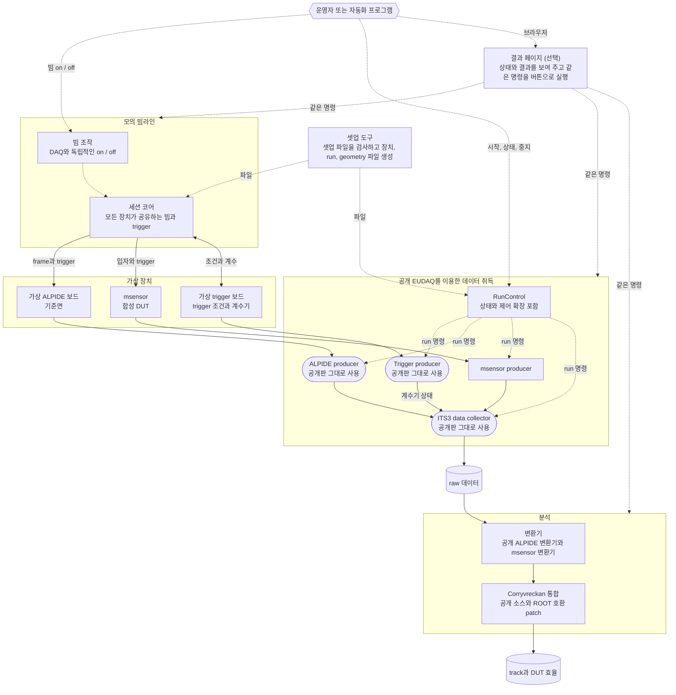

[English](README.md) | [한국어](README.ko.md) | [日本語](README.ja.md)

# Test-beam sandbox

이 저장소는 빔 테스트의 데이터 취득과 분석을 연습하는 환경입니다. 모의 빔이 가상 픽셀 센서로 이루어진 telescope(기준면)와 시험할 합성 픽셀 센서(msensor, DUT: 시험 대상 장치)를 통과합니다. 공개 데이터 취득 소프트웨어 EUDAQ는 변경 없이 데이터를 기록하고, 공개 분석 소프트웨어 Corryvreckan은 데이터에서 입자의 track을 재구성하고 DUT가 이를 얼마나 효율적으로 검출하는지 측정합니다. 빔은 데이터 취득과 독립적으로 켜고 끌 수 있으며 장치, 설정과 빔은 셋업 파일 하나에 지정합니다.

사람이 취득과 분석 절차를 익히거나, 취득을 조작하는 자동화 프로그램을 개발하고 시험할 때 사용할 수 있습니다. 모든 응답은 합성값이며 실제 장비의 측정값이 아닙니다.


## 필요한 것

Linux 컨테이너를 실행하는 Docker가 동작하는 Linux 또는 macOS, Python 3와 40 GiB 이상의 여유 공간이 필요합니다. 빌드에는 인터넷이 필요하며 세션은 network 없이 실행합니다. 빌드는 Docker daemon의 아키텍처(arm64 또는 amd64)를 선택하며 최대 4개 작업과 8 GiB 메모리를 사용합니다.

## 빠른 시작

코드를 받고 이미지를 한 번 빌드합니다. 명령은 모두 저장소 맨 위 디렉터리에서 실행합니다:

```sh
# 코드를 받습니다.
git clone https://github.com/BongHwi/test-beam-sandbox.git
cd test-beam-sandbox

# 공개 기반 이미지와 세션 이미지를 빌드합니다(한 번).
scripts/build_session.sh
```

첫 빌드는 EUDAQ와 Corryvreckan을 컴파일하므로 시간이 걸립니다. 이후 세션은 이미지를 재사용합니다.

그다음 터미널 경로 또는 브라우저 경로를 이용합니다. 둘 다 `public-session`이라는 세션 컨테이너 하나를 사용하며 브라우저의 각 버튼은 터미널과 같은 명령을 실행하므로 두 경로를 섞어 쓸 수 있습니다.

### 터미널에서

#### 1. 취득

기본 셋업으로 세션을 시작합니다. 다른 셋업은 `configs/setups/`에 있으며 [셋업 파일 설명](docs/ko/setup-file.md)을 참조합니다. RunControl, producer, data collector와 모의 빔이 `public-session`이라는 컨테이너 하나에서 돌고, 이 터미널에 공개 RunControl 화면이 나옵니다.

```sh
# 세션을 시작하고 공개 RunControl 화면을 보여 줍니다.
scripts/start_session.sh --setup configs/setups/default.ini --name public-session
```

세션은 빔이 꺼진 채 시작합니다. 두 번째 터미널에서 모의 빔을 켜면 RunControl 화면의 event 수가 늘기 시작합니다.

```sh
# 모의 빔을 켭니다.
scripts/session_control.sh public-session on
```

run이 끝나면 `T`로 시퀀스를 끝낼 때까지 RunControl이 다음 run을 시작합니다. 아무것도 멈추지 않고 화면을 떠나려면 `Ctrl-b`를 누르고 `d`를 누릅니다. `scripts/attach_session.sh public-session`으로 화면을 다시 볼 수 있습니다.


run 중인 세션의 RunControl 화면입니다. 세션은 [EUDAQ의 ITS3 RunControl](https://github.com/eudaq/eudaq/blob/bfe26c7b73844344b2cbfa37ab853f2a0cb1f23e/user/ITS3/python/ITS3RunControl.py)을 사용합니다. 창의 키는 [운영 화면 안내](docs/ko/operator-screen.md)에 있습니다.

#### 2. 분석

셋업 파일의 위치는 측량한 값입니다. 실제 위치는 설치한 뒤처럼 최대 `5` mm 다르고 감추어져 있으므로, QA가 Corryvreckan으로 track을 재구성하고 DUT 효율을 재기 전에 정렬이 데이터에서 위치를 찾습니다. 그동안 취득은 계속됩니다([정렬 안내](docs/ko/alignment.md)). 정렬은 현재 run의 데이터 event가 `3000`개가 될 때까지 기다립니다.

```sh
# 현재 run의 데이터에서 장치의 위치를 찾습니다.
scripts/align_session.sh public-session

# 현재 run을 분석합니다: event, track, DUT 효율.
scripts/analyze_session.sh public-session
```

QA는 다음과 같은 줄로 끝납니다(숫자는 달라집니다):

```text
  Events: Ev: 10.3k Px: 115.5k Tr: 7.2k (0.704/ev) t = 48.6715s
  [F:AnalysisEfficiency:MSENSOR_6] Total efficiency of detector MSENSOR_6: 98.446(+0.148435 -0.163065)%, measured with 6842/6950 matched/total tracks
```

정렬은 찾은 보정량과 정렬 전후의 event당 track 수를 출력합니다. QA는 event 수, track 수, DUT마다의 효율을 출력합니다. 첫 줄은 컨테이너 안의 결과 디렉터리를 알려 주며, 그 안의 `analysis/output/histograms.root`에 histogram이 있습니다. 둘 다 쓴 Corryvreckan 설정을 알려 줍니다([운영 화면 안내](docs/ko/operator-screen.md)). DUT는 DAQ에서 producer 이름을 따라 `MSENSOR_0`, 분석에서는 plane 번호를 따라 `MSENSOR_6`으로 불립니다.

#### 3. 끝내기

RunControl 화면에서 `T`를 눌러 시퀀스를 끝내고, 그다음 `Q`를 눌러 RunControl을 나갑니다. 다른 터미널에서 `scripts/session_control.sh public-session terminate`를 실행하면 `T`와 같은 요청을 보냅니다. 화면이 다시 그려질 때 누른 키가 공개 RunControl을 멈출 수 있으므로 프로그램은 이 명령을 사용해야 합니다([운영 화면 안내](docs/ko/operator-screen.md)).

```sh
# 출력을 호스트로 복사합니다.
docker cp public-session:/tmp/session-run ./session-output

# 세션 컨테이너와 그 안의 모든 것을 지웁니다.
docker rm -f public-session
```

창을 옮기는 키, `S`와 `R`, 떼었다 다시 붙기, 빔 기록은 [운영 화면 안내](docs/ko/operator-screen.md)에, run 길이는 [셋업 파일 설명](docs/ko/setup-file.md)에 있습니다.

### 브라우저에서

```sh
# 페이지 서버를 시작하고 결과 페이지를 엽니다(아직 세션 없음).
scripts/qa_page.sh
```

1. 셋업 탭에서 `default.ini`를 고르고 "세션 시작"을 누릅니다 (`scripts/start_session.sh --setup configs/setups/default.ini --name public-session --no-attach`).
2. 실험 탭에서 "빔 켜기"를 누르면 (`scripts/session_control.sh public-session on --id page-on`) event 수가 늘기 시작합니다.
3. QA 탭에서 "정렬" (`scripts/align_session.sh public-session`), 그다음 "QA 실행" (`scripts/analyze_session.sh public-session`)을 누릅니다.
4. 실험 탭에서 "취득 끝내기" (`scripts/session_control.sh public-session terminate --id page-terminate`), 그다음 "RunControl 나가기 (Q)" (`docker exec public-session tmux send-keys -t ITS3:rc Q`)를 누릅니다.
5. 같은 카드에서 "출력 복사" (`docker cp public-session:/tmp/session-run outputs/public-session-UTCTIME`), 그다음 "컨테이너 지우기" (`docker rm -f public-session`)를 누릅니다. DAQ 화면 탭에서도 같은 단계를 진행할 수 있습니다.
6. `scripts/qa_page.sh --stop`으로 페이지 서버를 멈춥니다.

터미널에서 시작한 세션을 보려면 `scripts/qa_page.sh public-session`을 실행합니다. 페이지는 실험 탭으로 열립니다. 각 탭은 [결과 페이지 안내](docs/ko/qa-page.md)에 설명되어 있습니다.

## 실제 빔 테스트에서는

| 단계 | 샌드박스에서 | 실제 빔 테스트에서 |
|---|---|---|
| 셋업 | 셋업 파일 하나 | 장치를 설치하고 EUDAQ 설정 파일을 준비합니다 |
| 취득 | `scripts/start_session.sh`가 공개 RunControl 화면을 보여 줍니다 | RunControl과 producer를 띄우고 그 화면에서 조작합니다 |
| 빔 | `scripts/session_control.sh NAME on`, `off` | 가속기에서 옵니다 |
| Trigger | 셋업 파일의 신틸레이터와 조건, 가상 보드와 공개 trigger producer | trigger 보드가 있는 신틸레이터, trigger producer가 조건을 설정합니다 |
| 정렬과 분석 | `scripts/align_session.sh`, `scripts/analyze_session.sh` | Corryvreckan을 설정 파일로 실행합니다 |
| 결과 | QA가 작성한 `histograms.root` | ROOT 파일을 엽니다 |

## 켜져 있는 것

| 무엇 | 켜는 것 | 끄는 것 | 남는 것 |
|---|---|---|---|
| 이미지 | `scripts/build_session.sh`(실행되는 것은 없습니다) | | 다시 빌드할 때까지 남습니다 |
| 세션: RunControl, producer, data collector와 모의 빔이 든 컨테이너 하나 | `scripts/start_session.sh` | `docker rm -f NAME` | 지우기 전에 `docker cp`로 꺼내지 않은 출력은 없어집니다 |
| 빔 | `scripts/session_control.sh NAME on`(세션은 빔이 꺼진 채 시작합니다) | `scripts/session_control.sh NAME off` | |
| 페이지 서버: 컨테이너 밖, 이 컴퓨터의 프로세스 | `scripts/qa_page.sh` | `scripts/qa_page.sh --stop` | 세션을 지워도 계속 돕니다 |

- `docker ps -a`는 도는 것과 멈춘 것을 포함해 세션 컨테이너를 보여 줍니다.
- `pgrep -f session_setup.webpage`는 페이지 서버의 프로세스 번호를 출력합니다.

## 스크립트

| 역할 | 스크립트 | 하는 일 |
|---|---|---|
| 셋업 | `scripts/setup_session.sh` | 셋업 파일을 만들고 보여 주고 확인합니다 |
| 세션 | `scripts/build_session.sh` | 이미지를 빌드합니다 |
| 세션 | `scripts/start_session.sh` | 셋업 파일로 세션을 시작합니다 |
| 세션 | `scripts/attach_session.sh` | 도는 세션의 RunControl 화면을 다시 보여 줍니다 |
| 빔과 run | `scripts/session_control.sh` | 빔을 켜고 끄며, run을 멈추고 되풀이하고 끝내고, 다음 run의 설정을 바꾸고 멈춘 producer를 끝내며, 상태를 보여 줍니다 |
| 분석 | `scripts/align_session.sh` | 분석 geometry를 데이터에 맞춥니다 |
| 분석 | `scripts/analyze_session.sh` | 현재 run이나 닫힌 run의 QA를 합니다 |
| 결과 페이지 | `scripts/qa_page.sh` | 페이지 서버를 켜고 끕니다 |
| 자동화 | `scripts/wait_session.sh` | 유한 예제가 끝나거나 세션이 끝날 때까지 기다립니다 |

## 작동 방식



사각형은 이 저장소의 구성 요소이고, 둥근 상자는 그대로 사용하는 공개 소프트웨어입니다. 실선은 데이터의 흐름을, 점선은 제어를 나타냅니다. 결과 페이지는 선택 사항입니다. 상태와 결과를 보여 주고 터미널과 같은 명령을 실행하며, 셋업 파일도 셋업 도구와 같은 확인을 거쳐 고칩니다.

빌드는 공개 소프트웨어의 버전을 고정합니다. 그중 EUDAQ commit은 `bfe26c7`, Corryvreckan master commit은 `22fca3e`입니다. 모든 버전과 patch는 [공개 스택과 소스 버전](docs/ko/public-stack.md)에 있습니다.

### 저장소 구성

- `configs/`: 셋업 파일, 배치와 세션 geometry 예제.
- `scripts/`: 이 README의 명령.
- `session_setup/`: 셋업 도구, 세션 시작, 분석 명령과 결과 페이지.
- `session_core/`: 모의 빔라인: 빔, 타이밍과 장치 조정.
- `virtual_alpide/`: 가상 ALPIDE 보드.
- `virtual_trigger/`: 가상 trigger 보드.
- `msensor/`: msensor 장치와 producer.
- `runcontrol/`: RunControl 확장과 EUDAQ에 적용하는 patch.
- `eudaq_module/`: EUDAQ용 msensor 변환기.
- `integration/`: 배치와 Corryvreckan 모듈.
- `tracksim/`: 세션 코어가 사용하는 입자 수송.
- `docker/`: 이미지 빌드.
- `docs/`: 설명서.
- `tests/`: 검사.

## 설명서

### 운영

- [운영 화면](docs/ko/operator-screen.md): 창과 키, 빔과 run 명령, QA 출력과 결과 파일.
- [셋업 파일](docs/ko/setup-file.md): 장치, 설정, run 길이, 빔과 `scripts/setup_session.sh`.
- [정렬](docs/ko/alignment.md): 장치의 위치를 왜, 어떻게 찾는지.
- [결과 페이지](docs/ko/qa-page.md): 브라우저 페이지.
- [trigger](docs/ko/trigger.md): trigger 신틸레이터와 trigger 조건.
- [msensor](docs/ko/msensor.md): 끌 수 있는 타일로 나뉜 합성 DUT와 데이터·stream 형식. 기본 타일 배치는 `6 x 2` 타일, 타일마다 `156 x 444` 픽셀, pitch `23 x 21` µm입니다.
- [자동 실행 예](docs/ko/automation.md): 프로그램을 위해 화면 없이 도는 세션과 상태 파일의 상태.
- [프로그램과 에이전트](docs/ko/programs-and-agents.md): 프로그램이나 에이전트가 연결할 수 있는 곳.

### 내부 구성

- [세션 source와 빔 제어](docs/ko/session-core.md): 공유 모의 빔, 타이밍, 장치 조정과 독립적인 on/off 조작.
- [가상 ALPIDE 보드](docs/ko/virtual-alpide-board.md): 공개 producer가 사용하는 보드 인터페이스.
- [가상 trigger 보드](docs/ko/trigger-board-surface.md): 공개 producer의 조건과 계수기.
- [공개 보드 호출 표면](docs/ko/alpide-board-surface.md): 공개 producer가 사용하는 보드 인터페이스.
- [RunControl 확장](docs/ko/runcontrol-hook.md): 상태 파일과 제어 socket.
- [세션 취득과 분석](docs/ko/session-run.md): 배치, 만들어지는 파일, 분석.
- [tracksim](docs/ko/tracksim.md): 세션 코어의 입자 수송.
- [공개 스택과 소스 버전](docs/ko/public-stack.md): 공개 소프트웨어 버전과 patch.

## 라이선스

Copyright (C) 2026 Bong-Hwi Lim (CNS, the University of Tokyo)

이 저장소는 `LGPL-3.0-or-later`로 배포합니다. LGPL은 GPL 본문에 조건을 더하는 형태이므로 전문은 [COPYING.LESSER](COPYING.LESSER)와 [COPYING](COPYING)에 있습니다. EUDAQ (`LGPL-3.0`)와 Corryvreckan (`MIT`)은 빌드할 때 받아 오며 이 저장소에는 그 사본이 들어 있지 않습니다. `runcontrol/ITS3RunControl.patch`와 `runcontrol/ITS3start.patch`는 EUDAQ에, `docker/base/corry-root-eigen.patch`는 Corryvreckan에 적용되며, 각 patch에는 적용 대상 소프트웨어의 줄이 들어 있습니다. 결과 페이지는 JSROOT `7.5.2`(`MIT`)로 그리고, 실험 화면의 3D는 그 JSROOT에 든 three.js `r155`(`MIT`)로 그립니다. JSROOT는 세션 이미지에 ROOT와 함께 들어 있으며 페이지 서버가 이미지에서 꺼내 쓰고, 이 저장소에는 그 사본이 없습니다.
