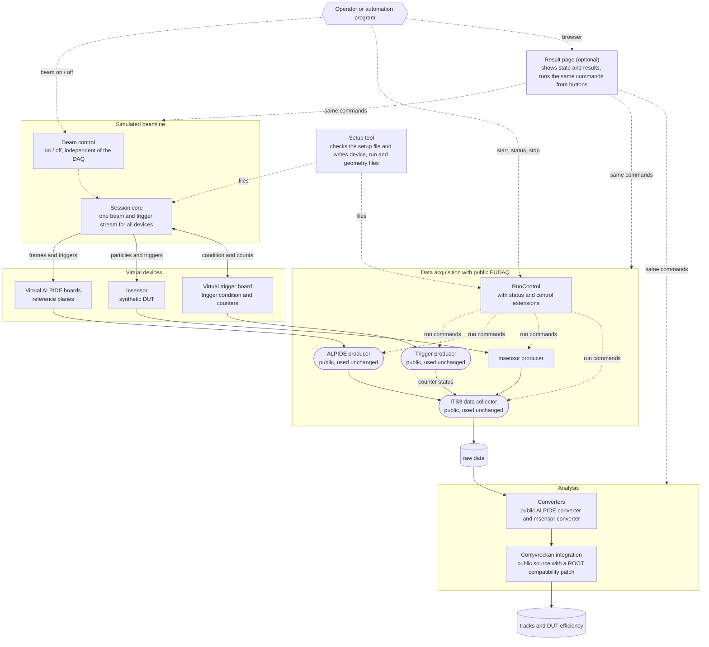

[English](README.md) | [한국어](README.ko.md) | [日本語](README.ja.md)

# Test-beam sandbox

This repository is an environment for practicing the data taking and the analysis of a beam test. A simulated beam crosses a telescope of virtual pixel sensors (the reference planes) and a synthetic pixel sensor under test (msensor, the DUT: device under test). The public data-acquisition software EUDAQ records the data, unchanged, and the public analysis software Corryvreckan reconstructs particle tracks from it and measures how efficiently the DUT detects them. The beam can be switched on and off independently of the data taking, and the devices, their settings and the beam are set in one setup file.

Use it to learn acquisition and analysis procedures or to develop and test automation that operates acquisitions. All responses are synthetic; they are not measurements from real equipment.


## Requirements

Linux or macOS with Docker running Linux containers, Python 3 and at least 40 GiB of free space are required. The build needs Internet access; a session runs without network access. The build selects the Docker daemon architecture (arm64 or amd64) and uses at most 4 jobs and 8 GiB of memory.

## Quick start

Get the code and build the images once. Run all commands from the repository root:

```sh
# Get the code.
git clone https://github.com/BongHwi/test-beam-sandbox.git
cd test-beam-sandbox

# Build the public base and session images (once).
scripts/build_session.sh
```

The first build compiles EUDAQ and Corryvreckan and takes a while; later sessions reuse the images.

Then take the terminal path or the browser path. Both use one session container named `public-session`, and each button of the browser path runs the same command as the terminal path, so the two can be mixed.

### In the terminal

#### 1. Acquire

Start a session from the default setup. Other setups are in `configs/setups/`; see the [setup file reference](docs/setup-file.md). RunControl, the producers, the data collector and the simulated beam run in one container named `public-session`, and this terminal shows the public RunControl screen.

```sh
# Start the session and show the public RunControl screen.
scripts/start_session.sh --setup configs/setups/default.ini --name public-session
```

The session starts with the beam off. In a second terminal turn the simulated beam on; the event counts on the RunControl screen start to grow.

```sh
# Turn on the simulated beam.
scripts/session_control.sh public-session on
```

RunControl starts the next run when a run ends, until the sequence is ended with `T`. To leave the screen without stopping anything press `Ctrl-b` and then `d`; `scripts/attach_session.sh public-session` shows it again.


The RunControl screen of a running session. The session uses the [ITS3 RunControl of EUDAQ](https://github.com/eudaq/eudaq/blob/bfe26c7b73844344b2cbfa37ab853f2a0cb1f23e/user/ITS3/python/ITS3RunControl.py). The window keys are in the [operator screen guide](docs/operator-screen.md).

#### 2. Analyze

The setup file gives surveyed positions. The actual positions differ by up to `5` mm and stay hidden, as after mounting, so alignment finds them from the data before QA reconstructs tracks and measures the DUT efficiency with Corryvreckan. Acquisition continues meanwhile ([alignment guide](docs/alignment.md)). Alignment waits until the current run has `3000` data events.

```sh
# Find the device positions from the data of the current run.
scripts/align_session.sh public-session

# Analyze the current run: events, tracks and DUT efficiency.
scripts/analyze_session.sh public-session
```

QA ends with lines like these (the numbers vary):

```text
  Events: Ev: 10.3k Px: 115.5k Tr: 7.2k (0.704/ev) t = 48.6715s
  [F:AnalysisEfficiency:MSENSOR_6] Total efficiency of detector MSENSOR_6: 98.446(+0.148435 -0.163065)%, measured with 6842/6950 matched/total tracks
```

Alignment prints the corrections it found and the tracks per event before and after. QA prints the event count, the track count and the efficiency of each DUT; its first line names the result directory in the container, whose `analysis/output/histograms.root` holds the histograms. Both name the Corryvreckan configuration they used ([operator screen guide](docs/operator-screen.md)). The DUT is named `MSENSOR_0` in the DAQ, after its producer, and `MSENSOR_6` in the analysis, after its plane number.

#### 3. Finish

On the RunControl screen press `T` to end the sequence and then `Q` to leave RunControl. From another terminal, `scripts/session_control.sh public-session terminate` sends the same request as `T`; programs should use it, because a key pressed while the screen redraws can freeze the public RunControl ([operator screen guide](docs/operator-screen.md)).

```sh
# Copy the output to the host.
docker cp public-session:/tmp/session-run ./session-output

# Remove the session container and everything in it.
docker rm -f public-session
```

Window keys, `S` and `R`, detaching and attaching again, and the beam history are in the [operator screen guide](docs/operator-screen.md); the run length is in the [setup file reference](docs/setup-file.md).

### In the browser

```sh
# Start the page server and open the result page (no session yet).
scripts/qa_page.sh
```

1. Setup tab: choose `default.ini` and press "Start the session" (`scripts/start_session.sh --setup configs/setups/default.ini --name public-session --no-attach`).
2. Experiment tab: press "Turn the beam on" (`scripts/session_control.sh public-session on --id page-on`); event counts start to grow.
3. QA tab: press "Align" (`scripts/align_session.sh public-session`), then "Run QA" (`scripts/analyze_session.sh public-session`).
4. Experiment tab: press "End data taking" (`scripts/session_control.sh public-session terminate --id page-terminate`), then "Leave RunControl (Q)" (`docker exec public-session tmux send-keys -t ITS3:rc Q`).
5. In the same card, press "Copy the output" (`docker cp public-session:/tmp/session-run outputs/public-session-UTCTIME`), then "Remove the container" (`docker rm -f public-session`). The DAQ screen tab has the same steps.
6. Stop the page server with `scripts/qa_page.sh --stop`.

To watch a session started in the terminal, run `scripts/qa_page.sh public-session`; the page opens at the experiment tab. The [result page guide](docs/qa-page.md) describes every tab.

## At a test beam

| Step | In the sandbox | At a test beam |
|---|---|---|
| Setup | one setup file | install the devices and prepare the EUDAQ configuration files |
| Acquisition | `scripts/start_session.sh` shows the public RunControl screen | start RunControl and the producers and operate them on that screen |
| Beam | `scripts/session_control.sh NAME on`, `off` | comes from the accelerator |
| Trigger | scintillators and the condition in the setup file; the public trigger producer with a virtual board | scintillators with their trigger board; the trigger producer sets the condition |
| Alignment and analysis | `scripts/align_session.sh`, `scripts/analyze_session.sh` | run Corryvreckan with configuration files |
| Results | `histograms.root` written by QA | open the ROOT file |

## What is running

| What | Started by | Stopped by | What remains |
|---|---|---|---|
| Images | `scripts/build_session.sh` (nothing runs) | | they stay until they are built again |
| Session: one container with RunControl, producers, data collector and simulated beam | `scripts/start_session.sh` | `docker rm -f NAME` | output not copied out with `docker cp` before removal is lost |
| Beam | `scripts/session_control.sh NAME on` (a session starts with the beam off) | `scripts/session_control.sh NAME off` | |
| Page server: a process on this computer, outside the container | `scripts/qa_page.sh` | `scripts/qa_page.sh --stop` | it keeps running when the session is removed |

- `docker ps -a` lists the session containers, running or stopped.
- `pgrep -f session_setup.webpage` prints the process numbers of the page servers.

## Scripts

| Role | Script | What it does |
|---|---|---|
| Setup | `scripts/setup_session.sh` | create, show and check a setup file |
| Session | `scripts/build_session.sh` | build the images |
| Session | `scripts/start_session.sh` | start a session from a setup file |
| Session | `scripts/attach_session.sh` | show the RunControl screen of a running session again |
| Beam and run | `scripts/session_control.sh` | turn the beam on and off, stop, repeat or terminate runs, change settings for the next run, end a stalled producer, show the status |
| Analysis | `scripts/align_session.sh` | align the analysis geometry with the data |
| Analysis | `scripts/analyze_session.sh` | QA of the current run or of a closed run |
| Result page | `scripts/qa_page.sh` | start and stop the page server |
| Automation | `scripts/wait_session.sh` | wait until the finite example has finished or the session has ended |

## How it works



Rectangles are components of this repository; rounded boxes are public software used unchanged. Solid arrows carry data, dashed arrows carry control. The result page is optional: it shows the state and the results and runs the same commands as the terminal, and setup files are edited there with the checks of the setup tool.

The build fixes the versions of the public software, among them EUDAQ commit `bfe26c7` and Corryvreckan master commit `22fca3e`; all versions and patches are in [Public stack and source versions](docs/public-stack.md).

### Repository layout

- `configs/`: setup files, layouts and the session geometry example.
- `scripts/`: the commands of this README.
- `session_setup/`: setup tool, session start, analysis commands and the result page.
- `session_core/`: simulated beamline: beam, timing and device coordination.
- `virtual_alpide/`: virtual ALPIDE board.
- `virtual_trigger/`: virtual trigger board.
- `msensor/`: msensor device and its producer.
- `runcontrol/`: RunControl extensions and the patches applied to EUDAQ.
- `eudaq_module/`: msensor converter for EUDAQ.
- `integration/`: layouts and Corryvreckan modules.
- `tracksim/`: particle transport used by the session core.
- `docker/`: image builds.
- `docs/`: documentation.
- `tests/`: checks.

## Documentation

### Operating

- [Operator screen](docs/operator-screen.md): windows and keys, beam and run commands, QA output and result files.
- [Setup file](docs/setup-file.md): devices, settings, run length, beam and `scripts/setup_session.sh`.
- [Alignment](docs/alignment.md): why and how the device positions are found.
- [Result page](docs/qa-page.md): the browser page.
- [Trigger](docs/trigger.md): trigger scintillators and the trigger condition.
- [msensor](docs/msensor.md): synthetic DUT divided into tiles that can be switched off, and its data and stream formats. Its default tile layout is `6 x 2` tiles of `156 x 444` pixels with pitch `23 x 21` µm.
- [Automated example](docs/automation.md): a session without the screen, for programs; the states of the status file.
- [Programs and agents](docs/programs-and-agents.md): what a program or an agent can connect to.

### Internals

- [Session source and beam control](docs/session-core.md): shared simulated beam, timing, device coordination and independent on/off operations.
- [Virtual ALPIDE board](docs/virtual-alpide-board.md): board interface for the public producer.
- [Virtual trigger board](docs/trigger-board-surface.md): condition and counters for the public producer.
- [Public board call surface](docs/alpide-board-surface.md): board interface used by the public producer.
- [RunControl extensions](docs/runcontrol-hook.md): status file and control socket.
- [Session acquisition and analysis](docs/session-run.md): layouts, generated files and the analysis.
- [tracksim](docs/tracksim.md): particle transport for the session core.
- [Public stack and source versions](docs/public-stack.md): public software versions and patches.

## License

Copyright (C) 2026 Bong-Hwi Lim (CNS, the University of Tokyo)

This repository is distributed under `LGPL-3.0-or-later`. The LGPL adds its conditions to the GPL text, so the full texts are in [COPYING.LESSER](COPYING.LESSER) and [COPYING](COPYING). EUDAQ (`LGPL-3.0`) and Corryvreckan (`MIT`) are downloaded during the build, and this repository contains no copy of them. `runcontrol/ITS3RunControl.patch` and `runcontrol/ITS3start.patch` are applied to EUDAQ, and `docker/base/corry-root-eigen.patch` is applied to Corryvreckan; each patch contains lines of the software it is applied to. The result page draws with JSROOT `7.5.2` (`MIT`), which the session image contains with ROOT, and its experiment view draws in 3D with three.js `r155` (`MIT`), which that JSROOT contains; the page server copies them from the image, and this repository contains no copy of them.
