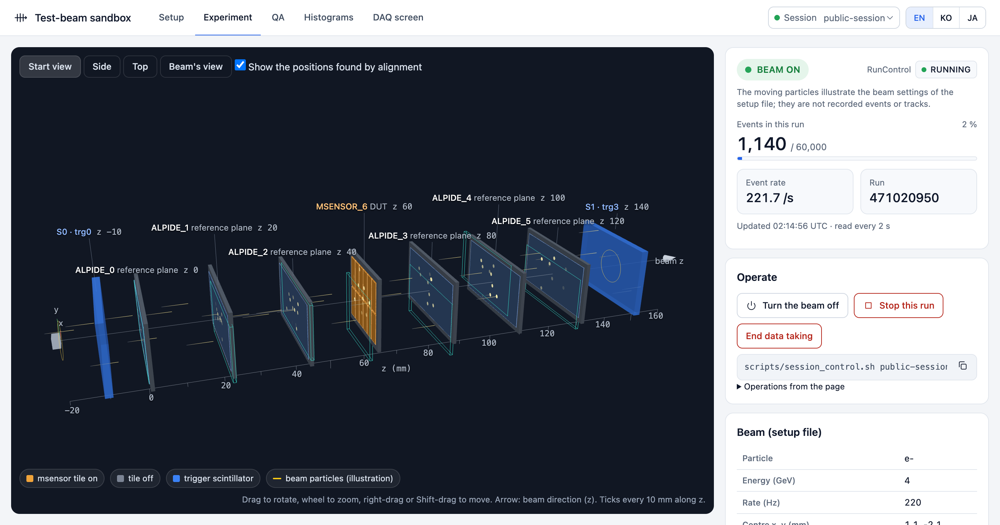

[English](alignment.md) | [Korean](ko/alignment.md) | [Japanese](ja/alignment.md)

# Alignment

## Why

The positions in a setup file are surveyed positions. As after mounting real devices, the actual positions in the simulated beamline differ from them in x and y, by up to `offset_max_mm` (default `5` mm) for each device. The actual positions are hidden: the analysis geometry, the session's setup copy and every command output show only the surveyed positions. Tracks reconstructed with the surveyed positions are wrong or missing, so the analysis first finds the positions from the data. This is alignment.

## How

`scripts/align_session.sh public-session` uses the current run; when the session is running it first waits for `3000` data events. `--run NUMBER` uses a closed run instead. It runs the public analysis modules `Prealignment`, then `Tracking4D` with `AlignmentTrackChi2` for the reference planes, then `DUTAssociation` with `AlignmentDUTResidual` for each DUT, and changes only x and y. The reference plane stays where the setup puts it, so all corrections are relative to it. The command prints the correction for each detector, the residual width after alignment, and the tracks per event before and after. With fewer than `100` tracks it stops with an error and leaves any earlier alignment unchanged. On the default setup with a few thousand events it takes less than 1 minute.

QA uses the aligned geometry and names the alignment it used. Without an alignment, QA prints `NOT ALIGNED` and the alignment command and stops without numbers. A setup with `offset_max_mm = 0` needs no alignment.

## Reuse

`scripts/align_session.sh public-session --save alignment.json` saves the result. `scripts/start_session.sh --setup FILE --alignment alignment.json` gives it to a new session, which can then run QA without aligning again. The saved alignment is used only when the devices are the same: changing the run length, thresholds, switched-off tiles or the beam keeps it valid; adding, removing or moving a device does not, and the start command then says why and starts without it.

## When to align again

The offsets of a device stay the same as long as it is not touched: the same setup gives the same actual positions in every session. `offset_draw` draws another set of offsets, as if the devices had been mounted again. QA prints the mean residual of each detector. If a mean exceeds `20` µm, or there are less than half as many tracks per event as when the alignment was made, QA prints `POSITIONS CHANGED?`: the devices seem to have moved, so align again.
