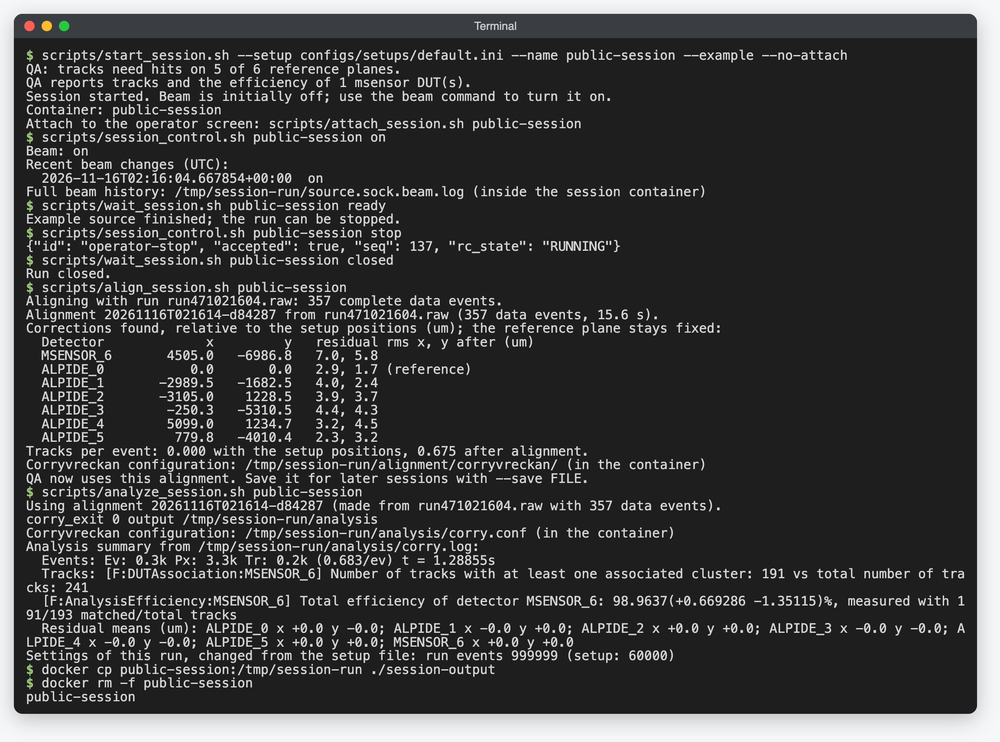

[English](automation.md) | [Korean](ko/automation.md) | [Japanese](ja/automation.md)

# Automated example

The finite example and the run commands on this page are for the EUDAQ mode; for a nestDAQ session see [nestDAQ mode](nestdaq.md).

The finite example runs one run from the default setup without the RunControl screen, as a program that operates acquisitions would. Run the commands from the repository root, without an existing `session-output` directory or container named `public-session`; use other names otherwise.

<!-- automated-example -->
```sh
# Build the public base and session images.
scripts/build_session.sh


# Start the finite example from the default setup without attaching.
scripts/start_session.sh --setup configs/setups/default.ini --name public-session --example --no-attach

# Turn on the simulated beam.
scripts/session_control.sh public-session on

# Wait until the example source finishes.
scripts/wait_session.sh public-session ready

# Request the run to stop.
scripts/session_control.sh public-session stop

# Wait until RunControl ends the sequence (TERMINATED).
scripts/wait_session.sh public-session closed


# Align the analysis geometry with the closed example run.
scripts/align_session.sh public-session

# Analyze the closed example run.
scripts/analyze_session.sh public-session

# Copy acquisition and QA output to the host.
docker cp public-session:/tmp/session-run ./session-output

# Remove the session container.
docker rm -f public-session
```



## Settings and producers

- `scripts/session_control.sh NAME settings --json` returns `format`, `next` and `current`; each has the run and devices, and `current` also has `run_number` and `file`, or is `null`.
- `set`, `end-producer` and `stall` return `0` on success, `1` for invalid values or an absent process or a stall that did not start, and `2` for invalid arguments or unknown items.
- `command-history.jsonl` contains `format`, `seq`, `utc`, `monotonic_ns`, `kind`, `id` and the changed `section`, `item`, `value`, `previous`, or the `producer`, `pid`, `signal` and `ended`.
- `run<number>.conf` keeps the configuration read for that run.
- QA writes `settings_changed` as the differences from the setup file, an empty list when equal, or `null` when unavailable.

## Waiting and stopping

- `scripts/wait_session.sh NAME ready` waits until the msensor producer reports that the example source has finished; the run can then be stopped.
- `scripts/wait_session.sh NAME closed` waits until RunControl reports `TERMINATED`, the end of the whole sequence, not the end of one run. In the finite example the sequence ends when its single run is stopped. In a session started without `--example`, a stop starts the next run, and `closed` waits until `T` or `terminate` ends the sequence. Both waits give up after `180` s.
- To stop early, leave out the `ready` wait and send `stop` once the control socket is available, even while devices are joining. A stop sends `stop_next`; accepted requests are applied and rejected requests include a reason.
- For acquisition without analysis, build with `scripts/build_session.sh --acquisition-only --image local/acquisition` and start with `--image local/acquisition:native`.

## States in the status file

`scripts/session_control.sh NAME status` prints the RunControl status file `/tmp/session-run/status.json`; its `rc_state` changes as follows.

- At start: `CONWAIT` while the devices connect, `UNCONF` for some tens of milliseconds, `CONF` for a few seconds, then `RUNNING`.
- After an accepted `stop_next` the run ends within a few seconds, once the devices have sent their data: `RUNNING`, `STOPPED` for some tens of milliseconds, `CONF` for a few seconds, then the next run, whose `run.number` is one higher, reaches `RUNNING`. A program that reads the status file now and then can miss `STOPPED`; to wait for the end of a run, wait until `run.number` changes or `rc_state` leaves `RUNNING`.
- While `rc_state` is `CONF`, a `stop_next` is accepted and applies to the next run: that run starts and then stops again within a few seconds.
- A request that is not JSON, has an unknown `intent` or an `id` that is not a string gets `"id": null` in its response, even when it carried an id.
