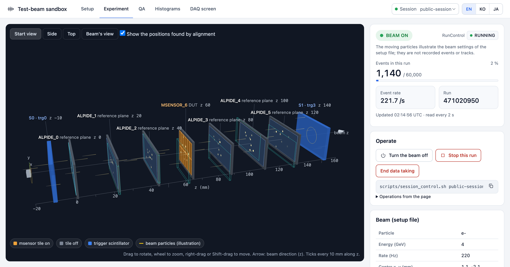

[English](../alignment.md) | [Korean](../ko/alignment.md) | [Japanese](../ja/alignment.md)

# アライメント

## なぜ必要か

セットアップファイルの位置は測量した位置です。実際のデバイスを設置したあとのように、模擬ビームラインの実際の位置はデバイスごとに x と y で最大 `offset_max_mm`（既定 `5` mm）ずれています。実際の位置は公開されず、解析用ジオメトリ、セッションのセットアップのコピー、すべてのコマンドの出力には測量した位置だけが出ます。測量した位置で再構成したトラックは誤るか見つからないため、解析はまずデータから位置を求めます。これがアライメントです。

## 方法

`scripts/align_session.sh public-session` は現在の run を使います。セッションが動作中であれば、まず `3000` 個の データイベントを待ちます。`--run NUMBER` は終了した run を使います。公開解析モジュール `Prealignment`、続いて基準面に対して `Tracking4D` と `AlignmentTrackChi2`、DUT ごとに `DUTAssociation` と `AlignmentDUTResidual` を実行し、x と y だけを変えます。基準面はセットアップの位置のまま置くため、すべての補正量は基準面に対する相対値です。コマンドは検出器ごとの補正量、アライメント後の residual の幅、アライメント前後のイベントあたりのトラック数を表示します。トラックが `100` 本より少ない場合はエラーで止まり、以前のアライメントはそのまま残ります。既定のセットアップで数千イベントなら 1 分もかかりません。

QA はアライメントしたジオメトリを使い、どのアライメントを使ったかを示します。アライメントがない場合、QA は `NOT ALIGNED` とアライメントのコマンドを表示し、数値を出さずに止まります。`offset_max_mm = 0` のセットアップではアライメントは不要です。

## 再利用

`scripts/align_session.sh public-session --save alignment.json` は結果を保存します。`scripts/start_session.sh --setup FILE --alignment alignment.json` で新しいセッションに渡すと、アライメントし直さずに QA ができます。保存したアライメントはデバイスが同じときだけ使われます。run の長さ、threshold、オフのタイル、ビームを変えても有効ですが、デバイスを追加、削除、移動すると無効になり、そのとき開始コマンドは理由を示してアライメントなしで開始します。

## アライメントし直すとき

デバイスに触れない限り、そのデバイスのずれは同じです。同じセットアップはセッションごとに同じ実際の位置を与えます。`offset_draw` はデバイスを設置し直したように別のずれを選びます。QA は検出器ごとに residual の平均を表示します。平均が `20` µm を超えるか、イベントあたりのトラック数がアライメントしたときの半分より少ない場合、QA は `POSITIONS CHANGED?` を表示します。デバイスが動いたと考えられるため、アライメントし直します。
