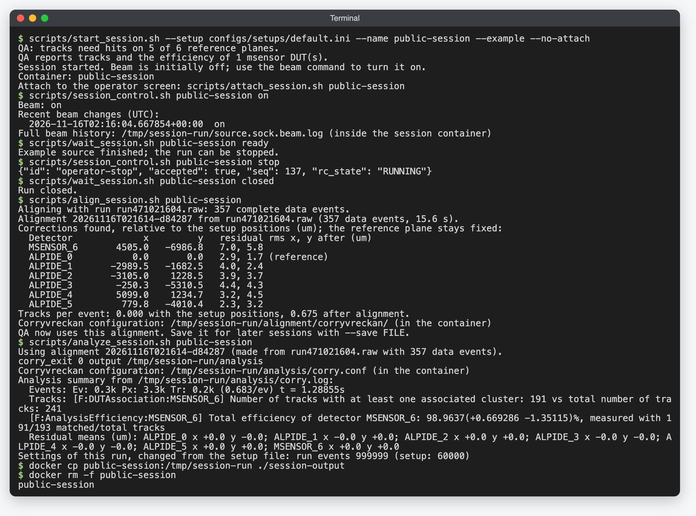

[English](../automation.md) | [Korean](../ko/automation.md) | [Japanese](../ja/automation.md)

# 自動実行の例

有限の例は、既定のセットアップで run を一つ、RunControl 画面なしで実行します。取得を操作するプログラムと同じやり方です。コマンドはリポジトリの最上位ディレクトリで、`session-output` ディレクトリと `public-session` という名前のコンテナーがないときに実行します。ある場合は別の名前を使います。

<!-- automated-example -->
```sh
# 公開ベースイメージとセッションイメージをビルドします。
scripts/build_session.sh


# 既定のセットアップで有限の例を接続せずに開始します。
scripts/start_session.sh --setup configs/setups/default.ini --name public-session --example --no-attach

# 模擬ビームをオンにします。
scripts/session_control.sh public-session on

# 例のソースが終わるまで待ちます。
scripts/wait_session.sh public-session ready

# run の停止を要求します。
scripts/session_control.sh public-session stop

# RunControl が一連の処理を終える（TERMINATED）まで待ちます。
scripts/wait_session.sh public-session closed


# 閉じた例の run で解析の幾何を位置合わせします。
scripts/align_session.sh public-session

# 閉じた例の run を解析します。
scripts/analyze_session.sh public-session

# 取得と QA の出力をホストにコピーします。
docker cp public-session:/tmp/session-run ./session-output

# セッションのコンテナーを削除します。
docker rm -f public-session
```



## 設定と producer

- `scripts/session_control.sh NAME settings --json` は `format`、`next`、`current` を返します。それぞれ run とデバイスを含み、`current` は `run_number` と `file` を持つか `null` です。
- `set` と `end-producer` は成功時に `0`、不正な値または存在しないプロセスに `1`、不正な引数や不明な項目に `2` を返します。
- `command-history.jsonl` は `format`、`seq`、`utc`、`monotonic_ns`、`kind`、`id` と、変更した `section`、`item`、`value`、`previous` または `producer`、`pid`、`signal`、`ended` を含みます。
- `run<number>.conf` はその run 用に読み込まれた設定を保存します。
- QA の `settings_changed` はセットアップファイルとの差で、同じなら空のリスト、利用できない場合は `null` です。

## 待つことと止めること

- `scripts/wait_session.sh NAME ready` は、msensor producer が例のソースが終わったと知らせるまで待ちます。その後 run を止められます。
- `scripts/wait_session.sh NAME closed` は RunControl が `TERMINATED` を知らせるまで待ちます。run 一つの終わりではなく、一連の処理全体の終わりです。有限の例では run 一つを止めると一連の処理が終わります。`--example` なしで開始したセッションでは止めると次の run が始まり、`closed` は `T` か `terminate` が一連の処理を終えるまで待ちます。どちらの待ちも `180` 秒でやめます。
- 早く止めるには `ready` の待ちを省き、制御 socket ができたら、デバイスがまだ接続中でも `stop` を送ります。停止は `stop_next` を送ります。受け付けられた要求は適用され、拒否された要求には理由が付きます。
- 解析なしで取得だけを行うには、`scripts/build_session.sh --acquisition-only --image local/acquisition` でビルドし、`--image local/acquisition:native` で開始します。

## 状態ファイルの状態

`scripts/session_control.sh NAME status` は RunControl の状態ファイル `/tmp/session-run/status.json` を表示します。その `rc_state` は次のように変わります。

- 開始時: デバイスが接続する間は `CONWAIT`、数十 ms の間 `UNCONF`、数秒の間 `CONF`、その後 `RUNNING` です。
- 受け付けられた `stop_next` の後、デバイスがデータを送り終えてから数秒のうちに run が終わります: `RUNNING`、数十 ms の間 `STOPPED`、数秒の間 `CONF`、その後 `run.number` が一つ大きい次の run の `RUNNING` です。状態ファイルをときどき読むプログラムは `STOPPED` を見逃すことがあります。run の終わりを待つときは、`run.number` が変わるか `rc_state` が `RUNNING` でなくなるまで待ちます。
- `rc_state` が `CONF` のときに送った `stop_next` は受け付けられ、次の run に適用されます: その run は始まった後、数秒のうちに再び止まります。
- JSON でない、不明な `intent` である、または `id` が文字列でない要求の応答は、要求に id があっても `"id": null` です。
