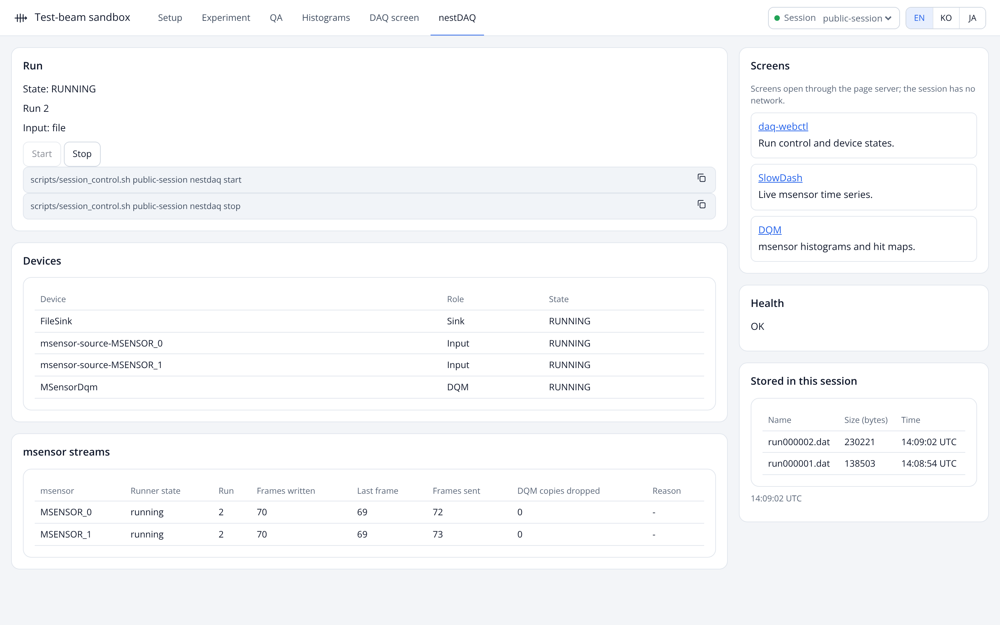

[英語](../nestdaq.md) | [韓国語](../ko/nestdaq.md) | [日本語](../ja/nestdaq.md)

# nestDAQ モード

## 概要

nestDAQ モードではセッションが EUDAQ の代わりに nestDAQ ですべての msensor を読み取ります。msensor ごとに実行器が continuous または triggered stream を書きます。msensor ごとの入力デバイスがファイルまたは TCP 接続から stream を読み、FileSink が frame を保存し、msensor DQM が hit map を埋めて msensor の trigger を対応づけます。daq-webctl は run を制御し、SlowDash は時系列を表示します。ビーム、セットアップファイル、結果ページは EUDAQ モードと同じように動き、EUDAQ モード自体は変わりません。

EUDAQ モードと比べると:

- msensor のみを読み、ALPIDE 面はビームラインの物質として残ります。
- シンチレーターと `[trigger]` は `trigger_board = on` のときだけ使え、`--example` は使えず、`events` は無視されます。
- アライメントと解析はまだ使えません。QA のために DQM は hit map、correlation、trigger の対応づけを表示し、`nestdaq qa` とページの QA タブはその数値を表示し、抽出ツールは msensor ごとの msraw stream を別のファイルに書きます。

## ビルド

`scripts/build_session.sh --nestdaq` でビルドします。ARM64 でセッションイメージに重ねて nestDAQ イメージを初めてビルドするのに約 10〜13 分かかりました。イメージは約 1.4 GB でセッションイメージより約 0.2 GB 大きいです。構成要素とライセンスは[公開スタックとソースのバージョン](public-stack.md)にあります。

## セットアップファイル

セットアップの例は EUDAQ モードのものと同じ `configs/setups/` にあり、ページのセットアップタブに表示されます:

| ファイル | 内容 |
|---|---|
| `nestdaq.ini` | nestDAQ モードで読む二つの msensor |
| `nestdaq-clocks.ini` | 独自の時計で動く msensor |
| `nestdaq-missed.ini` | 一部の trigger を取りこぼす msensor |
| `nestdaq-telescope.ini` | 基準 msensor 六つと DUT msensor 一つの telescope |
| `nestdaq-board.ini` | 仮想 trigger ボードを使う二つの msensor: 周期 trigger とボード stream |

`[run] daq = nestdaq` を設定します。`[nestdaq] input = file | socket` で入力を選び、`frame_ms` で frame を設定し、`send_buffer_mb` は socket 入力にのみ適用します。全項目は[セットアップファイルの説明](setup-file.md)を参照します。

msensor ごとに独自の時計で動かせます。`[msensor N]` セクションの `clock_offset_ns` はセッションの時計が 0 のときにその msensor の時計が示す値で、`clock_drift_ppm` はその時計がどれだけ速く進むかを ppm（百万分率）で指定します。どちらも `daq = nestdaq` でのみ使い、既定値 0 はセッションと共有する時計です。このとき msensor は window、frame、trigger の時刻を自分の時計で数えるため、msensor 同士で window 番号が一致しなくなります。trigger 番号はすべてに共通です。例は `configs/setups/nestdaq-clocks.ini` にあります。

msensor にわざと trigger を取りこぼさせることもできます。`[msensor N]` セクションの `missed_triggers` には、この msensor が受け取らないセッションの trigger 番号を書きます。番号は run ごとに 0 から数えます。msensor はその trigger のレコードを書かず、取りこぼした trigger ひとつごとに後の trigger 番号をひとつずつ下げて付けます。trigger を自分で数えるセンサーがそうするからです。そのため、最初に取りこぼした trigger からは、その msensor の trigger 番号がほかの msensor と一致しなくなります。このキーは `daq = nestdaq` でのみ使います。trigger ボードを有効にした場合（後述）、この番号は周期 trigger の番号です。例は `configs/setups/nestdaq-missed.ini` にあります。

nestDAQ モードでは msensor にノイズ hit も出させることができます。`[msensor N]` セクションに `noise = on` を書くと msensor の既定の応答を使い、そのノイズ発生率は `threshold_dac` を下げるほど大きくなります。既定値の `noise = off` では、EUDAQ モードと同じくノイズ hit はありません。

データ経路の負荷試験には、`[nestdaq]` セクションの `generator_mb_s` を使います。0 より大きいと、すべての msensor 実行器を発生器に置き換え、発生器はビームのシミュレーションなしに周期的な trigger とともに msensor あたりおおよそその値の MB/s で正しい msensor raw frame を書きます。すべての msensor は continuous readout でなければなりません。データに物理的な意味はないため、このモードでは DQM の correlation は意味を持ちません。
`configs/setups/nestdaq-telescope.ini` の telescope では最も上流の msensor 以外はそれぞれ自分の時計で動きます。 msensor ごとに自分の実行器と入力デバイスがあり、すべて同じ FileSink と DQM にデータを送ります。DQM は msensor ごとに最も上流の msensor と対応づけます。

`[nestdaq]` セクションに `trigger_board = on` を書くと、仮想 trigger ボードを追加できます。既定値の `off` では上記の内容はすべてそのままです。ボードを有効にすると、すべての msensor は粒子ごとに一つ受け取っていた trigger の代わりに周期 trigger を受け取ります。run ごとに 0 から数える k 番目の周期 trigger は、run 開始から 100.5 MHz のボード時計で (k + 1) × `periodic_clk` サイクル後に来ます。`periodic_clk` は 10000 から 1005000000 までで、既定値 1005000 は 10 ms です。周期はすべての msensor の window 一つ以上でなければなりません。hit は引き続きすべての粒子から出ます。各 msensor は周期 trigger を自分の時計で TRIGGER レコードに書くため、時計が異なると番号が同じ周期 trigger でも時刻が異なります。すべての msensor は continuous readout でなければならず、`generator_mb_s` はボードと併用できません。このモードでは シンチレーターと `[trigger]` を使え、どの粒子が物理 trigger になるかはこれらが決めます。シンチレーターがなければすべての粒子がパターン 0 の物理 trigger です。ボード実行器 `TRIGGERBOARD_0` は、セッションが受理した物理 trigger を読み、周期 trigger とともにボード stream として書きます。この stream は専用の入力デバイスを経て、DQM へのコピーなしで FileSink に届きます。例は `configs/setups/nestdaq-board.ini` にあります。

## セッションの開始

`scripts/start_session.sh --setup FILE --name public-session` で開始するとイメージが自動で選ばれます。`--no-attach` を使うと [ウォークスルー](walkthrough.md)のようにターミナルをそのまま使えます。tmux の `NESTDAQ` には七つのウィンドウがあります。`redis` は Redis、`webctl` は run 制御、`slowdash` は時系列、`runners` は msensor と trigger ボードの実行器、`sources` は入力デバイス、`sink` は FileSink、`dqm` は監視を担当します。`scripts/attach_session.sh public-session` は `NESTDAQ:runners` に接続します。`Ctrl-b`、次に `d` を押すと離れます。実行器が終了すると 2 秒後に再起動します。

## Run

`scripts/session_control.sh NAME nestdaq start|stop|status|qa [--json]` を使います。`--json` オプションは `status` と `qa` にのみ適用し、`start` と `stop` は既に JSON を出力します。終了コードは成功が 0、失敗が 1、拒否が 2、stop の drain 未完了が 3 です。ページタブの Start と Stop および daq-webctl ページも同じ run 制御を使います。Drain は STOP の前に残りのデータを送ります。コマンドとページタブは既にデータのある run 番号を拒否します。daq-webctl の RUN は次の空き番号に移りますが、更新まで古い番号を表示することがあります。ビームコマンドは `on`、`off`、`beam-status` のままで、他の EUDAQ コマンドは拒否されます。

`qa` は DQM から msensor ごとに現在の run の frame、trigger、hit を読み、ほかの msensor ごとに最も上流の msensor との trigger の対応づけ（対応あり、二つのうち片方のみ、飛ばした数）、列と行のずれ（ピクセル）、時計の drift（ppm）、時刻のずれ（マイクロ秒）を読みます。`--json` がなければ表を表示します。最初の対ができる前でも DQM が応答すれば 0、DQM を読めなければ 1 を返します。ページの QA タブも同じ数値を表示します。

## 画面

`scripts/qa_page.sh public-session` でページを開きます。nestDAQ タブには run 制御、デバイス、ストリーム、画面リンク、状態、保存ファイルが表示されます。

daq-webctl は run を制御し、SlowDash の `slowplot-msensor` は時系列を表示します。DQM は columns × rows bin の `hitmap`、`hitmap_tiles`、tiles_x × tiles_y bin の `tile_hits`、2048 bin で範囲が −0.5 以上 2047.5 未満の `hits_per_frame` と `triggers_per_frame` を表示します。ポート 8080、18881、8090 はコンテナー内にあります。 DQM のリンクはヒストグラムの一覧を開きます。`MSENSOR_0/hitmap` は `MSENSOR_0` の hit map を、`correlation/summary` はほかの msensor すべてを表示します。

DQM は、ほかの msensor ごとにその trigger を最も上流の msensor（z が最も小さいもの）の trigger とも対応づけます。以下の DEV はほかの msensor の名前です。対応づけは時刻で行います。最初のいくつかの trigger で基準を決めたあと、時計の drift のためにゆっくりとしか変わらない両方の trigger 時刻の差を追い、その差が続く trigger どうしを対応づけます。そのため、ある msensor が trigger を取りこぼしても、後の対応がずれません。`correlation/col_DEV` と `correlation/row_DEV` は対応づけた trigger の column と row を比べ、`dcol_DEV` と `drow_DEV` はその差を示し、`trigger_dt_DEV` は run が進むにつれて trigger 時刻の差を、`trigger_dn_DEV` は対応の trigger 番号の差を示します。番号の差は取りこぼした trigger ごとに階段のように変わります。`match_DEV` は対応づけた trigger、対応づけられなかった trigger、飛ばした trigger の数を数え、`lost_DEV` は上流の msensor だけ、または DEV だけにある trigger の数を数えます。continuous readout では trigger ひとつがその window の hit をすべて運ぶため、correlation は同じ window に入ったほかの粒子の hit による広い背景の上に現れます。差のヒストグラムで最もはっきり見え、そのピークの位置が両方の msensor の間のずれです。

`correlation/summary` はほかの msensor すべてを一度に、msensor ごとに bin ひとつで示します。`summary_dcol` と `summary_drow` は各 msensor の差のヒストグラムのピークの位置、つまりその msensor が上流の msensor からずれている量（ピクセル）を示し、`summary_drift` と `summary_offset` はその msensor の trigger 時刻の差を通る直線の傾き（ppm）と切片（マイクロ秒）を示すので、すべての msensor の時計を上流の msensor と比べられます。また `summary_counts` は対応づけた trigger、両方の msensor のうち片方だけが見た trigger、飛ばした trigger の数を示します。

画面はネットワークのないコンテナー内で動き、ページサーバーが `127.0.0.1` で中継します。nestDAQ タブのリンクには ticket があり、最初の訪問でそのポートの cookie と交換し、アドレスから ticket を除きます。接続の最初のリクエストだけを検査するため、ページ操作の token より弱い方式です。自分だけが使うコンピューターで使用し、終了時に `scripts/qa_page.sh --stop` でページサーバーを停止します。

## データ

データは実行器から入力デバイスを経て FileSink に流れます。`socket` では実行器がコンテナーのポート `18600 + N` に送り、受信が遅いと frame を破棄して数えます。`file` は実行器のファイルを読みます。保存ファイルはコンテナー内の `/tmp/session-run/nestdaq/data/` に run ごとに一つあり、`run000001.dat` のような名前です。`docker cp NAME:/tmp/session-run ./session-output` でコピーし、ホストのリポジトリ直下で `python3 -m nestdaq_mode.extract session-output/nestdaq/data/run000001.dat OUTDIR` を実行します。msensor ごとの msraw stream を OUTDIR の別ファイルに書き、JSON の要約を表示します。Extract は完全なデータに 0、不完全または欠落した frame に 3、形式または入出力エラーに 2 を返します。ホストの Python 3、バージョン 3.9 以降で動き、追加パッケージは不要です。

msraw stream にはヘッダーと五つのレコード種別 `TILE_DATA`、`TRIGGER`、`TICK`、`TILE_STATUS`、`END` があり、`TICK` が frame を終了します。メッセージは SubTimeFrame ヘッダーと `META`、frame、`END` データを含みます。

trigger ボードを使うと、run はボード stream も保存し、`extract` が `TRIGGERBOARD_0_runN.msraw` に書き出します。この stream は msraw stream のコンテナーを使い、メタデータ形式は `msraw-board-metadata-1`、plane は 1000 です。レコードは `PERIODIC`（周期 trigger 番号とボード時計）、`PHYSICS`（物理 trigger 番号、ボード時計、その直前の最後の周期 trigger の番号、その trigger または run 開始からの時計サイクル数、n ビット目がチャンネル n のシンチレーターパターン）、`TICK`、`END` です。ボード時計は run 開始から 100.5 MHz のサイクルを数え、`TICK` は `frame_ms` の長さの frame を終了します。周期 trigger は、下記のオフライン frame builder が使う論理的な frame 境界で、すべての stream の frame は今も各自の `TICK` で終わります。`python3 -m msensor.boardstream verify FILE` はボード stream を検査し、完全なら 0、不完全なら 2、破損していれば 3 を返します。DQM はボードを表示しません。

オフライン frame builder は、一つの run の stream を時間 frame にまとめます。`python3 -m nestdaq_mode.framebuilder --dir DIR --out frames.jsonl` で実行し、DIR には抽出済みの `*.msraw` ファイルを置きます。FileSink の run ファイルは、`--dat FILE --work DIR` で先に抽出できます。frame f はボードのサイクル f × `periodic_clk` から (f + 1) × `periodic_clk` までで、f 番目の周期 trigger で終わります。出力の各行が一つの frame で、その物理 trigger と、msensor ごとの window、tile、hit の数を含みます。`--hits` を付けると hit も書きます。msensor の window は、その msensor の TRIGGER レコードから分かる自身の時計での開始時刻の frame に属するため、時計のオフセットや drift でデータが別の frame に移ることはありません。msensor が取りこぼした周期 trigger は時刻で対応付け、その境界を補間し、その frame には `estimated_border` が付きます。最後の周期 trigger より後のデータは、閉じる周期 trigger のない最後の frame 一つに `partial` を付けて書きます。ボードを有効にした setup で `clock_offset_ns` が周期の半分以上なら setup ツールが拒否します。センサーの trigger を正しい周期 trigger に対応付けられなくなるためです。終了コードは、完全なら 0、入力が使えなければ 2、不完全なら 3 です。

## 終了

`scripts/session_control.sh NAME nestdaq stop` で run を止めます。run が止まる前に残りのデータが保存されます。`docker cp NAME:/tmp/session-run ./session-output` で出力をコピーし、`docker rm -f NAME` でコンテナーを削除すると、保存ファイルは `session-output/nestdaq/data/` にあります。`terminate` と `T`、`Q` キーは EUDAQ RunControl に属し、nestDAQ セッションは `terminate` を拒否します。ページでは nestDAQ タブが run を止め、実験タブが出力をコピーしてコンテナーを削除します。

## 障害と制約

実行器は 2 秒後に再起動します。DQM がなくても run は進み、DQM は新しいセッションでのみ戻ります。欠落した frame と破棄された DQM コピーを数えます。このモードにはアライメントと解析がありません。FileSink は STOP 後に届いたメッセージを破棄します。トンネルは接続の最初のリクエストだけを検査します。nestDAQ モードは arm64 と x86_64 Linux および arm64 macOS で確認されています。

各入力デバイスから DQM への待ち行列には frame が数個しか入りません。DQM が遅れると入力デバイスは DQM のコピーを捨てて `dqm_dropped` で数えるので、遅い DQM がメモリを使い切ったり保存データを遅らせたりすることはありません。
