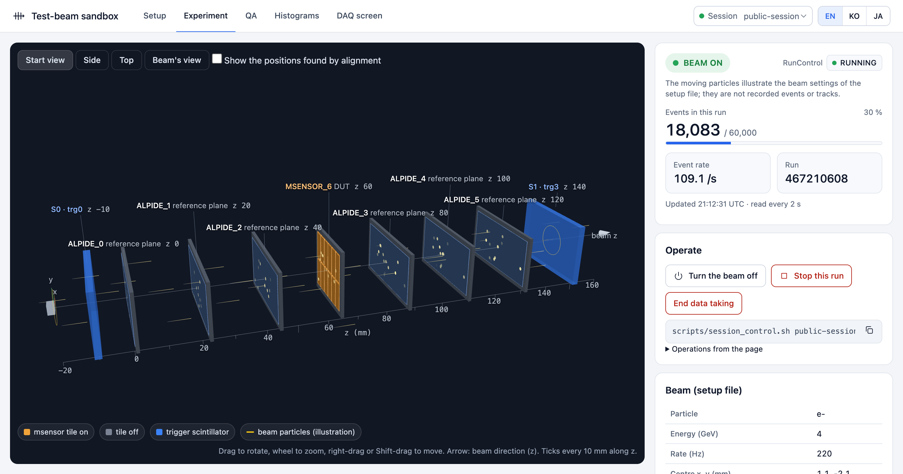
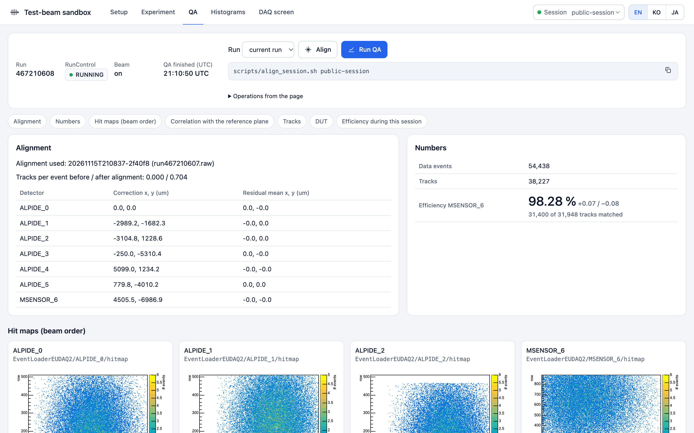

[English](../qa-page.md) | [Korean](../ko/qa-page.md) | [Japanese](../ja/qa-page.md)

# 結果ページ

結果ページはセッションの実験画面と QA をブラウザで表示します。ボタンでターミナルのコマンドを実行します。セットアップファイルを作って変更し、セッションを開始して終え、ビームをオンとオフにし、run を止め、RunControl の要求と Q キーを送り、アライメントと QA を実行します。セッション画面のウィンドウも表示します。ターミナルのコマンドはこれまでどおり動作します。

## 起動と終了

`scripts/qa_page.sh public-session` はページサーバーを `127.0.0.1` のポート `8765` でバックグラウンドで起動し、アドレスとプロセス番号を表示し、ターミナルから実行するとブラウザで実験画面を開きます。セッション名なしで `scripts/qa_page.sh` を実行すると、セッションなしでサーバーを起動し、セットアップタブを開きます。セッションはページ上部のセッション一覧で選びます。`--port N` は別のポートを選び、`--no-browser` はブラウザを開かず、`--foreground` は Ctrl-C までサーバーをターミナルに置きます。`scripts/qa_page.sh --stop` で終了します。以前の版が起動したページサーバーがそのポートでまだ動いている場合、`scripts/qa_page.sh` はそれを止めるコマンドとともにそのことを示し、`scripts/qa_page.sh --stop` はそのプロセスがそのページサーバーであることを確かめてから止めます。コンテナーがないか停止している場合はページがそのことを示します。

`scripts/analyze_session.sh public-session` はページを開きません。`--page` を付けると、ページサーバーがなければ起動してアドレスを表示し、ターミナルではブラウザで QA タブを開きます。`--page --no-browser` はアドレスだけを表示します。表示される QA の行は変わりません。

`--refresh SECONDS`（`10` 以上）はサーバーの動作中、その間隔で動作中の run の QA を繰り返し、ページは自動で更新されます。QA の実行は重なりません。

セットアップタブでは trigger シンチレーターと trigger・veto 式を表示し編集します。

## セットアップタブ

セットアップタブは `configs/setups/` のセットアップファイルを一覧で表示します。一つ選ぶと、`scripts/setup_session.sh check` と `scripts/setup_session.sh show` がそのファイルについて出力する内容と、実験画面タブと同じように描いたデバイスとビームの 3D 図を、ファイルの値で表示します（セッションは不要です）。"新しいセットアップ" は `scripts/setup_session.sh new --no-input` の値から始めます。

ファイルのすべての項目を変更できます: run、ビーム、位置のずれ、デバイスとその位置と設定、msensor のタイル。値はファイルに書くとおりに入力します（例: `1, -2, 60`）。各項目の下の小さな文字は、保存したファイルに入る説明行です。デバイスは追加と削除ができます。ページが種類ごとに番号を 0 から隙間なく付け直し、面番号と位置は自分で決めます。msensor のタイルをクリックするとオフとオンが切り替わります。編集中は確認と 3D 図が追従します。確認は `scripts/setup_session.sh check` のコードとその文言を使います。

"セットアップファイルを保存" は確認に通った場合だけ `configs/setups/` にファイルを書きます。形式は `scripts/setup_session.sh new` と同じで（項目ごとに説明行がある）、ターミナルでもそのまま使えます。保存した後、ページはそのファイルについての `scripts/setup_session.sh check` の出力を表示します。名前は英字、数字、`-`、`_` で書き、`.ini` で終わる必要があります。リポジトリに含まれるセットアップファイル `default.ini`、`small-msensor.ini`、`msensor-telescope.ini` と四つの `nestdaq` セットアップは上書きしません。これを変更したものは別の名前で保存します。既存のファイルを置き換えるときはページ内でもう一度確認します。

"セッションを開始" は保存したファイルとセッション名で `scripts/start_session.sh --setup configs/setups/FILE --name NAME --no-attach` を実行します。保存したアライメントを選ぶと `--alignment configs/alignments/FILE.json` も付けます（`scripts/align_session.sh NAME --save configs/alignments/FILE.json` で保存します）。ページはコマンドの出力と終了コードを表示し、例えばすでに使われている名前はコマンドの文言のとおりに表示されます。セッションが開始すると、ページは実験画面タブでそのセッションを表示します。イメージはページではビルドしません。イメージがない場合は `scripts/build_session.sh` を示します。

実験画面タブでは穴のある板を描き、デバイスの下にシンチレーターと trigger 条件を表示します。

## 実験画面タブ

ページサーバーのコマンドはこのタブを最初に開き、QA のコマンドは QA タブを最初に開きます。

"この run を停止" は `scripts/session_control.sh public-session stop --id page-stop` を実行し、RunControl はすぐに次の run を開始します。データ取得を終えるには "データ取得を終了"（`scripts/session_control.sh public-session terminate --id page-terminate`）を確認し、終了を待ってから "RunControl を終了 (Q)"（`docker exec public-session tmux send-keys -t ITS3:rc Q`）を確認します。その後、出力をコピーしてコンテナーを削除します。

- デバイス表は現在の run の設定を表示し、次の run で変わる値の後には "→ 次の run:" と新しい値を付けます。"次の run の設定"は `scripts/session_control.sh public-session set SECTION ITEM VALUE --id page-set` で項目を一つ変更し、セットアップファイルと同じように検査します。
- セッションのセットアップのデバイスをビーム順に、セットアップファイルの測量した x、y、z と実寸（ピクセル数 × ピッチ）で 3D に描きます。各デバイスには名前と役割（基準面または DUT）が付きます。msensor はタイルの格子を示し、オンのタイルはオレンジ、オフにしたタイルは灰色です。矢印はビームの方向（z）で、目盛りは 10 mm ごとです。ビームの始点の短い赤と緑の線が x と y です。
- ドラッグで回転、ホイールで拡大縮小、右ドラッグまたは Shift ドラッグで移動します。ボタンで初期視点に戻るか、横、上、ビーム方向から見ます。アドレスの `view=side`、`view=top`、`view=beam` で最初の視点を選びます（`view=reset` は初期視点です）。
- `BEAM ON` または `BEAM OFF`、セッション、RunControl の状態、run、その run のイベント数とイベントレート。ページはこれらを 2 秒ごとにセッションから読むため、ターミナルでビームを切り替えると数秒で表示されます。セッションがないか停止している場合はそのことを示します。
- セットアップファイルのビーム設定（粒子、エネルギー、レート、中心、分散、ビームの始点、run あたりのイベント）と、デバイスの設定とオフにしたタイルの表。
- ビームがオンの間、粒子がビームに沿って動きます。粒子はセットアップファイルのビーム設定を描いた絵で、記録されたイベントやトラックではなく、ページにもそう書かれています。ビームがオフなら粒子は描きません。ビームがオンで run が動いていないときも粒子は動き、記録されないことを示します。タブが表示されていない間は描画を止めます。
- 公開されない実際の位置は読まず、表示もしません。セッションにアライメントの結果があれば、チェックボックスでアライメントが求めた位置を輪郭で表示します。使う値はアライメント結果ファイルのものだけです。
- layout ディレクトリから起動したセッションはその解析ジオメトリで描き、ビーム設定はありません。

3D 表示は WebGL を使います。WebGL のないブラウザは同じ場面を SVG で描き、そのことを示します。どちらも使えない場合は理由を示し、セッションの状態はそのまま表示します。重なるラベルは離し、ラベルを隠す軸の数字は省くため、ビームから見た向きでも読めます。

## DAQ 画面タブ

このタブはセッションの運用画面のウィンドウ一つの文字を表示します: `rc`（RunControl）、`rp`（基準面）、`dp`（DUT producer）、`sp`（補助プロセス）、`dc`（collector）、`log`。ページはこのタブが表示されている間 `tmux capture-pane` で毎秒ウィンドウを読み、別のタブや別のブラウザタブが表示されていると読みません。読み取りだけです。下の Q キー以外に、ページから画面へ送るものはありません。`perf` ウィンドウ（`htop`）は表示しません。

`R` と `T` は `scripts/session_control.sh public-session repeat --id page-repeat` と `terminate --id page-terminate` を実行し、制御 socket で RunControl の要求を送ります。`Q` は `docker exec public-session tmux send-keys -t ITS3:rc Q` で RunControl ウィンドウにキーを送ります。`R` は現在の設定を繰り返し、`T` はシーケンスを終了し、`Q` は終了後に抜けます。各ボタンは実行するコマンドを表示し、`T` と `Q` はページ上で確認を求めます。

セッションを終えるときは [ウォークスルー](walkthrough.md)の順番に従います: `T`、`Q`、次に "出力をコピー"。これは `docker cp public-session:/tmp/session-run outputs/public-session-TIME` でリポジトリの `outputs/` の下の新しいディレクトリにコピーします（TIME は UTC 時刻）。次に "コンテナーを削除"。これはページ内で確認した後に `docker rm -f public-session` を実行します。削除できるのはこのリポジトリのセッションコンテナーだけです。その後ページはセットアップタブに戻ります。

## 操作

`scripts/qa_page.sh` が表示するアドレスで開いたページでは操作ができます。ボタンはそれぞれ既存のコマンドを実行し、そのコマンド行を横に表示するため、同じ作業をターミナルでも行えます。上のセットアップタブと DAQ 画面タブのほかに:

- 実験画面: ビームのオン（`scripts/session_control.sh public-session on`）とオフ（`scripts/session_control.sh public-session off`）、ページ内でもう一度確認した後の run の停止（`scripts/session_control.sh public-session stop`）。
- QA タブ: アライメント（`scripts/align_session.sh public-session`）と QA の実行（`scripts/analyze_session.sh public-session`）。現在の run か、一覧から選んだ run（`--run N`）について実行します。

状態に合わないボタン（例: オンのビームをオンにする）は押せません。アライメントと QA には時間がかかります。ページはコマンドの実行中であることを示し、終わるとターミナルと同じように出力の行と終了コードを表示します。`NOT ALIGNED` などの失敗はコマンドが示したとおりに表示されます。アライメントと QA はセッションごとに一度に一つだけ実行します。QA が終わると QA タブに新しい結果が表示されます。操作ごとに時刻、コマンド行、終了コードがセッションのディレクトリの `page-operations.jsonl` に記録され、ページがその一覧を表示します。コピーと削除は、コピーがセッションのディレクトリと同じになるようにここには加えず、サーバーが動いている間ページが表示します。

サーバーは起動のたびに新しいランダムな token を作ります。表示されるアドレスは `#` の後に token を含みます。ブラウザはこの部分をサーバーに送らず、ページは読み取った後にアドレスから消すため、ブラウザの履歴に残りません。操作はその token がある場合だけ受け付けるため、同じコンピュータの別のウェブページからは操作できません: セットアップファイルの保存、セッションの開始、キー、コピーと削除、ビーム、run の停止、アライメント、QA。token は `${XDG_STATE_HOME:-~/.local/state}/test-beam-sandbox/` にあるサーバーの状態ファイルに置かれ、このディレクトリは自分のユーザーアカウントだけが開けます。`scripts/qa_page.sh public-session` をもう一度実行すると同じアドレスを表示し、`scripts/analyze_session.sh public-session --page` は token を含むページを開きます。token なしで開いたページは表示のみで、アドレスの入手方法を示します。`--view-only` はすべての操作を拒否するサーバーを起動します。

## QA タブ

QA タブはアライメント、測定値、図を表示します。

- セッション、run、RunControl の状態、ビーム、QA の時刻。
- アライメント: アライメントの有無、使ったアライメント、補正量、アライメント前後のイベントあたりのトラック数、residual の平均。`NOT ALIGNED` と `POSITIONS CHANGED?` は上部にアライメントのコマンドとともに表示されます。
- 数値: データイベント、トラック、DUT ごとの効率と誤差、効率から除いたタイル。
- ビーム順のすべての面のヒットマップ、基準面に対する各面の x、y の相関、トラックの chi2/ndf、DUT ごとの効率マップ、ピクセル内効率、x、y の residual、run 内の時間ごとの効率。
- このセッション中の効率: QA ごとに点が一つ加わります。

エントリーのない図は、まだデータがないと表示します。

## ヒストグラムタブ

QA の ROOT ファイルのすべてのヒストグラムを一覧にし、一つを選ぶと描画します。

## nestDAQ セッション

nestDAQ セッションには nestDAQ タブが追加され、DAQ 画面にはそのウィンドウが表示されます。QA タブは `scripts/session_control.sh NAME nestdaq qa --json` の数値を 5 秒ごとに読み直して表示し、ヒストグラムは使えません。実験画面タブにはビーム制御が残り、EUDAQ の run ボタンは隠れます。nestDAQ run と全 msensor が送った frame および frame レートを表示し、nestDAQ run が動いていないときだけ "出力をコピー" と "コンテナーを削除" を有効にします。このモードは ALPIDE 面を読まないため、物質と表示します。token はこのページの操作に適用され、nestDAQ 画面は [nestDAQ モード](nestdaq.md)で説明されている ticket を使います。

## 言語と描画

ページの文は英語、韓国語、日本語で、上部のボタンで切り替え、最初の言語はブラウザに従います。数値、名前、コマンドはどの言語でも同じです。言語ごとの文は一つのファイル（`session_setup/web/text/en.json`、`ko.json`、`ja.json`）に一行一項目で置かれ、校正したファイルに置き換えるとページの文が変わります。図は JSROOT `7.5.2`（`MIT`）で、実験画面はその JSROOT に含まれる three.js `r155`（`MIT`）で描画します。JSROOT はセッションのイメージに ROOT とともに含まれ、サーバーが起動時にイメージから取り出すため、ページはインターネットから何も受け取りません。JSROOT のコピーは `~/.cache/test-beam-sandbox/` に残り、QA ファイルのコピーはサーバーの終了時に削除されます。

設定表と次の run の編集には `[trigger]` の `trg`、`veto`、`count` 項目が含まれます。

## ページの配置と移動

実験画面は残りの高さを使い、状態、操作、ビームとデバイスを横に置きます。セットアップタブはファイル一覧、エディター、プレビューを並べ、セクションへのリンクで run、ビーム、デバイスに移動します。デバイスとシンチレーターの要約はクリックで開き、新しいデバイスと検査エラーのあるデバイスは自動で開きます。

QA のセクションリンクで各結果に移動します。図の各グループは最初に 4 枚だけを表示し、すべて表示で展開して折りたたみで戻します。小さい QA の図は統計ボックスとタイトルを表示せず、ヒストグラムタブでは全体を描画します。ヒストグラムツリーはディレクトリを開閉し、件数と形式を表示します。絞り込みは大文字小文字を区別せずに名前を探し、一致するディレクトリを開きます。入力を消すと最初の状態に戻ります。

DAQ の終了手順は T と Q の送信、出力のコピー、コンテナーの削除の順です。ウィンドウ幅が 1024 ピクセル以上なら、ターミナルの文字サイズを調整して 80 列を収めます。コマンド欄のコピーボタンは表示されたコマンドをそのままコピーします。
