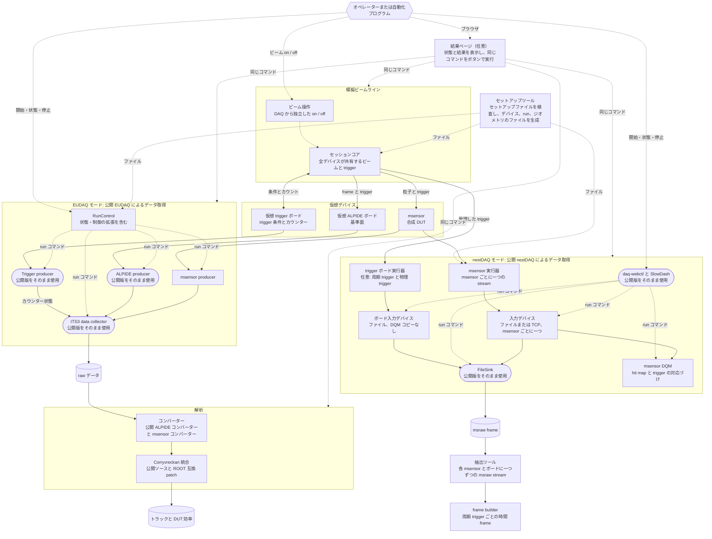

[English](../reference.md) | [Korean](../ko/reference.md) | [Japanese](../ja/reference.md)

# リファレンス

プロセス、スクリプト、サンドボックスの構造です。

## 動いているもの

| 何 | 起動するもの | 止めるもの | 残るもの |
|---|---|---|---|
| イメージ | `scripts/build_session.sh`（動くものはありません） | | 再びビルドするまで残ります |
| セッション: 模擬ビームとセットアップファイルの DAQ を含むコンテナー一つ; EUDAQ モードでは RunControl、producer、data collector | `scripts/start_session.sh` | `docker rm -f NAME` | 削除の前に `docker cp` で取り出していない出力はなくなります |
| nestDAQ モードの nestDAQ プロセス: コンテナーの `NESTDAQ` tmux セッションにある Redis、daq-webctl、SlowDash、msensor 実行器、trigger ボード実行器（`trigger_board = on` のとき）、入力デバイス、FileSink、DQM | `scripts/start_session.sh` | `docker rm -f NAME` | コンテナーの `/tmp/session-run/nestdaq/data/` に保存されたファイルはコピーしなければ一緒になくなります |
| nestDAQ run | `scripts/session_control.sh NAME nestdaq start` | `scripts/session_control.sh NAME nestdaq stop` | |
| ビーム | `scripts/session_control.sh NAME on`（セッションはビームがオフの状態で始まります） | `scripts/session_control.sh NAME off` | |
| ページサーバー: コンテナーの外、このコンピューターのプロセス | `scripts/qa_page.sh` | `scripts/qa_page.sh --stop` | セッションを削除しても動き続けます |

- `docker ps -a` は動いているものと止まったものを含めてセッションのコンテナーを表示します。
- `pgrep -f session_setup.webpage` はページサーバーのプロセス番号を表示します。

## スクリプト

| 役割 | スクリプト | すること |
|---|---|---|
| セットアップ | `scripts/setup_session.sh` | セットアップファイルを作り、表示し、確認します |
| セッション | `scripts/build_session.sh` | イメージをビルドします |
| セッション | `scripts/start_session.sh` | セットアップファイルでセッションを開始します |
| セッション | `scripts/attach_session.sh` | 動いているセッションの RunControl 画面（EUDAQ モード）または msensor 実行器（nestDAQ モード）を再表示します |
| ビームと run | `scripts/session_control.sh` | ビームをオンとオフにして状態を表示します; EUDAQ モードでは run を止め、繰り返し、終え、次の run の設定を変更し、応答しなくなった producer を終了します; nestDAQ モードでは run を開始し、止め、DQM の数値を表示します |
| 解析 | `scripts/align_session.sh` | 解析のジオメトリをデータに合わせます（EUDAQ モード） |
| 解析 | `scripts/analyze_session.sh` | 現在の run か閉じた run の QA をします（EUDAQ モード） |
| データ | `python3 -m nestdaq_mode.extract` | nestDAQ モードで保存したファイルから各 msensor と trigger ボードの msraw stream を抽出します |
| データ | `python3 -m nestdaq_mode.framebuilder` | 抽出した stream または保存したファイルから、周期 trigger ごとの時間 frame を作ります（trigger ボード） |
| 結果ページ | `scripts/qa_page.sh` | ページサーバーを起動し、止めます |
| 自動化 | `scripts/wait_session.sh` | 有限の例が終わるか、セッションが終わるまで待ちます |

## 動作の仕組み

四角形はこのリポジトリの構成要素、角丸の四角形は変更を加えずに使用する公開ソフトウェアを示します。実線はデータの流れ、破線は制御の流れを表します。セットアップファイルに従い、セッションは EUDAQ または nestDAQ の箱を使います。ビームライン、デバイス、結果ページは両方で同じです。結果ページは任意です。状態と結果を表示し、ターミナルと同じコマンドを実行します。セットアップファイルもセットアップツールと同じ検査を通して編集します。

ビルドは公開ソフトウェアのバージョンを固定します。その中には EUDAQ commit `bfe26c7`、Corryvreckan master commit `22fca3e`、nestDAQ commit `eda7287` が含まれます。すべてのバージョンと patch は[公開スタックとソースのバージョン](public-stack.md)にあります。

### リポジトリの構成

- `configs/`: 両モードのセットアップファイル、配置とセッションジオメトリの例。
- `scripts/`: [ウォークスルー](walkthrough.md)のコマンド。
- `session_setup/`: セットアップツール、セッション開始、解析コマンドと結果ページ。
- `session_core/`: 模擬ビームライン: ビーム、タイミングとデバイス間の調整。
- `virtual_alpide/`: 仮想 ALPIDE ボード。
- `virtual_trigger/`: 仮想 trigger ボード。
- `msensor/`: msensor デバイス、producer、実行器。
- `nestdaq_mode/`: nestDAQ モードのセッション開始、run 制御、入力デバイス、trigger ボード実行器、DQM、抽出ツール、frame builder。
- `runcontrol/`: RunControl 拡張と EUDAQ に適用する patch。
- `eudaq_module/`: EUDAQ 用 msensor コンバーター。
- `integration/`: 配置と Corryvreckan モジュール。
- `tracksim/`: セッションコアが使う粒子輸送。
- `docker/`: イメージのビルド。
- `docs/`: ドキュメント。
- `tests/`: 検査。
