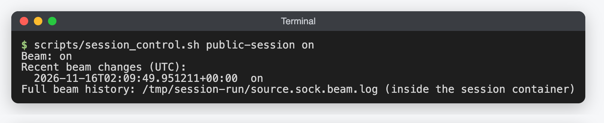

[English](../session-core.md) | [Korean](../ko/session-core.md) | [Japanese](../ja/session-core.md)

# セッションソースとビーム制御

このシステムの応答は合成値であり、実機の測定値ではありません。[公式 Corryvreckan リポジトリ](https://gitlab.cern.ch/corryvreckan/corryvreckan)の master commit `22fca3e43ceec7ba6263a5cf179cd57d5fff42fe` からビルドします。

## セッションソース

独立したセッションコアは参加デバイスに共有時計とソースを提供します。`configs/session/geometry.json` は例です。ソースシードとビーム条件は公開ジオメトリや出力ではなく `SESSION_SOURCE_CONFIG_JSON` で渡します。ランチャーは `--session-geometry` と `--session-socket` でコアを開始または再利用し、RunControl に run コマンドを送りません。デバイスの参加、イベント、ack、停止には Unix ソケット上の行単位 JSON を使います。

時刻単位は ps です。msensor は ns、ボードは 80 MHz tick に切り捨てます。ゲートまたは crossing guard が 90 ms を超える参加デバイスの要求は拒否されます。ボードのソースソケットは 3 秒、停止 drain は 12 秒でタイムアウトします。応答パラメーターは各 run 中は固定です。ソースの切断は空イベントではなくエラーです。`trigger_board = on` のときは、読み取り専用の `board_next` 要求が、セッションが受理した物理 trigger をシンチレーターパターンとともに一度に 512 件まで返し、応答の時計はまだ返していない最初のレコードを越えません。

停止時は設定された各 collector が `DataEventN` で最後の trigger までイベントを組み立てたと報告するまでデバイス接続を維持します。確認できなければ正常終了せずエラーになります。RunControl フックは collector の進捗をセッションソースに送り、ソースは run コマンドを送りません。

シンチレーターがある場合、[trigger 条件](trigger.md)を満たす粒子だけが trigger になり、他の粒子のヒットもデバイスに届きます。

## デバイス喪失とソースの上限

最初のデバイスが参加してから 10 秒間、残りのデバイスを待ちます。その後は未参加のデバイスを記録し、参加済みのデバイスで開始します。接続が切れたデバイス、または 10 秒間応答しないデバイスをその run から除外し、残りのデバイスにはビームと trigger を送り続けます。ソースはソケットの隣の `.session.log` に serial と理由を記録し、ソース条件は記録しません。強制終了した producer は RunControl の状態ファイルに切断として表示されます。停止要求後、残りの producer と collector が停止しても、RunControl は切断された producer を待ち続ける場合があり、raw は開いたまま読み取れる場合があります。外れた producer は現在の run に再参加できません。

producer が接続されたまま応答を停止すると、状態は RUNNING のままでその producer のイベント数は止まりますが、他の producer の数は増え続ける場合があります。公開 collector は停止した producer を待つため、collector の数は止まり、他のキューがたまります。run を停止する前に[オペレーター画面の案内](operator-screen.md)に従って停止した producer を終了します。collector は残りのデバイスのイベントの組み立てを再開できても、停止要求後に run が待機し続ける場合があります。停止要求後、残りの producer に `Stop Error` が発生し、RunControl が `ERROR` になる場合もあります。タイムアウトした producer が再開すると状態が `ERROR` に変わり、RunControl も `ERROR` になって停止要求が拒否され、raw が開いたまま不完全に残る場合があります。producer が停止したまま先に StopRun を要求すると、残りの producer に `Stop Error` が発生し、未組み立てのイベントが raw に含まれない場合があります。状態を確認して raw の結果を保存した後、`docker rm -f public-session` でコンテナーを削除し、`scripts/start_session.sh --layout /tmp/public-session-layout --name public-session` で新しいセッションを開始します。セッションソース自体が消えた場合もデバイスがエラーを報告するため、セッションを再起動します。

したがって同じ run での回復は 10 秒以内に限られます。source は参加者の最後の要求からの時間で除外するため、SIGSTOP で止めて 10 秒以上たってから再開した producer は拒否されて `ERROR` になります。同じ run で続くより長い停滞は source に応答し続ける必要があり、[オペレーター画面ガイド](operator-screen.md)の `stall` コマンドが msensor についてこれを行い、停滞中の event を停滞後のために保持します。

有限の例でイベント、交差、ピクセルの計算上限に達すると、msensor が `source_finished` を通知し、`source_limit` 状態フィールドに上限の種類を表示します。ビームがオフの間に消費したイベントも上限に数えます。RunControl から run を停止して通常どおり閉じます。ソースはその run を再開しません。

## ビームと比較

ビームはオフで始まります。`python -m session_core.beamctl --socket <source.sock> on`、`off`、`status` を使い、ソケットは JSON ビーム操作も受け付けます。`.beam.json` と `.beam.log` に状態と変更を記録します。予約された変更は同じ run 時刻に再生されます。オフ区間では trigger と粒子 signal の配信を抑制しますが、ノイズと遅延ヒットは残る場合があります。同一 run ではデバイスペイロード、デコード済みストリーム、BORE、EORE を比較します。実時間の中間 status イベントは raw に残し、比較から除外します。停止時は trigger を追加せず最後のゲートと guard を保持します。

`on` と `off` には `--id ID` で要求 id を指定でき、省略時は `scripts/session_control.sh` が `operator-on` と `operator-off` を使います。ビーム記録には `id` 項目があり、id のない要求と起動時・予約の記録は `null` です。ビーム操作は `control-history.jsonl` にないため、両履歴の順序は同じ単調時計の `monotonic_ns` と `actual_monotonic_ns` で合わせます。

画面と引き継ぎの操作は[オペレーター画面の案内](operator-screen.md)を参照してください。
