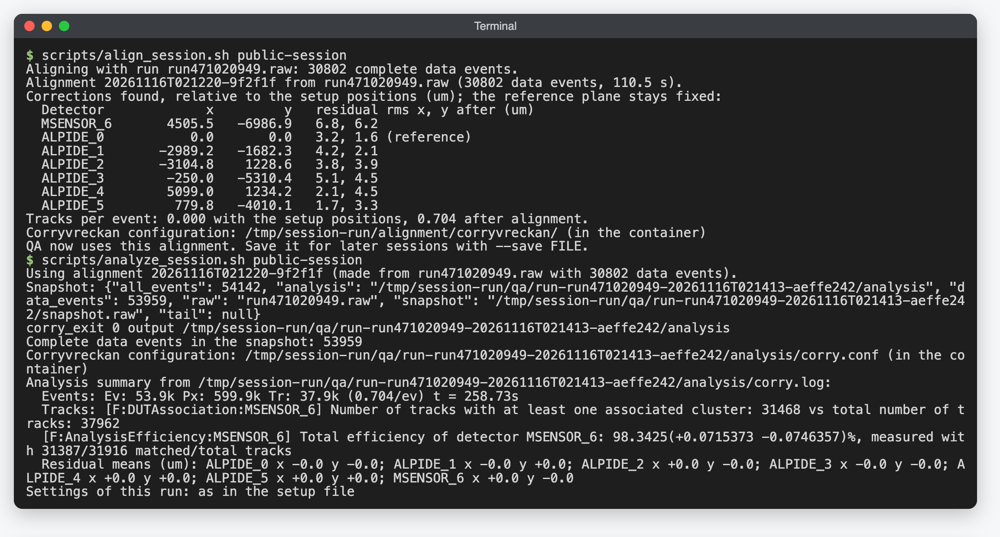

[English](../session-run.md) | [Korean](../ko/session-run.md) | [Japanese](../ja/session-run.md)

# セッション取得と解析

このシステムの応答は合成値であり、実機の測定値ではありません。[公式 Corryvreckan リポジトリ](https://gitlab.cern.ch/corryvreckan/corryvreckan)の master commit `22fca3e43ceec7ba6263a5cf179cd57d5fff42fe` からビルドします。

## 配置

既定の配置には基準面 6 枚と msensor 1 台があります。`python3 -m integration.layout --layout configs/layouts/default.json --directory /tmp/my-layout --analysis-geometry` は `geometry.json`、`init.ini`、`a.conf`、`devices/`、`mapping.json`、`analysis-geometry.conf` を生成します。plane 番号は一意、種別ごとの番号は連番にします。ビーム外の plane も使えます。ソースシードと非公開のビーム条件は配置に入れません。

セットアップファイルは `scripts/start_session.sh --setup FILE` でセッションを開始するときにこれらのファイルになります。`configs/layouts/default.json` のような配置ファイルもそこで受け付けます。作られたファイルを手で編集するには `python3 -m integration.layout --setup my-setup.ini --directory DIR --analysis-geometry` を実行し、`--layout DIR` で開始します。もう一度生成しても編集したファイルは上書きしません。

## 取得と解析

ビルド、起動、取得、停止、解析には[開始ガイド](../../README.ja.md)のコマンドを使います。セッションのビームは最初はオフです。解析には公開 EUDAQ 変換器、EventLoaderEUDAQ2、clustering、tracking、DUT association、efficiency、出力モジュールを使います。固定した Corryvreckan revision では補助の 30 µm ピッチヒストグラムで ROOT bin の警告が 1 回出る場合があります。他の変換エラーは失敗です。データイベントのない raw ファイルは解析しないでください。

`scripts/align_session.sh` と `scripts/analyze_session.sh` は、セッション自身のセットアップにあるデバイスを使います: `scripts/start_session.sh` が `/tmp/session-run` に残すコピー `setup.json`、または配置ディレクトリの解析ジオメトリです。QA には ALPIDE 基準面が 3 枚以上必要です。[自動実行の例](automation.md)は画面なしでセッションを動かし、[クイックスタート](../../README.ja.md)は画面とともに動かします。

ビームは `scripts/session_control.sh public-session off`、`on`、`beam-status` で操作します。デバイス設定はセットアップファイルの項目です。そこで変更して新しいセッションを開始するか、`scripts/session_control.sh public-session set` で次の run から変更します（[オペレーター画面の説明](operator-screen.md)）（[セットアップファイルの説明](setup-file.md)）。`--layout DIR` で開始したセッションは代わりに `DIR` のファイルを読みます。デバイス設定を変更するには開始の前にその `a.conf` を編集し、解析ジオメトリを配置に合わせておきます。

## 既定の detector 対応

既定の解析対応の識別子と位置は次のとおりです。`mapping.json` は解析 section 名を提供します。ジオメトリの `position_mm`、`pixels`、`pitch_um` はそれぞれ `position`、`number_of_pixels`、`pixel_pitch` に対応します。すべての面には、軸ごとに `spatial_resolution` = pitch/√12（例: pitch 30 µm なら `8.660um, 8.660um`）と、シミュレーションが使う面ごとのシリコン 100 µm に当たる `material_budget = 0.00106724` も入ります。取得専用の配置を生成しても既存の解析ジオメトリは変更しません。

| serial | producer / plane | geometry | analysis detector | z (mm) |
|---|---|---|---|---:|
| V0 | ALPIDE_plane_0 / 0 | P0 | ALPIDE_0 | 0 |
| V1 | ALPIDE_plane_1 / 1 | P1 | ALPIDE_1 | 20 |
| V2 | ALPIDE_plane_2 / 2 | P2 | ALPIDE_2 | 40 |
| MSENSOR_0 | MSENSOR_0 / 6 | D0 | MSENSOR_6 | 60 |
| V3 | ALPIDE_plane_3 / 3 | P3 | ALPIDE_3 | 80 |
| V4 | ALPIDE_plane_4 / 4 | P4 | ALPIDE_4 | 100 |
| V5 | ALPIDE_plane_5 / 5 | P5 | ALPIDE_5 | 120 |
