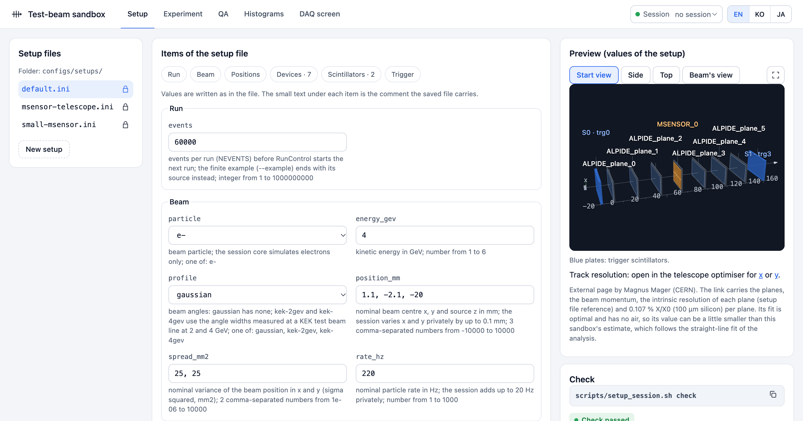

[English](../setup-file.md) | [Korean](../ko/setup-file.md) | [Japanese](../ja/setup-file.md)

# セットアップファイル

セットアップファイルは一つのセッションを記述します。どのデバイスをどこに置くか、その設定、run の長さ、ビームです。`[section]` の見出しと `item = value` の行からなるテキストファイルで、`#` で始まる行はコメントです。書かれていない項目には下の既定値が使われます。`configs/setups/default.ini` が既定のセットアップです。別の run の長さを使うには、このファイルをコピーして `[run]` の `events` を変更します。

`configs/setups/default.ini` は ALPIDE 基準面と msensor DUT を使います。`configs/setups/small-msensor.ini` はより小さい msensor DUT を使います。`configs/setups/msensor-telescope.ini` は六つの msensor 基準面と一つの msensor DUT を使います。

## コマンド

- `scripts/setup_session.sh new FILE` は基準面の数と間隔、DUT の種類と位置、run の長さ、ビームのエネルギーを尋ねます。`--reference-planes`、`--spacing-mm`、`--dut`、`--dut-z`、`--events`、`--energy-gev`、`--rate-hz`、`--alpide-ithr`、`--msensor-threshold`、`--msensor-readout` などのオプションで答えを指定でき、`--no-input` で質問を省略します。既存のファイルは `--force` を指定したときだけ置き換えます。
- `scripts/setup_session.sh show FILE` は、ビームの順に並べたデバイスと位置、主な設定、run の長さ、ビーム、およびビーム軸に沿った側面図を表示します。
- `scripts/setup_session.sh check FILE` は誤った項目ごとに受け付ける値を示し、0 以外のコードで終了します。QA が可能かどうかも伝えます。
- `scripts/start_session.sh --setup FILE` はセットアップを検査し、セッションのファイルを生成して開始します。セッションは、受け取ったままのセットアップ（`setup-source.ini` または `setup-source.json`）と `setup.json` を `/tmp/session-run` に残します。アライメントと QA はそのコピーのデバイスを使います。
 `--scintillators 0` は板なし、`--scintillators 2`（既定）は既定の板二枚です。

## 項目

| セクション | 項目 | 既定値 | 受け付ける値 |
|---|---|---|---|
| `[run]` | `events` | `60000` | 次の run が始まるまでの run あたりのイベント数、`1`–`1000000000` |
| `[beam]` | `particle` | `e-` | `e-` |
| `[beam]` | `energy_gev` | `4` | `1`–`6` |
| `[beam]` | `profile` | `gaussian` | `gaussian`、`kek-2gev`、`kek-4gev` のいずれか |
| `[beam]` | `position_mm` | `1.1, -2.1, -20` | 公称の x、y と source の z、source はすべてのデバイスより上流 |
| `[beam]` | `spread_mm2` | `25, 25` | x と y の公称分散、`0.000001`–`10000` |
| `[beam]` | `rate_hz` | `220` | 公称 rate、`1`–`1000` |
| `[positions]` | `offset_max_mm` | `5` | デバイスごとの非公開の x、y のずれの最大値、`0`–`10` mm、[アライメント](alignment.md)参照 |
| `[positions]` | `offset_draw` | `0` | 別の数は同じデバイスに別のずれを選ぶ、`0`–`1000000` |
| `[alpide N]`, `[msensor N]` | `plane` | 必須 | 一意、`0`–`63` |
| `[alpide N]`, `[msensor N]` | `position_mm` | 必須 | センサー中心の x、y、z |
| `[alpide N]` | `pitch_um` | `30, 30` | `1`–`1000` |
| `[alpide N]` | `pixels` | `1024, 512` | `1024, 512` |
| `[alpide N]` | `ithr` | `0` | `0`–`255` |
| `[alpide N]` | `strobe_length` | `40` | `1`–`4000`、25 ns 単位 |
| `[msensor N]` | `role` | `dut` | `dut` または `reference`、基準面は `triggered` 読み出しが必要 |
| `[msensor N]` | `pitch_um` | `23, 21` | `1`–`1000` |
| `[msensor N]` | `tiles` | `6, 2` | x と y 方向のタイル数、`1`–`64` |
| `[msensor N]` | `tile_pixels` | `156, 444` | タイル一つの列数と行数、matrix は一辺最大 `4096` |
| `[msensor N]` | `tiles_off` | 空 | オフにするタイル番号 |
| `[msensor N]` | `pixels` | なし | `tiles` と `tile_pixels` の代わりに使うタイル一つの matrix |
| `[msensor N]` | `threshold_dac` | `100` | `0`–`255`、値一つまたはタイルごとに一つ |
| `[msensor N]` | `readout` | `continuous` | `continuous` または `triggered` |
| `[msensor N]` | `window_length_ns` | `1000000` | `1000`–`10000000`、continuous 読み出しのみ |
| `[msensor N]` | `strobe_delay_ns` | `0` | `0`–`1000000`、triggered 読み出しのみ |
| `[msensor N]` | `strobe_length_ns` | `2000` | `1`–`1000000`、triggered 読み出しのみ |

`N` はデバイスの種類ごとに `0` から欠番なく数えます。ALPIDE は基準面で、msensor は `role` に従います。ビームの位置、広がり、rate は公称値です。セッションごとに非公開で少しずつ変わるため、解析で実際のビームを求める必要があります。有限サンプル（`--example`）は source が終わると終了し、`events` を使いません。

セッションは各電子を、ビーム源から各面を通って一定の運動量で追跡します。すべての面（面ごとにシリコン 100 µm）と、ビーム源から最後の面までの空気で、Highland の式によるガウス分布の散乱角を加えて多重散乱を入れます。エネルギー損失、制動放射、二次粒子はシミュレーションしません。シンチレーターは trigger を決めるだけで、物質を加えません。

`profile` はビームの角度を決めます。既定値の `gaussian` はすべての電子をビーム軸の向きに送ります。`kek-2gev` と `kek-4gev` は、KEK のテストビームで 2 GeV と 4 GeV で測った幅のガウス分布の角度を加え、ビーム軸から離れるほど角度が少し大きくなることも入れます。平均の角度は 0 です。位置の広がりは引き続き `spread_mm2` が決めます。セッションは角度を `energy_gev` に合わせて変えないため、プロファイルは測定したエネルギーで使います。角度の広がりは x と y それぞれ 7.5 mrad までです。`check` はこれを超える `profile` と `spread_mm2` を拒否します。

`--setup` で開始して動作中のセッションでは、run の長さとデバイス設定 `ithr`、`strobe_length`、`threshold_dac`、`readout`、`window_length_ns`、`strobe_delay_ns`、`strobe_length_ns` を `scripts/session_control.sh NAME set` で次の run から変更できます（[オペレーター画面の説明](operator-screen.md)）。他の項目はセッション開始時のままです。

既定の msensor は `6 x 2` タイル、タイルごとに `156 x 444` ピクセル、ピッチ `23 x 21` µm で、[msensor の文書](msensor.md)に説明があります。タイル番号は列 `0`、行 `0` から `0` で始まり、x 方向に先に数えます。既定の格子ではタイル `t` はタイル列 `t mod 6`、タイル行 `t div 6` です。オフのタイルはヒットもノイズも出しません。既定のビーム（分散 `25, 25` mm²、x と y ともに sigma `5` mm）はすべてのタイルに届く広さです。ある測定では既定の [trigger](trigger.md) を使ったイベントの `70.3` % にトラックがありました。`configs/setups/small-msensor.ini` は以前のタイル一つの `128 x 128` msensor（ピッチ `30` µm）、狭いビーム `0.003, 0.004`、位置のずれなしです。

| セクション | 項目 | 既定値 | 受け付ける値 |
|---|---|---|---|
| `[scintillator N]` | `channel` | 必須 | 重複しない `0`–`3` |
| `[scintillator N]` | `position_mm` | 必須 | 板の中心 x, y, z（mm）、ビーム源より下流 |
| `[scintillator N]` | `shape` | `rectangle` | `rectangle` または `disc` |
| `[scintillator N]` | `size_mm` | `30, 20` | 長方形の幅と高さまたは円板の直径、`1`–`200` mm |
| `[scintillator N]` | `hole_mm` | `0` | 中央の穴の幅と高さまたは直径、板より小さい値 |
| `[trigger]` | `trg` | `trg0&trg3&dt_trg>10000&dt_veto>5000&!bsy` | 存在する channel を使う空でない trigger 式 |
| `[trigger]` | `veto` | `ntrg>0` | trigger 式、空なら veto なし |
| `[trigger]` | `count` | `1xxR Rxx1 xxxR Rxxx` | 4文字のカウント条件 1–16個 |

## QA

QA は基準面からトラックを再構成します。基準面が少なくとも 3 枚必要です。トラックには 5 面のヒットが必要で、基準面が 6 枚より少ない場合は基準面の数より一つ少ない数の面のヒットが必要ですが、3 より少なくはなりません。msensor DUT がない場合、QA はトラックの数のみを報告します。オフのタイルは解析でマスクされるため、効率はオンのタイルだけで計算されます。QA はオフのタイルを一行で示します。有限サンプルには msensor が必要です。サンプルの source が終了したことを msensor producer が知らせるためです。

## セットアップファイルにないもの

仮想デバイスが反応しない設定は含めていません。`VCASN`、`RDOMODE`、`minspacing`、`fixedbusy` などの他の ALPIDE レジスタ、msensor の `regions`（タイルごとの threshold が代わりになります）と window guard、内部の source と clock の設定です。ビームの方向と非公開の変動はセッション内に隠されています。

## トラック分解能

`scripts/setup_session.sh show` とセットアップタブの要約は、各 DUT でトラック位置がどれだけ正確に分かるかを推定します。推定はこの sandbox のシミュレーションと解析に従います。

- 軸ごとの固有分解能。msensor の面はピクセル一つにだけヒットを出すので、分解能は pitch/√12 です。既定のピッチ `23 x 21` µm では `6.640` x `6.062` µm です。ALPIDE の面は、粒子がピクセル境界のまわりの帯の中を通ると両側のピクセルにヒットを出します。この帯は `ithr` が低いほど広がる（クラスター平均 `2 − ithr/255`）ので、ピッチ `30` µm の分解能は `ithr = 0` で `4.517` µm、`ithr = 255` で `8.660` µm です。
- すべての面（シリコン 100 µm、`0.00106724` X0）と、ビーム源から最後の面までの空気での多重散乱。Highland の式を使い、対数項はシミュレーションと同じく全物質から一度だけ決めます。
- 解析と同じく、基準面を通る直線を固有分解能で重み付けして当てはめます。DUT は fit に含めません。

`show` は DUT ごとに x と y のトラック分解能（DUT で当てはめた位置の広がり）と予想 residual（トラックと DUT の分解能を合わせたもの）を表示します。4 GeV の `default.ini` では推定がトラック `2.97 x 2.97` µm、residual `7.27 x 6.75` µm で、ある run で測った residual は `7.21 x 6.84` µm でした。この推定はこのシミュレーションを表すもので、実際の telescope を表すものではありません。面と空気を合わせた物質はシミュレーションの上限 `0.01998` X0 までです。`check` はこれを超えるセットアップを拒否します。

セットアップタブは Magnus Mager（CERN）の外部 telescope optimiser も x または y の一軸で開き、インターネットが必要です。リンクは `T` を運動エネルギー、`m = 0.00051099895` GeV とするビーム運動量 `sqrt(T² + 2 T m)` GeV/c と、z 順のデバイス面を渡します。各面の分解能は選択した軸の上記の固有分解能、物質は 100 µm のシリコン、すなわち 0.107 % X/X0 です。DUT は測定せず散乱だけを起こす面で、シンチレーターは含めません。デバイスの前後 10 mm の端点には物質も測定もありません。optimiser は最適な fit を使い空気を含めないため、値が `show` の推定より少し小さくなることがあります。

[既定のセットアップの x 軸を開く](https://mmager.web.cern.ch/telescope/tracking.html#part=e&p=4.0005&x=[-1,0,2,4,6,8,10,12,13]&XX0=[,0.00107,0.00107,0.00107,0.00107,0.00107,0.00107,0.00107,]&sy=[,0.000452,0.000452,0.000452,0.000664,0.000452,0.000452,0.000452,]&en=[0,1,1,1,0,1,1,1,0])

