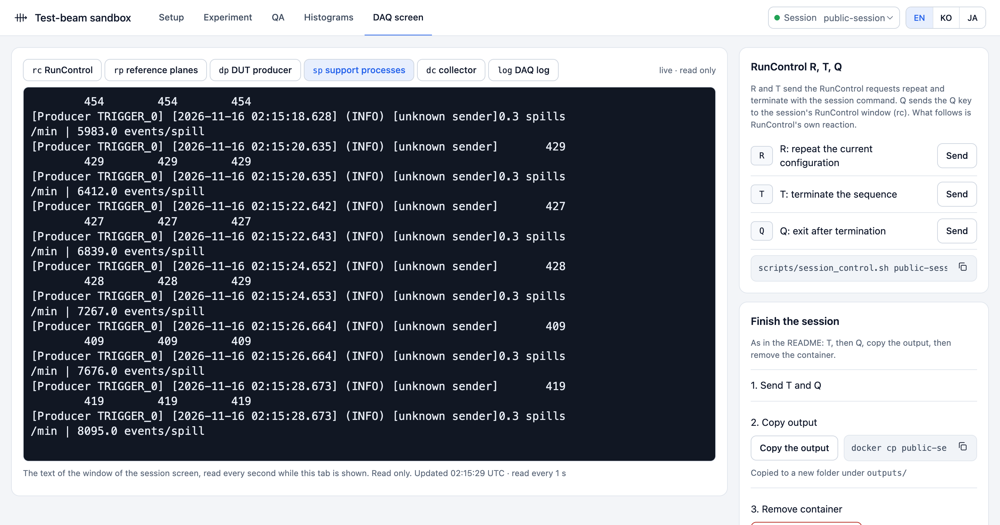

[English](../trigger-board-surface.md) | [Korean](../ko/trigger-board-surface.md) | [Japanese](../ja/trigger-board-surface.md)

# 公開 trigger ボードの呼び出し範囲

このシステムの応答は合成値であり、実機の測定値ではありません。[公式 Corryvreckan リポジトリ](https://gitlab.cern.ch/corryvreckan/corryvreckan)の master commit `22fca3e43ceec7ba6263a5cf179cd57d5fff42fe` からビルドします。

この表は変更していない公開 `TriggerProducer.py` の commit [`bfe26c7`](https://github.com/eudaq/eudaq/blob/bfe26c7b73844344b2cbfa37ab853f2a0cb1f23e/user/ITS3/python/TriggerProducer.py) がボードモジュールから使う項目、ソースの行番号、仮想ボードの動作を示します。

| ソースインターフェース | 行 | 仮想動作 |
|---|---|---|
| `find_trigger()` | 32 | 仮想ボードを探します |
| `TriggerBoard(port)`, `tb.con.port` | 32, 128 | virtual のみ受け付けポートを記録します |
| `DacAddrCh.keys()`, `DacAddrCh(name)`, `.channel`, `.address`, `str()` | 33, 35, 37, 38 | DAC 名を受け付けます |
| `DacVoltage(text).value` | 36 | DAC 値を受け付けます |
| `tb.set_dac(val=, channel=, address=)` | 38 | 判定を変えず DAC 値を記録します |
| `TriggerConditionParser().get_cmd_sequence(trg, veto)` | 53–56 | trigger と veto の式を検査します |
| `tb.write_trg_logic(seq)` | 57 | 次の run の条件を送ります |
| `tb.latch_and_read_cnts()` | 107, 110 | 符号なしカウンター 256 個を読みます |
| `CounterCondition(text)`, `.name`, `.count(dc)` | 59, 108, 115 | 条件に名前を付け、一致するカウントを合計します |
