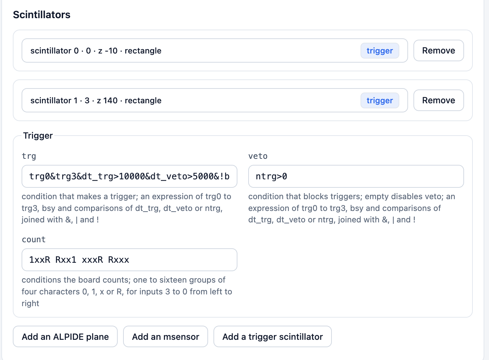

[English](../trigger.md) | [Korean](../ko/trigger.md) | [Japanese](../ja/trigger.md)

# Trigger

このシステムの応答は合成値であり、実機の測定値ではありません。[公式 Corryvreckan リポジトリ](https://gitlab.cern.ch/corryvreckan/corryvreckan)の master commit `22fca3e43ceec7ba6263a5cf179cd57d5fff42fe` からビルドします。

## シンチレーター

セットアップには最大 4 枚を `0` から欠番なく置きます。記載した位置が実際の位置で、隠された位置ずれは適用せず、解析 geometry にも入りません。既定の channel `0`、`3` はそれぞれ `1.1, -2.1, -10`、`1.1, -2.1, 140` mm にあります。



| セクション | 項目 | 既定値 | 受け付ける値 |
|---|---|---|---|
| `[scintillator N]` | `channel` | 必須 | 重複しない `0`–`3` |
| `[scintillator N]` | `position_mm` | 必須 | 板の中心 x, y, z（mm）、ビーム出発点より下流 |
| `[scintillator N]` | `shape` | `rectangle` | `rectangle` または `disc` |
| `[scintillator N]` | `size_mm` | `30, 20` | 長方形の幅と高さまたは円板の直径、`1`–`200` mm |
| `[scintillator N]` | `hole_mm` | `0` | 中央の穴の幅と高さまたは直径、板より小さい値 |
| `[trigger]` | `trg` | `trg0&trg3&dt_trg>10000&dt_veto>5000&!bsy` | 存在する channel を使う空でない trigger 式 |
| `[trigger]` | `veto` | `ntrg>0` | trigger 式、空なら veto なし |

## Trigger 条件

```text
expr    := and ('|' and)*
and     := unary ('&' unary)*
unary   := '!' unary | atom
atom    := '(' expr ')' | 'trg0' | 'trg1' | 'trg2' | 'trg3' | 'bsy' | compare
compare := ('dt_trg' | 'dt_veto' | 'ntrg') ('>' | '<' | '>=' | '<=' | '==') INT
INT     := 0 – 1000000000000
```

空白は無視します。ビームがオンの間、粒子ごとに `trgN` は channel N の有効部分を通ったか、`ntrg` は反応した channel 数を表します。`dt_trg`、`dt_veto` は直前に受理された trigger と veto からの 100.5 MHz clock の cycle 数（一 cycle は 9.95 ns）で、前のものがなければ `2**62` です。`bsy` は直前の trigger から参加デバイスの最長 gate が終わるまで真です。trigger 式を先に、veto 式を後に評価するため、同じ粒子の veto は自身の trigger に影響しません。veto 式が空なら veto はありません。既定条件は両方の板を通り、直前の trigger から 10000 cycle（99.5 µs）、直前の板の信号から 5000 cycle（49.75 µs）を超え、busy でない場合です。

ここで説明する仮想ボードはこの sandbox のモデルです。入力パルスを一 cycle とし粒子ごとに判定し `bsy` を最長デバイス gate とすることは単純化です。別々の粒子同士が二 cycle 内で偶然 coincidence になることは模擬しません。

## Trigger producer

`TRIGGER_0` は公開 trigger producer を仮想 trigger ボードとともにそのまま実行します。producer がボードに条件を設定すると、ボードは次の run のためにセッションコアに渡し、producer はボードを通してカウンターを読みます。

シンチレーターのあるセットアップは `TRIGGER_0` を `init.ini` に追加し、`a.conf` と `b.conf` にその項目を追加します:

| ファイル | 項目 | 値 | 役割 |
|---|---|---|---|
| `init.ini` | `port` | `auto` | ボードのポート |
| `init.ini` | `CHn_GAIN`, `CHn_THR` | 板のある各 channel に `0.8`, `1.0` | DAC 値。記録するだけで判定には影響しません |
| `init.ini` | `spill_counter_sampling_period_s` | `180` | spill の標本周期（秒） |
| `init.ini` | `spill_counter_threshold` | `5` | カウンター値による spill しきい値 |
| `a.conf`, `b.conf` | `EUDAQ_DC` | `dc` | collector |
| `a.conf`, `b.conf` | `trg`, `veto`, `count` | セットアップファイルの値 | trigger 式、veto 式、カウント条件 |
| `a.conf`, `b.conf` | `read_interval` | `2` | カウンターの読み取り間隔（秒） |

ボードは現在と直前の入力による 256 ビンの histogram を 100.5 MHz の cycle ごとに数え、idle cycle を含めて複数の run にわたり累積します。セットアップではそれぞれ四文字の count 条件を 1–16 個指定します。文字は左から入力 3、2、1、0 を表します。`1` は現在の cycle でオン、`0` はオフ、`x` はどちらでもよく、`R` は前の cycle でオフ、現在オンになる立ち上がり edge です。`xxxx` は cycle 数、`xxxR` は入力 0 のパルス数、`1xxR` は入力 3 がオンで入力 0 が立ち上がる cycle 数です。シンチレーターのない入力も条件に使えます。

producer は `sp` と `log` のウィンドウに条件名と各読み取り間隔のカウンター値を表示し、カウンターを含む status イベントを raw データに保存し、spill 状態を表示します。次の run の条件を変更するには:

```sh
scripts/session_control.sh NAME set trigger count "1xx1 xxx1"
```

## データへの影響

シンチレーターがなければビームがオンの間は粒子ごとに trigger になります。それぞれ `10000` イベント以上の run の比較では、既定セットアップは `205.4` events/s でイベントの `70.1` % にトラックがあり、同じセットアップでシンチレーターを除くと `221.9` events/s で `66.7` % にトラックがありました。
