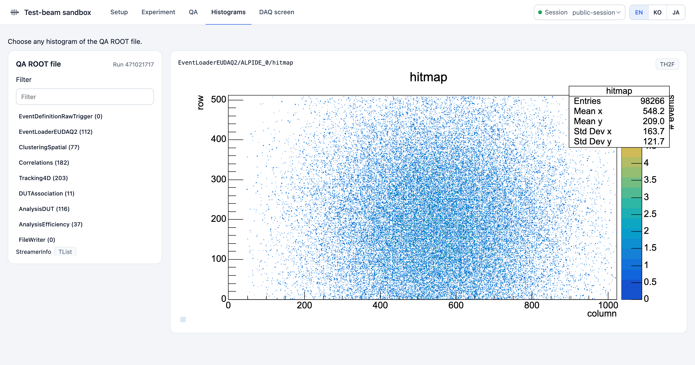

[English](../virtual-alpide-board.md) | [Korean](../ko/virtual-alpide-board.md) | [Japanese](../ja/virtual-alpide-board.md)

# 仮想 ALPIDE ボード

このシステムの応答は合成値であり、実機の測定値ではありません。[公式 Corryvreckan リポジトリ](https://gitlab.cern.ch/corryvreckan/corryvreckan)の master commit `22fca3e43ceec7ba6263a5cf179cd57d5fff42fe` からビルドします。

## インターフェース

変更を加えていない公開 EUDAQ producer が `virtual_alpide/alpidedaqboard.py` をインポートします。レジスタは書き込んだ整数を保持し、未書き込みの値は 0 です。`event_read` はソースピクセルを公開変換器の形式にエンコードします。電源と温度の値は仮の値です。実際のボードやデバイスファイルは開きません。固定された仮想 Git 作業ツリーは producer の識別子 `cfb0e422af953a0fec8ad98a8541a98cf6c6c1b3` と空の diff を提供します。Git 作業ツリーの外では、公開 producer が BORE を作成するときにエラーになります。

## 応答

応答の例には `virtual_alpide/response.json` を使います。`ITHR` を 0 から 255 に上げると、効率は 1 から 0、平均クラスタサイズは 2 から 1 に下がります。`STROBE_LENGTH` は 25,000 ps 単位のゲートです。trigger 番号を維持し、ps 時刻を 12,500 ps tick に切り捨てます。ソースがない場合やシリアルが違う場合、StartRun は失敗します。ソケットのタイムアウトは 3 秒、停止 drain タイムアウトは 12 秒です。検査は `tests/scripts/run_alpide_board_e2e.sh` で実行します。

