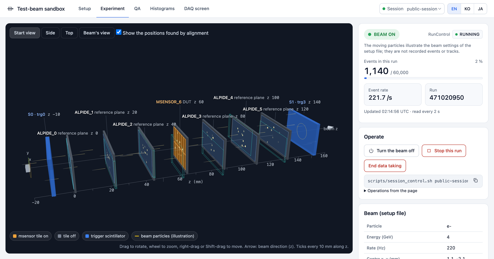

[English](../alignment.md) | [Korean](../ko/alignment.md) | [Japanese](../ja/alignment.md)

# 정렬

## 왜 필요한가

셋업 파일의 위치는 측량한 위치입니다. 실제 장치를 설치한 뒤처럼, 모의 빔라인의 실제 위치는 장치마다 x와 y로 최대 `offset_max_mm`(기본 `5` mm)만큼 다릅니다. 실제 위치는 감춰져 있어 분석 geometry, 세션의 셋업 사본, 모든 명령의 출력에는 측량한 위치만 나옵니다. 측량한 위치로 재구성한 track은 틀리거나 생기지 않으므로, 분석은 먼저 데이터에서 위치를 찾습니다. 이것이 정렬입니다.

## 방법

`scripts/align_session.sh public-session`은 현재 run을 씁니다. 세션이 돌고 있으면 먼저 `3000`개의 data event를 기다립니다. `--run NUMBER`는 닫힌 run을 씁니다. 공개 분석 모듈 `Prealignment`, 이어서 기준면에 대해 `Tracking4D`와 `AlignmentTrackChi2`, DUT마다 `DUTAssociation`과 `AlignmentDUTResidual`을 실행하며 x와 y만 바꿉니다. 기준면은 셋업의 위치에 그대로 두므로 모든 보정량은 기준면에 대한 상대값입니다. 명령은 검출기마다 보정량, 정렬 뒤 residual 폭, 정렬 전후의 event당 track 수를 출력합니다. track이 `100`개보다 적으면 오류로 멈추고 이전 정렬은 그대로 둡니다. 기본 셋업에서 몇천 event라면 1분이 채 걸리지 않습니다.

QA는 정렬된 geometry를 쓰고 어느 정렬을 썼는지 말합니다. 정렬이 없으면 QA는 `NOT ALIGNED`와 정렬 명령을 출력하고 숫자 없이 멈춥니다. `offset_max_mm = 0`인 셋업은 정렬이 필요 없습니다.

## 다시 쓰기

`scripts/align_session.sh public-session --save alignment.json`은 결과를 저장합니다. `scripts/start_session.sh --setup FILE --alignment alignment.json`으로 새 세션에 주면 다시 정렬하지 않고 QA를 할 수 있습니다. 저장한 정렬은 장치가 같을 때만 쓰입니다. run 길이, threshold, 끈 타일, 빔을 바꾸어도 유효하지만 장치를 더하거나 빼거나 옮기면 유효하지 않으며, 이때 시작 명령은 이유를 말하고 정렬 없이 시작합니다.

## 다시 정렬해야 할 때

장치를 건드리지 않는 한 그 장치의 어긋남은 같습니다. 같은 셋업은 세션마다 같은 실제 위치를 줍니다. `offset_draw`는 장치를 다시 설치한 것처럼 다른 어긋남을 뽑습니다. QA는 검출기마다 residual 평균을 출력합니다. 평균이 `20` µm를 넘거나 event당 track 수가 정렬했을 때의 절반보다 적으면 QA는 `POSITIONS CHANGED?`를 출력합니다. 장치가 움직인 것으로 보이므로 다시 정렬합니다.
