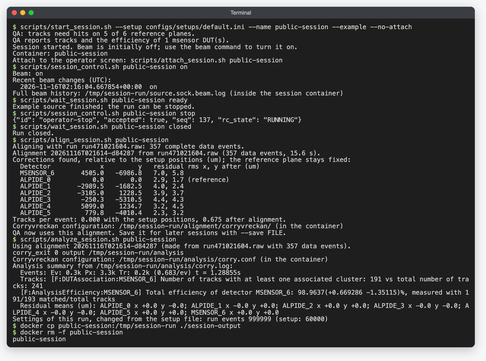

[English](../automation.md) | [Korean](../ko/automation.md) | [Japanese](../ja/automation.md)

# 자동 실행 예

이 페이지의 유한 예제와 run 명령은 EUDAQ 모드용입니다. nestDAQ 세션은 [nestDAQ 모드](nestdaq.md)를 참조합니다.

유한 예제는 기본 셋업으로 run 하나를 RunControl 화면 없이 돌립니다. 취득을 조작하는 프로그램이 하는 방식과 같습니다. 명령은 저장소 맨 위 디렉터리에서, `session-output` 디렉터리와 `public-session`이라는 컨테이너가 없을 때 실행합니다. 있으면 다른 이름을 씁니다.

<!-- automated-example -->
```sh
# 공개 기반 이미지와 세션 이미지를 빌드합니다.
scripts/build_session.sh


# 기본 셋업으로 유한 예제를 화면에 붙지 않고 시작합니다.
scripts/start_session.sh --setup configs/setups/default.ini --name public-session --example --no-attach

# 모의 빔을 켭니다.
scripts/session_control.sh public-session on

# 예제 소스가 끝날 때까지 기다립니다.
scripts/wait_session.sh public-session ready

# run을 멈추도록 요청합니다.
scripts/session_control.sh public-session stop

# RunControl이 순서를 끝낼 때(TERMINATED)까지 기다립니다.
scripts/wait_session.sh public-session closed


# 닫힌 예제 run으로 분석 기하를 정렬합니다.
scripts/align_session.sh public-session

# 닫힌 예제 run을 분석합니다.
scripts/analyze_session.sh public-session

# 취득과 QA 출력을 호스트로 복사합니다.
docker cp public-session:/tmp/session-run ./session-output

# 세션 컨테이너를 지웁니다.
docker rm -f public-session
```



## 설정과 producer

- `scripts/session_control.sh NAME settings --json`은 `format`, `next`, `current`를 반환합니다. 각각 run과 장치를 담고 `current`는 `run_number`와 `file`도 담거나 `null`입니다.
- `set`, `end-producer`, `stall`은 성공에 `0`, 잘못된 값이나 없는 프로세스나 시작되지 않은 정체에 `1`, 잘못된 인수나 모르는 항목에 `2`를 반환합니다.
- `command-history.jsonl`에는 `format`, `seq`, `utc`, `monotonic_ns`, `kind`, `id`와 변경한 `section`, `item`, `value`, `previous` 또는 `producer`, `pid`, `signal`, `ended`가 있습니다.
- `run<number>.conf`는 그 run을 위해 읽은 설정을 보존합니다.
- QA의 `settings_changed`는 셋업 파일과 다른 항목이며 같으면 빈 목록, 사용할 수 없으면 `null`입니다.

## 기다리기와 멈추기

- `scripts/wait_session.sh NAME ready`는 msensor producer가 예제 소스가 끝났다고 알릴 때까지 기다립니다. 그다음 run을 멈출 수 있습니다.
- `scripts/wait_session.sh NAME closed`는 RunControl이 `TERMINATED`를 알릴 때까지 기다립니다. run 하나의 끝이 아니라 시퀀스 전체의 끝입니다. 유한 예제에서는 run 하나를 멈추면 시퀀스가 끝납니다. `--example` 없이 시작한 세션에서는 멈추면 다음 run이 시작되고, `closed`는 `T` 나 `terminate`가 시퀀스를 끝낼 때까지 기다립니다. 두 기다림 모두 `180` 초 뒤에는 그만둡니다.
- 일찍 멈추려면 `ready` 기다림을 빼고, 제어 socket이 생기면 장치가 아직 붙는 중이어도 `stop`을 보냅니다. 멈추기는 `stop_next`를 보냅니다. 받아들여진 요청은 적용되고, 거절된 요청에는 이유가 붙습니다.
- 분석 없이 취득만 하려면 `scripts/build_session.sh --acquisition-only --image local/acquisition`로 빌드하고 `--image local/acquisition:native`로 시작합니다.

## 상태 파일의 상태

`scripts/session_control.sh NAME status`는 RunControl 상태 파일 `/tmp/session-run/status.json`을 출력합니다. 그 `rc_state`는 다음과 같이 바뀝니다.

- 시작할 때: 장치가 연결되는 동안 `CONWAIT`, 수십 ms 동안 `UNCONF`, 몇 초 동안 `CONF`, 그다음 `RUNNING` 입니다.
- 받아들여진 `stop_next` 뒤에는 장치가 데이터를 다 보낸 뒤 몇 초 안에 run이 끝납니다: `RUNNING`, 수십 ms 동안 `STOPPED`, 몇 초 동안 `CONF`, 그다음 `run.number`가 하나 큰 다음 run의 `RUNNING` 입니다. 상태 파일을 가끔 읽는 프로그램은 `STOPPED`를 놓칠 수 있습니다. run의 끝을 기다릴 때는 `run.number`가 바뀌거나 `rc_state`가 `RUNNING`이 아니게 될 때까지 기다립니다.
- `rc_state`가 `CONF` 일 때 보낸 `stop_next`는 받아들여지고 다음 run에 적용됩니다: 그 run은 시작했다가 몇 초 안에 다시 멈춥니다.
- JSON이 아니거나, 모르는 `intent`이거나, `id`가 문자열이 아닌 요청의 응답은 요청에 id가 있어도 `"id": null` 입니다.
