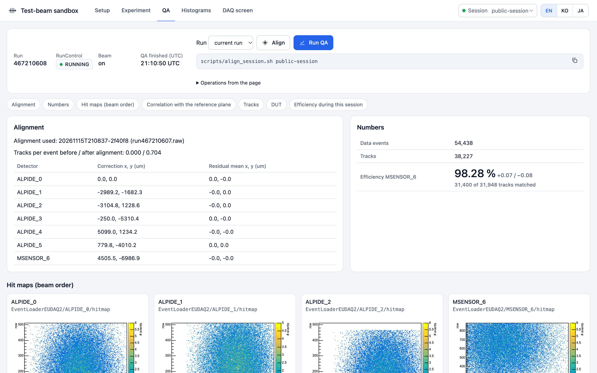

[English](../qa-page.md) | [Korean](../ko/qa-page.md) | [Japanese](../ja/qa-page.md)

# 결과 페이지

결과 페이지는 세션의 실험 화면과 QA를 브라우저에서 보여 줍니다. 버튼으로 터미널 명령을 실행합니다. 셋업 파일을 만들고 고치며, 세션을 시작하고 끝내고, 빔을 켜고 끄고, run을 멈추고, RunControl 요청과 Q 키를 보내고, 정렬과 QA를 실행합니다. 세션 화면의 창도 보여 줍니다. 터미널 명령은 그대로 동작합니다.

## 시작과 끝내기

`scripts/qa_page.sh public-session`은 페이지 서버를 `127.0.0.1`의 포트 `8765`에서 백그라운드로 띄우고 주소와 프로세스 번호를 출력하며, 터미널에서 실행하면 브라우저에 실험 화면을 엽니다. 세션 이름 없이 `scripts/qa_page.sh`를 실행하면 세션 없이 서버를 띄우고 셋업 탭을 엽니다. 세션은 페이지 위의 세션 목록에서 고릅니다. `--port N`은 다른 포트를 고르고 `--no-browser`는 브라우저를 열지 않으며 `--foreground`는 Ctrl-C까지 서버를 터미널에 둡니다. `scripts/qa_page.sh --stop`으로 끝냅니다. 예전 판이 띄운 페이지 서버가 그 포트에서 아직 돌고 있으면, `scripts/qa_page.sh`는 그것을 끝내는 명령과 함께 그렇게 알리고, `scripts/qa_page.sh --stop`은 그 프로세스가 그 페이지 서버인지 확인한 뒤 끝냅니다. 컨테이너가 없거나 멈춰 있으면 페이지가 그렇게 알립니다.

`scripts/analyze_session.sh public-session`은 페이지를 열지 않습니다. `--page`를 주면 페이지 서버가 없을 때 띄우고 주소를 출력하며, 터미널에서는 브라우저에 QA 탭을 엽니다. `--page --no-browser`는 주소만 출력합니다. 출력되는 QA 줄은 그대로입니다.

`--refresh SECONDS`(`10` 이상)는 서버가 도는 동안 그 간격으로 실행 중인 run의 QA를 다시 실행하며, 페이지는 스스로 바뀝니다. QA 실행은 겹치지 않습니다.

셋업 탭에서 trigger 신틸레이터와 trigger·veto 식을 그림으로 보고 편집합니다.

## 셋업 탭

셋업 탭은 `configs/setups/`의 셋업 파일을 목록으로 보여 줍니다. 하나를 고르면 `scripts/setup_session.sh check`와 `scripts/setup_session.sh show`가 그 파일에 대해 출력하는 내용과, 실험 화면 탭처럼 그린 장치와 빔의 3D 그림을 파일의 값으로 보여 줍니다(세션이 없어도 됩니다). "새 셋업"은 `scripts/setup_session.sh new --no-input`의 값에서 시작합니다.

파일의 모든 항목을 고칠 수 있습니다: run, 빔, 위치의 어긋남, 장치와 그 위치와 설정, msensor의 타일. 값은 파일에 쓰는 그대로 적습니다(예: `1, -2, 60`). 항목 아래의 작은 글은 저장한 파일에 들어가는 설명 줄입니다. 장치를 더하고 뺄 수 있습니다. 페이지가 종류마다 번호를 0부터 빈틈없이 매기고, 면 번호와 위치는 직접 정합니다. msensor의 타일을 누르면 끄거나 켭니다. 고치는 동안 확인과 3D 그림이 따라 바뀝니다. 확인은 `scripts/setup_session.sh check`의 코드와 그 말을 씁니다.

"셋업 파일 저장"은 확인을 통과한 경우에만 `configs/setups/`에 파일을 씁니다. 형식은 `scripts/setup_session.sh new`와 같고(항목마다 설명 줄이 있음) 터미널에서도 그대로 쓸 수 있습니다. 저장한 뒤 페이지는 그 파일에 대한 `scripts/setup_session.sh check`의 출력을 보여 줍니다. 이름은 영문자, 숫자, `-`, `_`로 쓰고 `.ini`로 끝나야 합니다. 저장소에 포함된 셋업 파일 `default.ini`, `small-msensor.ini`, `msensor-telescope.ini`와 네 `nestdaq` 셋업은 덮어쓰지 않습니다. 이것을 고친 것은 다른 이름으로 저장합니다. 이미 있는 파일을 바꿀 때는 페이지 안에서 한 번 더 확인합니다.

"세션 시작"은 저장한 파일과 세션 이름으로 `scripts/start_session.sh --setup configs/setups/FILE --name NAME --no-attach`를 실행합니다. 저장해 둔 정렬을 고르면 `--alignment configs/alignments/FILE.json`도 줍니다(`scripts/align_session.sh NAME --save configs/alignments/FILE.json`으로 저장해 둡니다). 페이지는 명령의 출력과 종료 코드를 보여 주며, 예를 들어 이미 쓰는 이름은 명령의 말 그대로 보입니다. 세션이 시작되면 페이지는 실험 화면 탭에서 그 세션을 보여 줍니다. 이미지는 페이지에서 빌드하지 않습니다. 이미지가 없으면 `scripts/build_session.sh`를 알려 줍니다.

실험 화면 탭에서 구멍이 있는 판을 그리고 장치 아래에 신틸레이터와 trigger 조건을 표시합니다.

## 실험 화면 탭

페이지 서버 명령은 이 탭을 먼저 열고, QA 명령은 QA 탭을 먼저 엽니다.

"이 run 멈추기"는 `scripts/session_control.sh public-session stop --id page-stop`을 실행하고 RunControl은 곧바로 다음 run을 시작합니다. 취득을 끝내려면 "취득 끝내기" (`scripts/session_control.sh public-session terminate --id page-terminate`)를 확인하고 종료를 기다린 다음 "RunControl 나가기 (Q)" (`docker exec public-session tmux send-keys -t ITS3:rc Q`)를 확인합니다. 그다음 출력을 복사하고 컨테이너를 지웁니다.

- 장치 표는 현재 run의 설정을 보여 주며 다음 run에 값이 바뀌는 항목 뒤에는 "→ 다음 run:"과 새 값을 붙입니다. "다음 run의 설정"은 `scripts/session_control.sh public-session set SECTION ITEM VALUE --id page-set`으로 항목 하나를 바꾸고 셋업 파일과 같이 검사합니다.
- 세션 셋업의 장치를 빔 순서대로, 셋업 파일의 측량한 x, y, z와 실제 크기(픽셀 수 × pitch)로 3D에 그립니다. 장치마다 이름과 역할(기준면 또는 DUT)이 붙습니다. msensor는 타일의 격자를 보여 주며 켜진 타일은 주황, 꺼 둔 타일은 회색입니다. 화살표는 빔 방향(z)이고 눈금은 10 mm마다 있으며, 빔이 시작하는 곳의 짧은 빨강과 초록 선이 x와 y입니다.
- 끌어서 돌리고 휠로 확대·축소하며 오른쪽 끌기나 Shift 끌기로 옮깁니다. 버튼으로 처음 시점으로 돌아가거나 옆, 위, 빔이 보는 방향에서 봅니다. 주소의 `view=side`, `view=top`, `view=beam`으로 처음 시점을 고릅니다(`view=reset`은 처음 시점입니다).
- `BEAM ON` 또는 `BEAM OFF`, 세션, RunControl 상태, run, 그 run의 event 수와 event rate. 페이지는 이 값을 2초마다 세션에서 읽으므로 터미널에서 빔을 바꾸면 몇 초 안에 보입니다. 세션이 없거나 멈춰 있으면 그렇게 보여 줍니다.
- 셋업 파일의 빔 항목(입자, 에너지, rate, 중심, 분산, 빔이 시작하는 곳, run당 event)과 장치의 설정, 꺼 둔 타일을 담은 표.
- 빔이 켜져 있으면 입자가 빔을 따라 움직입니다. 입자는 셋업 파일의 빔 항목을 그린 그림이며 기록된 event나 track이 아니고, 페이지에 그렇게 적혀 있습니다. 빔이 꺼져 있으면 입자를 그리지 않습니다. 빔이 켜져 있고 run이 돌지 않으면 입자는 그대로 움직이고 기록되지 않는다고 적습니다. 탭이 보이지 않는 동안에는 그리기를 멈춥니다.
- 감춘 실제 위치는 읽지도 보여 주지도 않습니다. 세션에 정렬 결과가 있으면 확인란으로 정렬이 찾은 위치를 윤곽으로 보여 주며, 정렬 결과 파일의 값만 씁니다.
- layout 디렉터리로 시작한 세션은 그 분석 geometry로 그리고 빔 항목은 없습니다.

3D 화면은 WebGL을 씁니다. WebGL이 없는 브라우저는 같은 장면을 SVG로 그리고 그렇게 알립니다. 둘 다 안 되면 이유를 보여 주고 세션 상태는 그대로 보입니다. 서로 겹칠 이름표는 떨어뜨리고, 이름표를 가릴 축 숫자는 빼므로 빔이 보는 방향에서도 읽을 수 있습니다.

## DAQ 화면 탭

이 탭은 세션 운영 화면의 창 하나의 글을 보여 줍니다: `rc`(RunControl), `rp`(기준면), `dp`(DUT producer), `sp`(보조 프로세스), `dc`(collector), `log`. 페이지는 이 탭이 보이는 동안 `tmux capture-pane`으로 매초 창을 읽고, 다른 탭이나 다른 브라우저 탭이 보이면 읽지 않습니다. 읽기만 합니다. 아래 Q 키 밖에는 페이지에서 화면으로 가는 것이 없습니다. `perf` 창(`htop`)은 보이지 않습니다.

`R`과 `T`는 `scripts/session_control.sh public-session repeat --id page-repeat`와 `terminate --id page-terminate`를 실행해 제어 socket으로 RunControl 요청을 보냅니다. `Q`는 `docker exec public-session tmux send-keys -t ITS3:rc Q`로 RunControl 창에 키를 보냅니다. `R`은 현재 설정을 되풀이하고 `T`는 시퀀스를 끝내며 `Q`는 끝난 뒤 나갑니다. 버튼마다 실행하는 명령을 보여 주고, `T`와 `Q`는 페이지에서 한 번 더 확인합니다.

세션을 끝낼 때는 [따라 하기](walkthrough.md)의 순서를 따릅니다: `T`, `Q`, 그다음 "출력 복사", 이것은 `docker cp public-session:/tmp/session-run outputs/public-session-TIME`으로 저장소의 `outputs/` 아래 새 디렉터리에 복사합니다(TIME은 UTC 시각). 그다음 "컨테이너 지우기", 이것은 페이지 안에서 확인한 뒤 `docker rm -f public-session`을 실행합니다. 지울 수 있는 것은 이 저장소의 세션 컨테이너뿐입니다. 그 뒤 페이지는 셋업 탭으로 돌아갑니다.

## 조작

`scripts/qa_page.sh`가 출력하는 주소로 연 페이지는 조작을 할 수 있습니다. 버튼마다 기존의 명령을 실행하고 그 명령 줄을 옆에 보여 주므로, 같은 일을 터미널에서도 할 수 있습니다. 위의 셋업 탭과 DAQ 화면 탭 외에도:

- 실험 화면: 빔 켜기(`scripts/session_control.sh public-session on`)와 끄기(`scripts/session_control.sh public-session off`), 페이지 안에서 한 번 더 확인한 뒤 run 멈추기(`scripts/session_control.sh public-session stop`).
- QA 탭: 정렬(`scripts/align_session.sh public-session`)과 QA 실행(`scripts/analyze_session.sh public-session`). 현재 run이나 목록에서 고른 run(`--run N`)에 대해 실행합니다.

상태에 맞지 않는 버튼(예: 켜진 빔을 켜기)은 누를 수 없습니다. 정렬과 QA는 시간이 걸립니다. 페이지는 명령이 실행 중임을 보여 주고, 끝나면 터미널에서처럼 출력 줄과 종료 코드를 보여 줍니다. `NOT ALIGNED` 같은 실패는 명령이 알린 그대로 보입니다. 세션마다 정렬이나 QA는 한 번에 하나만 실행합니다. QA가 끝나면 QA 탭에 새 결과가 보입니다. 조작마다 시각, 명령 줄, 종료 코드가 세션 디렉터리의 `page-operations.jsonl`에 기록되고, 페이지가 그 목록을 보여 줍니다. 복사와 지우기는 복사본이 세션 디렉터리와 같도록 여기에 더하지 않으며, 서버가 도는 동안 페이지가 보여 줍니다.

서버는 시작할 때마다 새 무작위 token을 만듭니다. 출력되는 주소는 `#` 뒤에 token을 담습니다. 브라우저는 이 부분을 서버에 보내지 않고, 페이지는 읽은 뒤 주소에서 지우므로 브라우저 기록에 남지 않습니다. 조작은 그 token이 있어야 받으므로 같은 컴퓨터의 다른 웹 페이지는 조작할 수 없습니다: 셋업 파일 저장, 세션 시작, 키, 복사와 지우기, 빔, run 멈추기, 정렬, QA. token은 `${XDG_STATE_HOME:-~/.local/state}/test-beam-sandbox/`의 서버 상태 파일에 있으며, 이 디렉터리는 자기 사용자 계정만 열 수 있습니다. `scripts/qa_page.sh public-session`을 다시 실행하면 같은 주소를 출력하고, `scripts/analyze_session.sh public-session --page`는 token이 든 페이지를 엽니다. token 없이 연 페이지는 보기만 하며 주소를 얻는 방법을 알려 줍니다. `--view-only`는 모든 조작을 거절하는 서버를 띄웁니다.

## QA 탭

QA 탭은 정렬과 측정값, 그림을 보여 줍니다.

- 세션, run, RunControl 상태, 빔, QA 시각.
- 정렬: 정렬 여부, 쓴 정렬, 보정량, 정렬 전후의 event당 track 수, residual 평균. `NOT ALIGNED`와 `POSITIONS CHANGED?`는 맨 위에 정렬 명령과 함께 보입니다.
- 숫자: data event, track, DUT별 효율과 오차, 효율에서 뺀 타일.
- 빔 순서로 모든 면의 hit map, 기준면에 대한 각 면의 x, y correlation, track의 chi2/ndf, DUT마다 효율 map, 픽셀 내부 효율, x, y residual, run 안의 시간에 따른 효율.
- 이 세션 동안의 효율: QA마다 점이 하나씩 더해집니다.

항목이 없는 그림은 아직 데이터가 없다고 표시합니다.

## Histogram 탭

QA ROOT 파일의 모든 histogram을 보여 주며, 하나를 고르면 그립니다.

## nestDAQ 세션

nestDAQ 세션에는 nestDAQ 탭이 생기고 DAQ 화면은 해당 창을 보여 줍니다. QA 탭은 `scripts/session_control.sh NAME nestdaq qa --json`의 숫자를 5초마다 다시 읽어 보여 주며 Histogram 탭은 사용할 수 없습니다. 실험 화면 탭에는 빔 제어가 남고 EUDAQ run 버튼은 숨겨집니다. nestDAQ run과 모든 msensor가 보낸 frame 및 frame rate를 보여 주며 nestDAQ run이 돌고 있지 않을 때만 "출력 복사"와 "컨테이너 지우기"를 활성화합니다. 이 모드는 ALPIDE 평면을 읽지 않으므로 물질로 표시합니다. token은 이 페이지의 조작에 적용되며 nestDAQ 화면은 [nestDAQ 모드](nestdaq.md)에 설명된 ticket을 사용합니다.

## 언어와 그림

페이지의 글은 영어, 한국어, 일본어이며 위쪽 버튼으로 바꾸고, 처음 언어는 브라우저를 따릅니다. 숫자, 이름, 명령은 모든 언어에서 같습니다. 언어마다 글은 파일 하나(`session_setup/web/text/en.json`, `ko.json`, `ja.json`)에 한 줄에 한 항목씩 있으며, 교정한 파일로 바꾸면 페이지의 글이 바뀝니다. 그림은 JSROOT `7.5.2`(`MIT`)로, 실험 화면은 그 JSROOT에 든 three.js `r155`(`MIT`)로 그립니다. JSROOT는 세션 이미지에 ROOT와 함께 들어 있으며 서버가 시작할 때 이미지에서 꺼내므로, 페이지는 인터넷에서 아무것도 받지 않습니다. JSROOT 사본은 `~/.cache/test-beam-sandbox/`에 남고, QA 파일의 사본은 서버가 끝나면 지워집니다.

설정 표와 다음 run 편집에는 `[trigger]`의 `trg`, `veto`, `count` 항목이 들어갑니다.

## 페이지 배치와 이동

실험 화면은 남은 높이를 채우고 상태, 조작, 빔과 장치를 옆에 둡니다. 셋업 탭은 파일 목록, 편집기와 미리보기를 함께 두며 절 바로가기로 run, 빔, 장치로 이동합니다. 장치와 신틸레이터 요약은 누르면 펼쳐지고 새 장치와 검사 오류가 있는 장치는 자동으로 펼쳐집니다.

QA 절 바로가기로 각 결과로 이동합니다. 그림 묶음은 처음 4장만 보이며 전체 보기로 펼치고 접기로 줄입니다. 작은 QA 그림에서는 통계 상자와 제목을 빼고 Histogram 탭에서는 전체 그림을 유지합니다. histogram 트리는 폴더를 접고 개수와 형식을 보여 줍니다. 걸러 보기는 대소문자를 구분하지 않고 이름을 찾고 해당 폴더를 펼칩니다. 입력을 지우면 처음 상태로 돌아갑니다.

DAQ 종료 단계는 T와 Q 보내기, 출력 복사, 컨테이너 지우기 순서입니다. 창 너비가 1024픽셀 이상이면 터미널 글자 크기를 조절해 80열을 맞춥니다. 명령 상자의 복사 버튼은 표시된 명령을 그대로 복사합니다.
