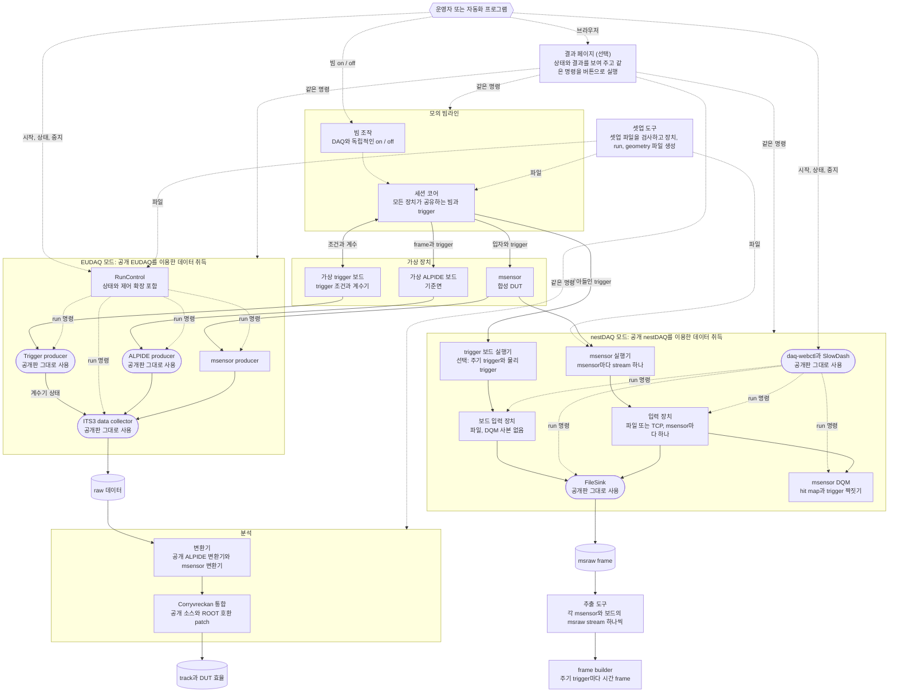

[English](../reference.md) | [Korean](../ko/reference.md) | [Japanese](../ja/reference.md)

# 참조

프로세스, 스크립트와 샌드박스의 구조입니다.

## 켜져 있는 것

| 무엇 | 켜는 것 | 끄는 것 | 남는 것 |
|---|---|---|---|
| 이미지 | `scripts/build_session.sh`(실행되는 것은 없습니다) | | 다시 빌드할 때까지 남습니다 |
| 세션: 모의 빔과 셋업 파일의 DAQ가 든 컨테이너 하나; EUDAQ 모드에서는 RunControl, producer, data collector | `scripts/start_session.sh` | `docker rm -f NAME` | 지우기 전에 `docker cp`로 꺼내지 않은 출력은 없어집니다 |
| nestDAQ 모드의 nestDAQ 프로세스: 컨테이너의 `NESTDAQ` tmux 세션에 있는 Redis, daq-webctl, SlowDash, msensor 실행기, trigger 보드 실행기(`trigger_board = on`일 때), 입력 장치, FileSink와 DQM | `scripts/start_session.sh` | `docker rm -f NAME` | 컨테이너의 `/tmp/session-run/nestdaq/data/`에 저장된 파일은 복사하지 않으면 함께 없어집니다 |
| nestDAQ run | `scripts/session_control.sh NAME nestdaq start` | `scripts/session_control.sh NAME nestdaq stop` | |
| 빔 | `scripts/session_control.sh NAME on`(세션은 빔이 꺼진 채 시작합니다) | `scripts/session_control.sh NAME off` | |
| 페이지 서버: 컨테이너 밖, 이 컴퓨터의 프로세스 | `scripts/qa_page.sh` | `scripts/qa_page.sh --stop` | 세션을 지워도 계속 돕니다 |

- `docker ps -a`는 도는 것과 멈춘 것을 포함해 세션 컨테이너를 보여 줍니다.
- `pgrep -f session_setup.webpage`는 페이지 서버의 프로세스 번호를 출력합니다.

## 스크립트

| 역할 | 스크립트 | 하는 일 |
|---|---|---|
| 셋업 | `scripts/setup_session.sh` | 셋업 파일을 만들고 보여 주고 확인합니다 |
| 세션 | `scripts/build_session.sh` | 이미지를 빌드합니다 |
| 세션 | `scripts/start_session.sh` | 셋업 파일로 세션을 시작합니다 |
| 세션 | `scripts/attach_session.sh` | 도는 세션의 RunControl 화면(EUDAQ 모드) 또는 msensor 실행기(nestDAQ 모드)를 다시 보여 줍니다 |
| 빔과 run | `scripts/session_control.sh` | 빔을 켜고 끄며 상태를 보여 줍니다; EUDAQ 모드에서는 run을 멈추고 되풀이하고 끝내고 다음 run의 설정을 바꾸고 응답하지 않는 producer를 끝냅니다; nestDAQ 모드에서는 run을 시작하고 멈추며 DQM 숫자를 출력합니다 |
| 분석 | `scripts/align_session.sh` | 분석 geometry를 데이터에 맞춥니다(EUDAQ 모드) |
| 분석 | `scripts/analyze_session.sh` | 현재 run이나 닫힌 run의 QA를 합니다(EUDAQ 모드) |
| 데이터 | `python3 -m nestdaq_mode.extract` | nestDAQ 모드에서 저장한 파일에서 각 msensor와 trigger 보드의 msraw stream을 추출합니다 |
| 데이터 | `python3 -m nestdaq_mode.framebuilder` | 추출한 stream이나 저장한 파일에서 주기 trigger마다 시간 frame을 만듭니다(trigger 보드) |
| 결과 페이지 | `scripts/qa_page.sh` | 페이지 서버를 켜고 끕니다 |
| 자동화 | `scripts/wait_session.sh` | 유한 예제가 끝나거나 세션이 끝날 때까지 기다립니다 |

## 작동 방식

사각형은 이 저장소의 구성 요소이고, 둥근 상자는 그대로 사용하는 공개 소프트웨어입니다. 실선은 데이터의 흐름을, 점선은 제어를 나타냅니다. 셋업 파일에 따라 세션은 EUDAQ 상자나 nestDAQ 상자를 사용하며 빔라인, 장치와 결과 페이지는 둘 다 같습니다. 결과 페이지는 선택 사항입니다. 상태와 결과를 보여 주고 터미널과 같은 명령을 실행하며, 셋업 파일도 셋업 도구와 같은 확인을 거쳐 고칩니다.

빌드는 공개 소프트웨어의 버전을 고정합니다. 그중 EUDAQ commit은 `bfe26c7`, Corryvreckan master commit은 `22fca3e`, nestDAQ commit은 `eda7287`입니다. 모든 버전과 patch는 [공개 스택과 소스 버전](public-stack.md)에 있습니다.

### 저장소 구성

- `configs/`: 두 모드의 셋업 파일, 배치와 세션 geometry 예제.
- `scripts/`: [따라 하기](walkthrough.md)의 명령.
- `session_setup/`: 셋업 도구, 세션 시작, 분석 명령과 결과 페이지.
- `session_core/`: 모의 빔라인: 빔, 타이밍과 장치 조정.
- `virtual_alpide/`: 가상 ALPIDE 보드.
- `virtual_trigger/`: 가상 trigger 보드.
- `msensor/`: msensor 장치, producer와 실행기.
- `nestdaq_mode/`: nestDAQ 모드의 세션 시작, run 제어, 입력 장치, trigger 보드 실행기, DQM, 추출 도구와 frame builder.
- `runcontrol/`: RunControl 확장과 EUDAQ에 적용하는 patch.
- `eudaq_module/`: EUDAQ용 msensor 변환기.
- `integration/`: 배치와 Corryvreckan 모듈.
- `tracksim/`: 세션 코어가 사용하는 입자 수송.
- `docker/`: 이미지 빌드.
- `docs/`: 설명서.
- `tests/`: 검사.
