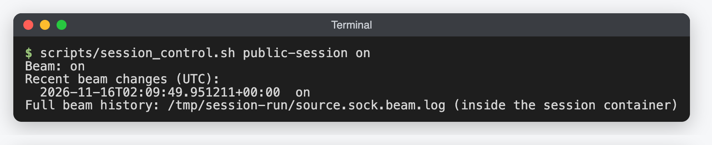

[English](../session-core.md) | [Korean](../ko/session-core.md) | [Japanese](../ja/session-core.md)

# 세션 source와 빔 제어

이 시스템의 응답은 합성값이며 실제 장비의 측정값이 아닙니다. [공식 Corryvreckan 저장소](https://gitlab.cern.ch/corryvreckan/corryvreckan)의 master commit `22fca3e43ceec7ba6263a5cf179cd57d5fff42fe`로 빌드합니다.

## 세션 source

독립 세션 코어는 참여 장치에 공유 시계와 source를 제공합니다. `configs/session/geometry.json`은 예시입니다. source seed와 빔 조건은 공개 geometry나 출력이 아니라 `SESSION_SOURCE_CONFIG_JSON`으로 전달합니다. launcher는 `--session-geometry`와 `--session-socket`으로 코어를 시작하거나 재사용하며 RunControl에 run 명령을 보내지 않습니다. 장치 참여, event, ack, 종료는 Unix socket의 줄 단위 JSON을 사용합니다.

시각 단위는 ps입니다. msensor는 ns로, 보드는 80 MHz tick으로 내림합니다. gate 또는 crossing guard가 90 ms를 넘는 참여 장치의 요청은 거절합니다. 보드 source socket은 3초, 종료 drain은 12초에 시간 초과됩니다. 응답 parameter는 각 run에서 고정됩니다. source 연결 단절은 빈 event가 아니라 오류입니다.

멈출 때는 설정된 모든 collector가 `DataEventN`으로 마지막 trigger까지 event를 조립했다고 보고할 때까지 장치 연결을 유지합니다. 확인이 없으면 성공으로 종료하지 않고 오류를 냅니다. RunControl hook은 collector 진행 상황을 세션 source에 전달하며 source는 run 명령을 보내지 않습니다.

신틸레이터가 있으면 [trigger 조건](trigger.md)을 만족한 입자만 trigger가 되며 나머지 입자의 hit도 장치에 갑니다.

## 장치 상실과 source 한도

첫 장치가 참여한 때부터 10초 동안 나머지 장치를 기다립니다. 그 뒤에는 참여하지 않은 장치를 기록하고 나머지 장치로 시작합니다. 연결이 끊기거나 10초 동안 응답하지 않은 장치는 그 run에서 제외되며 나머지 장치는 빔과 trigger를 계속 받습니다. source는 socket 옆 `.session.log`에 serial과 사유를 기록하며 source 조건은 기록하지 않습니다. 강제 종료한 producer는 RunControl 상태 파일에 연결 끊김으로 표시됩니다. 멈춤 요청 뒤 남은 producer와 collector가 멈춰도 RunControl은 끊긴 producer를 계속 기다릴 수 있으며 raw 파일은 열린 채 읽을 수 있습니다. 빠진 producer는 현재 run에 다시 참여할 수 없습니다.

producer가 연결된 채 응답을 멈추면 상태가 RUNNING으로 남고 그 producer의 event 수는 멈추지만 다른 producer의 수는 계속 늘어날 수 있습니다. 공개 collector는 멈춘 producer를 기다리므로 collector의 수는 멈추고 다른 대기열은 쌓입니다. run을 멈추기 전에 [운영자 화면 안내](operator-screen.md)에 따라 멈춘 producer를 끝냅니다. collector가 남은 장치의 event 조립을 다시 시작할 수 있지만 멈춤 요청 뒤 run은 계속 기다릴 수 있습니다. 멈춤 요청 뒤 남은 producer에 `Stop Error`가 생기고 RunControl이 `ERROR`가 될 수도 있습니다. 시간 초과된 producer가 다시 깨어나면 그 상태가 `ERROR`로 바뀌고 RunControl도 `ERROR`가 될 수 있으며 멈춤 요청이 거부되고 raw 파일이 열린 채 불완전하게 남을 수 있습니다. producer가 멈춘 채로 StopRun을 먼저 요청하면 남은 producer에 `Stop Error`가 발생하고 아직 조립되지 않은 event가 raw 데이터에서 빠질 수 있습니다. 상태를 확인하고 raw 데이터를 보존한 뒤 `docker rm -f public-session`으로 컨테이너를 제거하고 `scripts/start_session.sh --layout /tmp/public-session-layout --name public-session`으로 새 세션을 시작합니다. 세션 source 자체가 사라져도 장치에서 오류가 발생하므로 세션을 다시 시작합니다.

유한 예제에서 event, 교차 또는 픽셀 계산 한도에 도달하면 msensor가 `source_finished`를 알리고 `source_limit` 상태 필드에 한도 종류를 표시합니다. 빔이 꺼진 동안 소비한 event도 한도에 포함합니다. RunControl에서 run을 멈추어 정상적으로 닫습니다. source는 그 run을 재개하지 않습니다.

## 빔과 비교

빔은 꺼진 상태로 시작합니다. `python -m session_core.beamctl --socket <source.sock> on`, `off`, `status`를 사용하며 socket은 JSON 빔 조작도 받습니다. `.beam.json`과 `.beam.log`에 상태와 변경이 기록됩니다. 예약 변경은 같은 run 시각에 재생됩니다. off 구간에서는 trigger와 입자 signal 전달이 억제되지만 noise와 지연 hit는 남을 수 있습니다. 동일 run은 장치 payload, 디코딩 stream, BORE와 EORE를 비교합니다. 실제 시각의 중간 status event는 raw에 보존하고 비교에서는 제외합니다. 종료 시 추가 trigger 없이 마지막 gate와 guard를 유지합니다.

`on`과 `off`에 `--id ID`로 요청 id를 지정하며, 생략하면 `scripts/session_control.sh`는 `operator-on`과 `operator-off`를 사용합니다. 빔 기록에는 `id` 항목이 있고 id 없는 요청과 시작·예약 기록은 `null`입니다. 빔 조작은 `control-history.jsonl`에 없으므로 두 이력의 순서는 같은 단조 시계의 `monotonic_ns`와 `actual_monotonic_ns`로 맞춥니다.

화면과 넘겨받기 조작은 [운영자 화면 안내](operator-screen.md)를 참고합니다.
