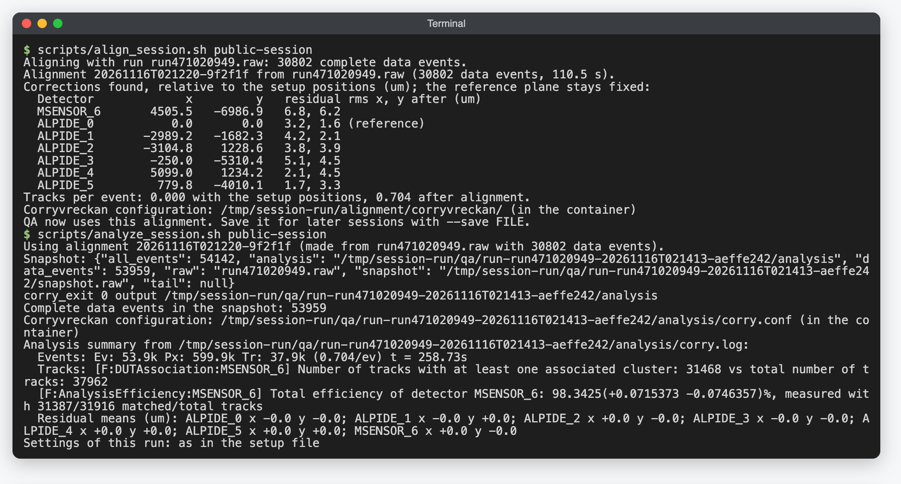

[English](../session-run.md) | [Korean](../ko/session-run.md) | [Japanese](../ja/session-run.md)

# 세션 취득과 분석

이 시스템의 응답은 합성값이며 실제 장비의 측정값이 아닙니다. [공식 Corryvreckan 저장소](https://gitlab.cern.ch/corryvreckan/corryvreckan)의 master commit `22fca3e43ceec7ba6263a5cf179cd57d5fff42fe`로 빌드합니다.

## 배치

기본 배치에는 기준면 6개와 msensor 1개가 있습니다. `python3 -m integration.layout --layout configs/layouts/default.json --directory /tmp/my-layout --analysis-geometry`는 `geometry.json`, `init.ini`, `a.conf`, `devices/`, `mapping.json`, `analysis-geometry.conf`를 생성합니다. plane 번호는 고유하고 종류별 번호는 연속이어야 합니다. 빔 밖 plane도 허용됩니다. source seed와 비공개 빔 조건은 배치에 넣지 않습니다.

셋업 파일은 `scripts/start_session.sh --setup FILE`로 세션을 시작할 때 이 파일들이 됩니다. `configs/layouts/default.json` 같은 배치 파일도 마찬가지로 허용됩니다. 만들어진 파일을 손으로 고치려면 `python3 -m integration.layout --setup my-setup.ini --directory DIR --analysis-geometry`를 실행하고 `--layout DIR`로 시작합니다. 다시 만들어도 고친 파일은 덮어쓰지 않습니다.

## 취득과 분석

빌드, 시작, 취득, 종료와 분석은 [따라 하기](walkthrough.md)의 명령을 따릅니다. 세션의 빔은 처음에 꺼져 있습니다. 분석에는 공개 EUDAQ 변환기, EventLoaderEUDAQ2, clustering, tracking, DUT association, efficiency와 출력 모듈을 사용합니다. 고정된 Corryvreckan revision은 보조 30 µm pitch histogram에서 ROOT bin 경고를 1번 낼 수 있습니다. 다른 변환 오류가 발생하면 실패로 처리합니다. data event가 없는 raw 파일은 분석하면 안 됩니다.

`scripts/align_session.sh`와 `scripts/analyze_session.sh`는 세션 자신의 셋업에 있는 장치를 씁니다: `scripts/start_session.sh`가 `/tmp/session-run`에 남기는 사본 `setup.json`, 또는 배치 디렉터리의 분석 geometry입니다. QA에는 ALPIDE 기준면이 3개 이상 필요합니다. [자동 실행 예](automation.md)는 화면 없이 세션을 돌리고, [빠른 시작](../../README.ko.md)은 화면과 함께 돌립니다.

빔은 `scripts/session_control.sh public-session off`, `on`, `beam-status`로 조작합니다. 장치 설정은 셋업 파일의 항목입니다. 그곳에서 바꾸고 새 세션을 시작하거나 `scripts/session_control.sh public-session set`으로 다음 run부터 바꿉니다([운영자 화면 설명](operator-screen.md))([셋업 파일 설명](setup-file.md)). `--layout DIR`로 시작한 세션은 대신 `DIR`의 파일을 읽습니다. 장치 설정을 바꾸려면 시작하기 전에 그 `a.conf`를 편집하고, 분석 geometry를 배치에 맞게 유지합니다.

## 기본 detector 대응

기본 분석 대응의 식별자와 위치는 다음과 같습니다. `mapping.json`은 분석 section 이름을 제공합니다. geometry의 `position_mm`, `pixels`, `pitch_um`은 각각 `position`, `number_of_pixels`, `pixel_pitch`에 대응합니다. 모든 면에는 [셋업 파일 설명](setup-file.md)의 고유 해상도인 `spatial_resolution`(예: ALPIDE 면은 `4.517um, 4.517um`(`ithr = 0`일 때), 기본 msensor는 `6.640um, 6.062um`)과, `material_budget = 0.00106724`(시뮬레이션이 면마다 쓰는 실리콘 100 µm에 해당)도 들어갑니다. 취득 전용 배치를 생성하면 기존 분석 geometry는 그대로 둡니다.

| serial | producer / plane | geometry | analysis detector | z (mm) |
|---|---|---|---|---:|
| V0 | ALPIDE_plane_0 / 0 | P0 | ALPIDE_0 | 0 |
| V1 | ALPIDE_plane_1 / 1 | P1 | ALPIDE_1 | 20 |
| V2 | ALPIDE_plane_2 / 2 | P2 | ALPIDE_2 | 40 |
| MSENSOR_0 | MSENSOR_0 / 6 | D0 | MSENSOR_6 | 60 |
| V3 | ALPIDE_plane_3 / 3 | P3 | ALPIDE_3 | 80 |
| V4 | ALPIDE_plane_4 / 4 | P4 | ALPIDE_4 | 100 |
| V5 | ALPIDE_plane_5 / 5 | P5 | ALPIDE_5 | 120 |
