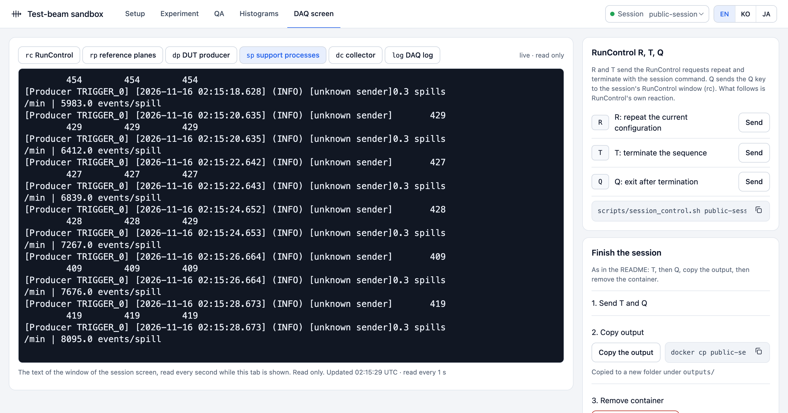

[English](../trigger-board-surface.md) | [Korean](../ko/trigger-board-surface.md) | [Japanese](../ja/trigger-board-surface.md)

# 공개 trigger 보드 호출 표면

이 시스템의 응답은 합성값이며 실제 장비의 측정값이 아닙니다. [공식 Corryvreckan 저장소](https://gitlab.cern.ch/corryvreckan/corryvreckan)의 master commit `22fca3e43ceec7ba6263a5cf179cd57d5fff42fe`로 빌드합니다.

이 표는 변경하지 않은 공개 `TriggerProducer.py`의 commit [`bfe26c7`](https://github.com/eudaq/eudaq/blob/bfe26c7b73844344b2cbfa37ab853f2a0cb1f23e/user/ITS3/python/TriggerProducer.py)이 보드 모듈에서 쓰는 항목, 소스의 줄 번호와 가상 보드가 하는 일을 보여 줍니다.

| 소스 인터페이스 | 줄 | 가상 동작 |
|---|---|---|
| `find_trigger()` | 32 | 가상 보드를 찾습니다 |
| `TriggerBoard(port)`, `tb.con.port` | 32, 128 | virtual만 받고 포트를 기록합니다 |
| `DacAddrCh.keys()`, `DacAddrCh(name)`, `.channel`, `.address`, `str()` | 33, 35, 37, 38 | DAC 이름을 받습니다 |
| `DacVoltage(text).value` | 36 | DAC 값을 받습니다 |
| `tb.set_dac(val=, channel=, address=)` | 38 | 판정은 바꾸지 않고 DAC 값을 기록합니다 |
| `TriggerConditionParser().get_cmd_sequence(trg, veto)` | 53–56 | trigger와 veto 식을 검사합니다 |
| `tb.write_trg_logic(seq)` | 57 | 다음 run의 조건을 보냅니다 |
| `tb.latch_and_read_cnts()` | 107, 110 | 부호 없는 계수기 256개를 읽습니다 |
| `CounterCondition(text)`, `.name`, `.count(dc)` | 59, 108, 115 | 조건에 이름을 붙이고 맞는 계수기 값을 더합니다 |
