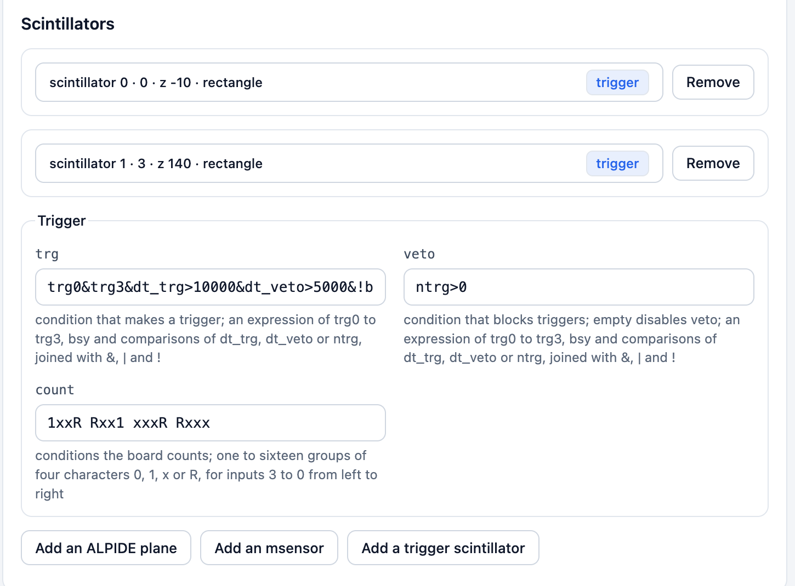

[English](../trigger.md) | [Korean](../ko/trigger.md) | [Japanese](../ja/trigger.md)

# Trigger

이 시스템의 응답은 합성값이며 실제 장비의 측정값이 아닙니다. [공식 Corryvreckan 저장소](https://gitlab.cern.ch/corryvreckan/corryvreckan)의 master commit `22fca3e43ceec7ba6263a5cf179cd57d5fff42fe`로 빌드합니다.

## 신틸레이터

셋업에는 최대 4개의 판이 있으며 `0`부터 빠짐없이 번호를 매깁니다. 적힌 위치가 실제 위치이며 숨겨진 위치 어긋남을 적용하지 않고 분석 geometry에도 넣지 않습니다. 기본 셋업의 channel `0`, `3`은 각각 `1.1, -2.1, -10`, `1.1, -2.1, 140` mm에 있습니다.



| 절 | 항목 | 기본값 | 받는 값 |
|---|---|---|---|
| `[scintillator N]` | `channel` | 필수 | 중복 없는 `0`–`3` |
| `[scintillator N]` | `position_mm` | 필수 | 판 중심 x, y, z (mm); 빔 출발점보다 하류 |
| `[scintillator N]` | `shape` | `rectangle` | `rectangle` 또는 `disc` |
| `[scintillator N]` | `size_mm` | `30, 20` | 직사각형 폭과 높이 또는 원판 지름, `1`–`200` mm |
| `[scintillator N]` | `hole_mm` | `0` | 중앙 구멍의 폭과 높이 또는 지름, 판보다 작음 |
| `[trigger]` | `trg` | `trg0&trg3&dt_trg>10000&dt_veto>5000&!bsy` | 있는 channel을 쓰는 비어 있지 않은 trigger 식 |
| `[trigger]` | `veto` | `ntrg>0` | trigger 식; 비우면 veto 없음 |

## Trigger 조건

```text
expr    := and ('|' and)*
and     := unary ('&' unary)*
unary   := '!' unary | atom
atom    := '(' expr ')' | 'trg0' | 'trg1' | 'trg2' | 'trg3' | 'bsy' | compare
compare := ('dt_trg' | 'dt_veto' | 'ntrg') ('>' | '<' | '>=' | '<=' | '==') INT
INT     := 0 – 1000000000000
```

공백은 무시합니다. 빔이 켜진 동안 입자마다 `trgN`은 channel N의 활성 부분을 지났는지, `ntrg`는 켜진 channel 수를 뜻합니다. `dt_trg`, `dt_veto`는 직전에 수락된 trigger와 veto부터 지난 100.5 MHz clock의 cycle 수(한 cycle 9.95 ns)이며 이전 것이 없으면 `2**62`입니다. `bsy`는 직전 trigger부터 참여 장치 중 가장 긴 gate가 끝나기 전까지 참입니다. trigger 식을 먼저, veto 식을 다음에 계산하므로 같은 입자의 veto는 자신의 trigger에 영향을 주지 않습니다. veto 식이 비면 veto가 없습니다. 기본 조건은 두 판을 지나고 직전 trigger에서 10000 cycle(99.5 µs), 직전 판 신호에서 5000 cycle(49.75 µs)보다 더 지나고 busy가 아닌 경우입니다.

여기에서 설명하는 가상 보드는 이 sandbox의 모델입니다. 입력 펄스를 한 cycle로 두고 입자마다 판정하며 `bsy`를 가장 긴 장치 gate로 정한 것은 단순화입니다. 두 입자가 두 cycle 안에서 우연히 coincidence를 만드는 일은 모의하지 않습니다. `trigger_board = on`인 nestDAQ 모드에서는 받아들여진 trigger가 물리 trigger일 뿐입니다. msensor는 주기 trigger를 받고, trigger 보드 실행기가 gate를 보고하지 않으므로 `bsy`는 효과가 없습니다. [nestDAQ 모드](nestdaq.md)를 보세요.

## Trigger producer

`TRIGGER_0`은 공개 trigger producer를 가상 trigger 보드와 함께 그대로 실행합니다. producer가 보드에 조건을 설정하면 보드가 다음 run을 위해 세션 코어에 전달하고, producer는 보드를 통해 계수기 값을 읽습니다.

신틸레이터가 있는 셋업은 `TRIGGER_0`을 `init.ini`에 추가하고 `a.conf`와 `b.conf`에 해당 항목을 추가합니다:

| 파일 | 항목 | 값 | 하는 일 |
|---|---|---|---|
| `init.ini` | `port` | `auto` | 보드 포트 |
| `init.ini` | `CHn_GAIN`, `CHn_THR` | 판이 있는 각 channel에 `0.8`, `1.0` | DAC 값으로, 기록만 하며 판정에 영향을 주지 않습니다 |
| `init.ini` | `spill_counter_sampling_period_s` | `180` | spill 표본 주기(초) |
| `init.ini` | `spill_counter_threshold` | `5` | 계수기 값으로 나타낸 spill 임계값 |
| `a.conf`, `b.conf` | `EUDAQ_DC` | `dc` | collector |
| `a.conf`, `b.conf` | `trg`, `veto`, `count` | 셋업 파일의 값 | trigger 식, veto 식, 계수 조건 |
| `a.conf`, `b.conf` | `read_interval` | `2` | 계수기 읽기 간격(초) |

보드는 현재 입력과 직전 입력으로 256칸 histogram을 만들어 100.5 MHz cycle마다 idle cycle도 포함해 여러 run에 걸쳐 누적합니다. 셋업에는 각각 네 글자로 된 count 조건을 1–16개 씁니다. 글자는 왼쪽부터 입력 3, 2, 1, 0을 나타냅니다. `1`은 현재 cycle에 켜짐, `0`은 꺼짐, `x`는 상관없음, `R`은 직전 cycle에 꺼졌다가 지금 켜지는 상승 edge입니다. `xxxx`는 cycle 수, `xxxR`은 입력 0의 펄스 수, `1xxR`은 입력 3이 켜져 있고 입력 0이 상승하는 cycle 수입니다. 신틸레이터가 없는 입력도 조건에 쓸 수 있습니다.

producer는 `sp`와 `log` 창에 조건 이름과 각 읽기 간격의 계수기 값을 출력하고, 계수기를 담은 status event를 raw 데이터에 저장하며 spill 상태를 표시합니다. 다음 run의 조건을 바꾸려면:

```sh
scripts/session_control.sh NAME set trigger count "1xx1 xxx1"
```

## 데이터에 미치는 영향

신틸레이터가 없으면 빔이 켜진 동안 입자마다 trigger가 됩니다. 각각 `10000` event 이상인 run 비교에서 기본 셋업은 `205.4` events/s이고 event의 `70.1` %에 track이 있었으며, 같은 셋업에서 신틸레이터를 빼면 `221.9` events/s이고 `66.7` %에 track이 있었습니다.
