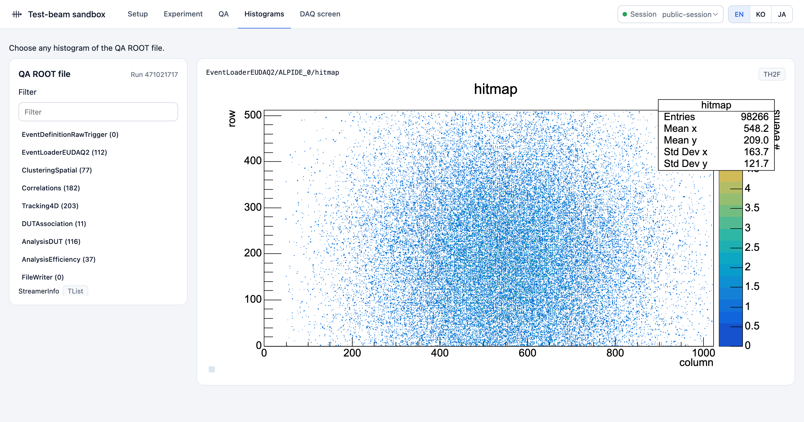

[English](../virtual-alpide-board.md) | [Korean](../ko/virtual-alpide-board.md) | [Japanese](../ja/virtual-alpide-board.md)

# 가상 ALPIDE 보드

이 시스템의 응답은 합성값이며 실제 장비의 측정값이 아닙니다. [공식 Corryvreckan 저장소](https://gitlab.cern.ch/corryvreckan/corryvreckan)의 master commit `22fca3e43ceec7ba6263a5cf179cd57d5fff42fe`로 빌드합니다.

## 인터페이스

변경하지 않은 공개 EUDAQ producer가 `virtual_alpide/alpidedaqboard.py`를 import합니다. register는 기록한 정수를 보관하며 쓰지 않은 값은 0입니다. `event_read`는 공개 변환기의 형식으로 source 픽셀을 인코딩합니다. 전원과 온도 값은 placeholder입니다. 실제 보드나 장치 파일은 열지 않습니다. 고정 가상 Git 작업 트리는 producer 식별자 `cfb0e422af953a0fec8ad98a8541a98cf6c6c1b3`와 빈 diff를 제공합니다. Git 작업 트리 밖에서는 공개 producer가 BORE를 만들 때 오류가 발생합니다.

## 응답

예시 응답은 `virtual_alpide/response.json`을 사용합니다. `ITHR`을 0에서 255로 올리면 효율은 1에서 0으로, 평균 cluster 크기는 2에서 1로 감소합니다. `STROBE_LENGTH`는 25,000 ps 단위 gate입니다. trigger 번호는 보존하고 ps 시각은 12,500 ps tick으로 내림합니다. source가 없거나 serial이 틀리면 StartRun이 실패합니다. socket 시간 초과는 3초, 종료 drain 시간 초과는 12초입니다. 검사는 `tests/scripts/run_alpide_board_e2e.sh`로 실행합니다.

