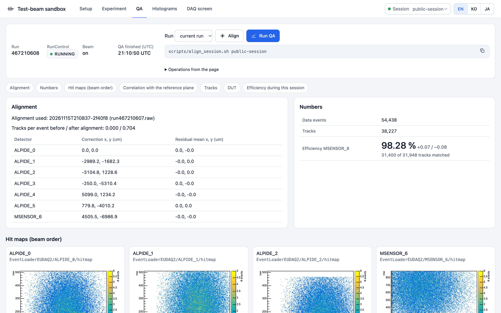
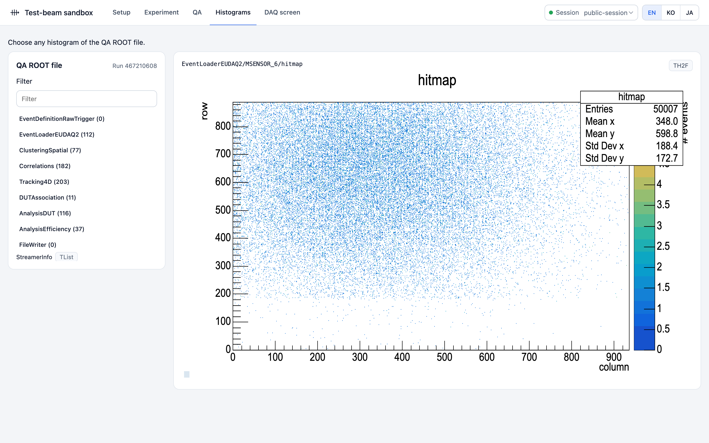

[English](qa-page.md) | [Korean](ko/qa-page.md) | [Japanese](ja/qa-page.md)

# Result page

The result page shows the experiment and the QA of a session in a browser. Its buttons run the terminal commands: they make and change setup files, start and finish a session, turn the beam on and off, stop the run, send RunControl requests and the Q key, and run alignment and QA. The page also shows the session's screen windows. The terminal commands work as before.

## Start and stop

`scripts/qa_page.sh public-session` starts the page server in the background on `127.0.0.1` port `8765`, prints the address and the process number, and opens a browser on the experiment view when it runs in a terminal. `scripts/qa_page.sh` without a session name starts the server without a session and opens the setup tab; the session list at the top of the page then chooses a session. `--port N` chooses another port, `--no-browser` keeps the browser closed, and `--foreground` keeps the server in the terminal until Ctrl-C. `scripts/qa_page.sh --stop` stops it. If a page server started by an earlier version still runs on the port, `scripts/qa_page.sh` says so together with the command that stops it, and `scripts/qa_page.sh --stop` stops it after checking that the process is that page server. When the container is missing or stopped, the page says so.

`scripts/analyze_session.sh public-session` does not open the page. With `--page` it also starts the page server if none runs, prints the address and, in a terminal, opens the QA tab in a browser; `--page --no-browser` only prints the address. The printed QA lines stay the same.

`--refresh SECONDS` (at least `10`) repeats the QA of the running run at that interval while the server runs; the page updates by itself. QA runs never overlap.

The setup tab draws and edits trigger scintillators and their trigger and veto expressions.

## Setup tab

The setup tab lists the setup files of `configs/setups/`. Choosing one shows what `scripts/setup_session.sh check` and `scripts/setup_session.sh show` print for it, and the devices and beam in 3D, drawn as in the experiment tab from the values of the file (no session is needed). "New setup" starts from the values of `scripts/setup_session.sh new --no-input`.

Every item of the file can be changed: the run, the beam, the position offsets, the devices and their positions and settings, and the msensor tiles. Values are written as in the file (for example `1, -2, 60`); the small text under each item is the comment the saved file carries. Devices can be added and removed; the page numbers each kind from 0 without gaps, and the plane numbers and positions are yours to set. Clicking an msensor tile switches it off or on. While you edit, the check and the 3D view follow; the check uses the code of `scripts/setup_session.sh check` and its words.

"Save the setup file" writes the file in `configs/setups/` only after the check passes, in the same form as `scripts/setup_session.sh new` (with the comment of every item), so it can be used from a terminal as well. The page then shows what `scripts/setup_session.sh check` prints for the saved file. The name must use letters, digits, `-` and `_` and end in `.ini`. `default.ini` and `small-msensor.ini` belong to the repository and are not overwritten: an edit of them is saved under another name. Replacing an existing file asks for a confirmation on the page.

"Start the session" runs `scripts/start_session.sh --setup configs/setups/FILE --name NAME --no-attach` with the saved file and the session name, and with `--alignment configs/alignments/FILE.json` when a saved alignment is chosen (keep one with `scripts/align_session.sh NAME --save configs/alignments/FILE.json`). The page shows the command's output and exit code; a name that is already in use, for example, is reported in the command's words. When the session has started, the page shows it in the experiment tab. The page does not build the image: when it is missing, the page names `scripts/build_session.sh`.

The experiment tab draws the plates with holes and lists scintillators and trigger conditions below the devices.

## Experiment tab

The page server command opens this tab first; the QA command opens the QA tab.

"Stop this run" runs `scripts/session_control.sh public-session stop --id page-stop`; RunControl starts the next run immediately. To end data taking, confirm "End data taking" (`scripts/session_control.sh public-session terminate --id page-terminate`), wait for termination, then confirm "Leave RunControl (Q)" (`docker exec public-session tmux send-keys -t ITS3:rc Q`); copy the output and remove the container.

- The device table shows the settings of the current run; a value that changes for the next run is followed by "→ next run:" and the new value. "Settings for the next run" changes one item with `scripts/session_control.sh public-session set SECTION ITEM VALUE --id page-set`, checked as in the setup file.
- The devices of the session's setup in 3D, in beam order, at the surveyed x, y and z of the setup file and at their real size (pixels x pitch). Each device carries its name and role (reference plane or DUT). An msensor shows its tile grid: tiles switched on are orange, switched-off tiles grey. An arrow marks the beam direction (z), with ticks every 10 mm, and short red and green lines at the beam source mark x and y.
- Drag to rotate, use the wheel to zoom and right-drag or Shift-drag to move. The buttons return to the start view or show the devices from the side, from the top or as the beam sees them. `view=side`, `view=top` or `view=beam` in the address chooses the first view (`view=reset` is the start view).
- `BEAM ON` or `BEAM OFF`, the session, the RunControl state, the run, the events of the run and the event rate. The page reads them from the session every 2 s, so a beam change in the terminal shows within a few seconds. A missing or stopped session is shown as such.
- The beam items of the setup file (particle, energy, rate, centre, variance, where the beam starts, events per run) and a table of the devices with their settings and switched-off tiles.
- While the beam is on, particles move along the beam. They illustrate the beam items of the setup file; they are not recorded events or tracks, and the page says so. With the beam off no particles are drawn. With the beam on and no run taking data, the particles still move and the page notes that nothing is recorded. Drawing stops while the tab is not shown.
- The hidden actual positions are not read or shown. When the session has an alignment, a check box shows the positions found by the alignment as outlines, from the alignment result file only.
- A session started from a layout directory is drawn from its analysis geometry, without beam items.

The 3D view uses WebGL. A browser without WebGL draws the same scene with SVG and says so; if neither works, the page gives the reason and still shows the session state. Labels that would cover one another are moved apart, and axis numbers that would cover a label are left out, so the view along the beam stays readable.

## DAQ screen tab

The tab shows the text of one window of the session's operator screen: `rc` (RunControl), `rp` (reference planes), `dp` (DUT producer), `sp` (support processes), `dc` (collector) or `log`. The page reads the window with `tmux capture-pane` every second while the tab is shown, and stops reading when another tab or another browser tab is shown. It only reads; nothing typed in the page goes to the screen except the Q key below. The `perf` window (`htop`) is not shown.

`R` and `T` run `scripts/session_control.sh public-session repeat --id page-repeat` and `terminate --id page-terminate`, which send the RunControl requests through the control socket; `Q` sends the key to the RunControl window with `docker exec public-session tmux send-keys -t ITS3:rc Q`. `R` repeats the current configuration, `T` terminates the sequence and `Q` exits after termination. Each button shows its command; `T` and `Q` ask for a confirmation on the page.

To finish a session, follow the README order: `T`, `Q`, then "Copy the output", which runs `docker cp public-session:/tmp/session-run outputs/public-session-TIME` into a new folder under `outputs/` of the repository (TIME is the UTC time), then "Remove the container", which runs `docker rm -f public-session` after a confirmation on the page. Only a session container of this repository can be removed. The page then returns to the setup tab.

## Operations

A page opened from the address that `scripts/qa_page.sh` prints can run operations. Each button runs an existing command and shows that command line next to it, so the same step can be done in a terminal. Besides the setup tab and the DAQ screen tab described above:

- The experiment view: turn the beam on (`scripts/session_control.sh public-session on`) or off (`scripts/session_control.sh public-session off`), and stop the run (`scripts/session_control.sh public-session stop`) after a confirmation on the page.
- The QA tab: align (`scripts/align_session.sh public-session`) and run QA (`scripts/analyze_session.sh public-session`), for the current run or for a run chosen in the list (`--run N`).

A button that does not fit the state (for example turning on a beam that is on) cannot be pressed. Alignment and QA take some time: the page shows that the command runs, then its output lines and exit code as a terminal would; a failure such as `NOT ALIGNED` is shown as the command reports it. Only one alignment or QA runs at a time for a session. When QA finishes, the QA tab shows the new result. Each operation is recorded with its time, command line and exit code in `page-operations.jsonl` of the session directory, which the page lists. Copying and removing are not added there, so that the copy equals the session directory; the page lists them while the server runs.

The server makes a new random token when it starts. The printed address carries it after `#`; the browser does not send that part to the server, and the page removes it from the address after reading it, so it does not stay in the browser history. Operations are accepted only with that token, so another web page on the same computer cannot run them: saving a setup file, starting a session, the keys, copying and removing, the beam, stopping the run, alignment and QA. The token is kept in the server's state file in `${XDG_STATE_HOME:-~/.local/state}/test-beam-sandbox/`, a folder only your own user account can open. Running `scripts/qa_page.sh public-session` again prints the same address, and `scripts/analyze_session.sh public-session --page` opens a page with the token. A page opened without the token only views, and shows where to get the address. `--view-only` starts a server that refuses every operation.

## QA tab

The QA tab shows alignment, measurements and plots.

- Session, run, RunControl state, beam and the time of the QA.
- Alignment: whether the session is aligned, the alignment used, the corrections, the tracks per event before and after, and the residual means. `NOT ALIGNED` and `POSITIONS CHANGED?` are shown at the top with the alignment command.
- Numbers: data events, tracks, efficiency of each DUT with its errors, and tiles left out of the efficiency.
- Hit maps of every plane in beam order, the x and y correlation of each plane with the reference plane, the track chi2/ndf, and for each DUT the efficiency map, the in-pixel efficiency, the x and y residuals and the efficiency over time in the run.
- Efficiency during this session: each QA adds one point.

A plot without entries says that there are no data yet.

## Histograms tab

It lists every histogram of the QA ROOT file; choosing one draws it.

## Languages and drawing

The page text is in English, Korean or Japanese; the buttons at the top switch it, and the first language follows the browser. Numbers, names and commands are the same in every language. The text of each language is in one file, `session_setup/web/text/en.json`, `ko.json` or `ja.json`, one item per line; a corrected file replaces the page text. The plots are drawn with JSROOT `7.5.2` (`MIT`), which the session image contains with ROOT, and the experiment view with three.js `r155` (`MIT`), which that JSROOT contains; the server copies it from the image when it starts, so the page loads nothing from the Internet. The JSROOT copy stays in `~/.cache/test-beam-sandbox/`; copies of QA files are deleted when the server stops.

The settings table and next-run editor include the `[trigger]` items `trg`, `veto` and `count`.

## Page layout and navigation

The experiment view fills the available height, with status, controls, beam and devices alongside it. The setup tab places the file list, editor and preview together; section links jump to run, beam and devices. Device and scintillator summaries open on a click; new devices and devices with validation errors open automatically.

QA section links jump to each result. Each plot group initially shows 4 plots; Show all expands the group and Show fewer collapses it. Small QA plots omit their statistics boxes and titles; the Histograms tab keeps the full drawing. The histogram tree folds folders and shows counts and types; Filter matches names without regard to case and opens matching folders. Clearing the filter restores the initial view.

DAQ finishing steps are ordered: send T and Q, copy the output, then remove the container. At a window width of at least 1024 pixels, the terminal adjusts its text to fit 80 columns. Each command box has a copy button that copies the displayed command unchanged.
