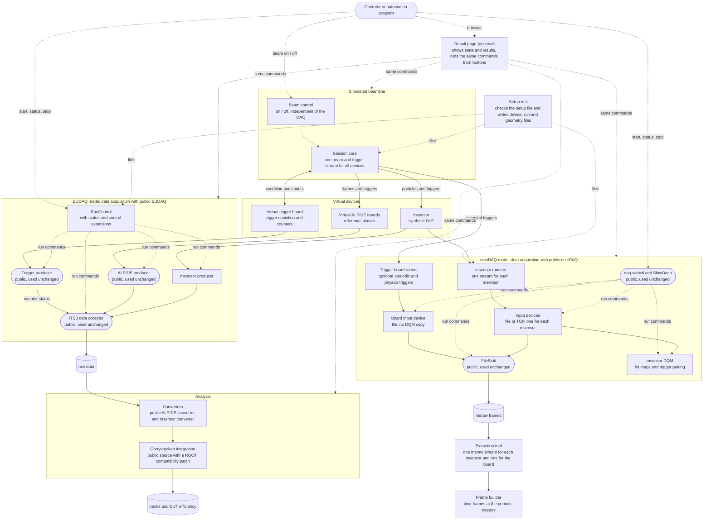

[English](reference.md) | [Korean](ko/reference.md) | [Japanese](ja/reference.md)

# Reference

Processes, scripts and the architecture of the sandbox.

## What is running

| What | Started by | Stopped by | What remains |
|---|---|---|---|
| Images | `scripts/build_session.sh` (nothing runs) | | they stay until they are built again |
| Session: one container with the simulated beam and the DAQ of the setup file; in the EUDAQ mode RunControl, producers and data collector | `scripts/start_session.sh` | `docker rm -f NAME` | output not copied out with `docker cp` before removal is lost |
| nestDAQ processes in the nestDAQ mode: Redis, daq-webctl, SlowDash, msensor runners, trigger board runner (when `trigger_board = on`), input devices, FileSink and DQM in the `NESTDAQ` tmux session of the container | `scripts/start_session.sh` | `docker rm -f NAME` | stored files in `/tmp/session-run/nestdaq/data/` of the container, lost with it unless copied out |
| nestDAQ run | `scripts/session_control.sh NAME nestdaq start` | `scripts/session_control.sh NAME nestdaq stop` | |
| Beam | `scripts/session_control.sh NAME on` (a session starts with the beam off) | `scripts/session_control.sh NAME off` | |
| Page server: a process on this computer, outside the container | `scripts/qa_page.sh` | `scripts/qa_page.sh --stop` | it keeps running when the session is removed |

- `docker ps -a` lists the session containers, running or stopped.
- `pgrep -f session_setup.webpage` prints the process numbers of the page servers.

## Scripts

| Role | Script | What it does |
|---|---|---|
| Setup | `scripts/setup_session.sh` | create, show and check a setup file |
| Session | `scripts/build_session.sh` | build the images |
| Session | `scripts/start_session.sh` | start a session from a setup file |
| Session | `scripts/attach_session.sh` | show the RunControl screen (EUDAQ mode) or the msensor runners (nestDAQ mode) of a running session again |
| Beam and run | `scripts/session_control.sh` | turn the beam on and off and show the status; in the EUDAQ mode stop, repeat or terminate runs, change settings for the next run and end a stalled producer; in the nestDAQ mode start and stop runs and print the DQM numbers |
| Analysis | `scripts/align_session.sh` | align the analysis geometry with the data (EUDAQ mode) |
| Analysis | `scripts/analyze_session.sh` | QA of the current run or of a closed run (EUDAQ mode) |
| Data | `python3 -m nestdaq_mode.extract` | extract the msraw streams of each msensor and the trigger board from a file stored in the nestDAQ mode |
| Data | `python3 -m nestdaq_mode.framebuilder` | build time frames at the periodic triggers from extracted streams or a stored file (trigger board) |
| Result page | `scripts/qa_page.sh` | start and stop the page server |
| Automation | `scripts/wait_session.sh` | wait until the finite example has finished or the session has ended |

## How it works

Rectangles are components of this repository; rounded boxes are public software used unchanged. Solid arrows carry data, dashed arrows carry control. A session uses either the EUDAQ box or the nestDAQ box, as its setup file says; the beamline, the devices and the result page are the same for both. The result page is optional: it shows the state and the results and runs the same commands as the terminal, and setup files are edited there with the checks of the setup tool.

The build fixes the versions of the public software, among them EUDAQ commit `bfe26c7`, Corryvreckan master commit `22fca3e` and nestDAQ commit `eda7287`; all versions and patches are in [Public stack and source versions](public-stack.md).

### Repository layout

- `configs/`: setup files for both modes, layouts and the session geometry example.
- `scripts/`: the commands of the [walkthrough](walkthrough.md).
- `session_setup/`: setup tool, session start, analysis commands and the result page.
- `session_core/`: simulated beamline: beam, timing and device coordination.
- `virtual_alpide/`: virtual ALPIDE board.
- `virtual_trigger/`: virtual trigger board.
- `msensor/`: msensor device, its producer and its runner.
- `nestdaq_mode/`: nestDAQ mode: session start, run control, input devices, trigger board runner, DQM, the extraction tool and the frame builder.
- `runcontrol/`: RunControl extensions and the patches applied to EUDAQ.
- `eudaq_module/`: msensor converter for EUDAQ.
- `integration/`: layouts and Corryvreckan modules.
- `tracksim/`: particle transport used by the session core.
- `docker/`: image builds.
- `docs/`: documentation.
- `tests/`: checks.
