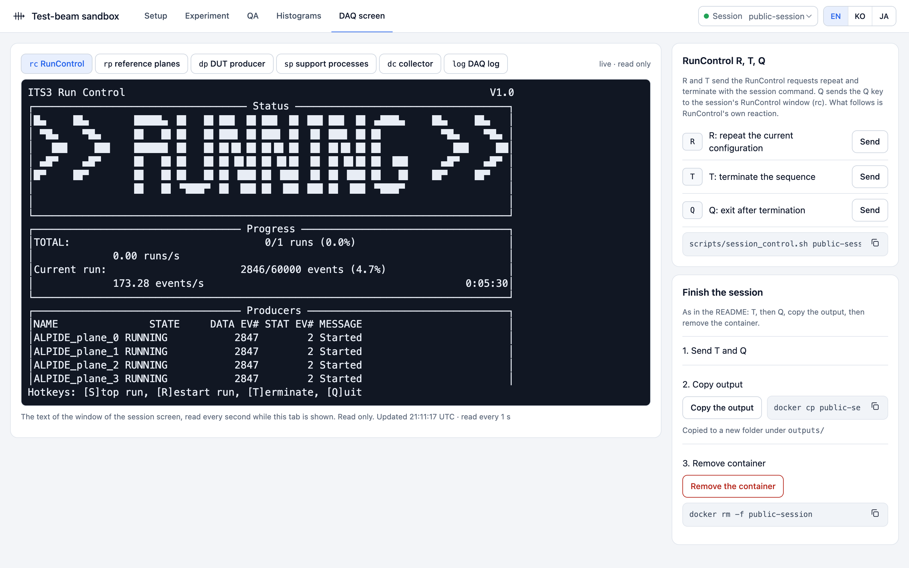

[English](runcontrol-hook.md) | [Korean](ko/runcontrol-hook.md) | [Japanese](ja/runcontrol-hook.md)

# RunControl observation and control

This system produces synthetic responses, not measurements from real equipment. The build uses the [official Corryvreckan repository](https://gitlab.cern.ch/corryvreckan/corryvreckan) at master commit `22fca3e43ceec7ba6263a5cf179cd57d5fff42fe`.

## Options

The public ITS3 RunControl accepts `--status-file PATH` for atomic JSON status, `--control-socket PATH` for local JSON control and `--one-pass` to stop after the last configuration. Socket intents `stop_next`, `repeat`, and `terminate` match the corresponding keyboard controls. `accepted` means the request was received, not that the run has stopped. The `its3-runcontrol-status/v1` status retains disconnected connections with `connected=false`; `run.number` is the number of the current run. The public API does not expose it, so when a run reaches `RUNNING` the status takes it from the name of the raw file the data collector opened in the directory of the status file (`run<number>.raw`). The number stays after the run stops, until the next run reaches `RUNNING`; before the first run, or without a raw file in that directory, it is `null`.

## Control history

The file `control-history.jsonl` is beside the status file, at `/tmp/session-run/control-history.jsonl` in a session. Each `S`, `R`, or `T` key is recorded when pressed; accepted socket requests are recorded, while rejected or malformed requests and `Q` are not. Without a status file no history is written.

| Field | Meaning |
|---|---|
| `format` | Format version `1` |
| `seq` | History sequence, starting at 1 |
| `utc` | UTC time in ISO 8601 |
| `monotonic_ns` | Monotonic time in nanoseconds |
| `kind` | Request: `stop_next`, `repeat`, or `terminate` |
| `source` | Origin: `keyboard` or `socket` |
| `id` | Request identifier |
| `status_seq` | Sequence of `last_intent` in the status file |
| `rc_state` | RunControl state at the request |

Within the same `format`, the names and meanings of these fields remain stable and fields may be added. A change of meaning raises `format`.

The hook also keeps the configuration that RunControl read for each run as `run<number>.conf` beside its raw file. Setting changes and ended producers are not in this file; `scripts/session_control.sh` records them in `command-history.jsonl`.

## Launcher

The launcher supports `--extra-dut`, `--rc-args`, `--rc-address`, `--producer-env`, and `--no-attach`. Pass environment variable names, not their values. The msensor producer reports successfully sent data events directly as `DataEventN`, starting at 0 for each run and excluding BORE and EORE. Run `tests/scripts/run_runcontrol_e2e.sh` for checks.

Accepted requests remain pending through run startup and are applied after the run starts. A request is rejected with a reason when another request is pending or there is no applicable run. Keyboard and socket share the same handling.

Before starting clients, the launcher waits until its RunControl process owns the requested TCP listener. It reports an occupied port or a listener that never becomes ready as an error.
