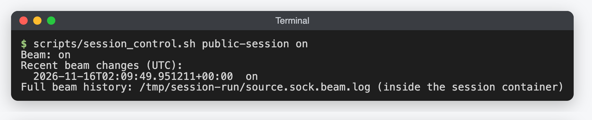

[English](session-core.md) | [Korean](ko/session-core.md) | [Japanese](ja/session-core.md)

# Session source and beam control

This system produces synthetic responses, not measurements from real equipment. The build uses the [official Corryvreckan repository](https://gitlab.cern.ch/corryvreckan/corryvreckan) at master commit `22fca3e43ceec7ba6263a5cf179cd57d5fff42fe`.

## Session source

The independent session core provides a shared clock and source to participating devices. `configs/session/geometry.json` provides an example. Pass the source seed and beam conditions in `SESSION_SOURCE_CONFIG_JSON`, not in public geometry or output. The launcher starts or reuses the core with `--session-geometry` and `--session-socket`. It does not send run commands to RunControl. Device joins, events, acknowledgements and stops use newline-delimited JSON over the Unix socket.

The time unit is ps. msensor floors to ns and the board floors to 80 MHz ticks. A participant request for a gate or crossing guard exceeding 90 ms is rejected. A board source socket times out after 3 seconds and the stop drain after 12 seconds. Response parameters remain fixed within each run. A disconnected source is an error, not an empty event.

At stop, the devices remain connected until each configured collector reports through `DataEventN` that it has assembled all events through the final trigger. Missing confirmation produces an error instead of a successful stop. The RunControl hook forwards collector progress to the session source; the source sends no run commands.

With scintillators, only particles satisfying the [trigger condition](trigger.md) produce triggers; hits from the other particles also reach the devices.

## Device loss and source limits

The source waits 10 seconds after the first join for all participants. It records missing participants and starts with the rest. A participant that disconnects or does not respond for 10 seconds is excluded from that run; the other devices continue receiving beam and triggers. The source writes the participant serial and reason, without source conditions, to the `.session.log` file beside its socket. A killed producer appears disconnected in the RunControl status file. After a stop request, the remaining producers and collector can stop while RunControl continues waiting for the disconnected producer; the raw can remain open and readable. The producer cannot rejoin the current run.

If a producer stops responding while still connected, its status can remain RUNNING and its event count stops increasing while the other producer counts continue. The public collector waits for that producer and its count stops while the other queues grow. Before stopping the run, end the stalled producer as described in the [operator screen guide](operator-screen.md); the collector can resume assembling events from the remaining devices, but the run can still remain waiting after a stop request. The remaining producers can also report `Stop Error`, and RunControl can enter `ERROR`. If the timed-out producer wakes up instead, its status can change to `ERROR` and RunControl can enter `ERROR`; a stop request can be rejected; the raw can remain open and incomplete. If StopRun is requested while the producer is still stalled, remaining producers can report `Stop Error`, and unassembled events can be absent from the raw. Check the status and preserve any raw output, then remove the container with `docker rm -f public-session` and start a fresh session with `scripts/start_session.sh --layout /tmp/public-session-layout --name public-session`. If the session source itself disappears, devices report errors; restart the session.

Same-run recovery is therefore possible only within 10 seconds: the source excludes a participant by the time since its last request, so a producer stopped with SIGSTOP and continued after 10 seconds or more is rejected and ends in `ERROR`. A longer stall that ends in the same run must keep answering the source; the `stall` command of the [operator screen guide](operator-screen.md) does this for an msensor and keeps the events for after the stall.

In the finite example, when an event, intersection or pixel calculation limit is reached, msensor reports `source_finished`, and the `source_limit` status field identifies the limit. Events consumed while the beam is off count toward the limits. Stop the run through RunControl to close it normally; the source does not resume that run.

## Beam and comparison

The beam starts off. Use `python -m session_core.beamctl --socket <source.sock> on`, `off`, or `status`; the socket also accepts JSON beam operations. The `.beam.json` and `.beam.log` files describe state and changes. Scheduled changes are replayed at the same run times. Off intervals suppress trigger and particle signal delivery, while noise and delayed hits may remain. Identical runs compare device payloads, decoded streams, BORE and EORE; intermediate wall-clock status events remain in raw data but are excluded from the comparison. Stopping preserves the last gate and guard without adding triggers.

For `on` and `off`, `--id ID` sets the request id; without it `scripts/session_control.sh` uses `operator-on` and `operator-off`. The beam record has an `id` field; requests without an id and startup or scheduled records use `null`. Beam operations are not in `control-history.jsonl`: order the two histories using `monotonic_ns` and `actual_monotonic_ns` from the same monotonic clock.

See the [operator screen guide](operator-screen.md) for screen and takeover operations.
