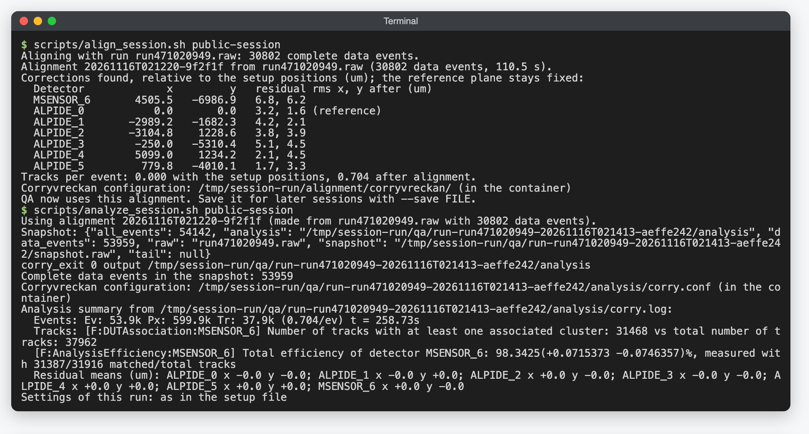

[English](session-run.md) | [Korean](ko/session-run.md) | [Japanese](ja/session-run.md)

# Session acquisition and analysis

This system produces synthetic responses, not measurements from real equipment. The build uses the [official Corryvreckan repository](https://gitlab.cern.ch/corryvreckan/corryvreckan) at master commit `22fca3e43ceec7ba6263a5cf179cd57d5fff42fe`.

## Layout

The default layout contains 6 reference planes and 1 msensor. `python3 -m integration.layout --layout configs/layouts/default.json --directory /tmp/my-layout --analysis-geometry` creates `geometry.json`, `init.ini`, `a.conf`, `devices/`, `mapping.json`, and `analysis-geometry.conf`. Use unique plane numbers and consecutive per-kind numbers. A plane outside the beam is allowed. Source seed and hidden beam conditions do not belong in the layout.

A setup file becomes these files when a session starts with `scripts/start_session.sh --setup FILE`; layout files such as `configs/layouts/default.json` are accepted there as well. To edit the generated files by hand, run `python3 -m integration.layout --setup my-setup.ini --directory DIR --analysis-geometry` and start with `--layout DIR`; generating again never overwrites edited files.

## Acquisition and analysis

Follow the commands in the [walkthrough](walkthrough.md) to build, start, acquire, stop, and analyze a run. The session starts with the beam off. Analysis uses public EUDAQ converters, EventLoaderEUDAQ2, clustering, tracking, DUT association, efficiency and output modules. The pinned Corryvreckan revision can emit a ROOT histogram bin warning for the auxiliary 30 µm pitch plot 1 time; other conversion errors are failures. Do not analyze a raw file with no data events.

`scripts/align_session.sh` and `scripts/analyze_session.sh` use the devices of the session's own setup: what `scripts/start_session.sh` keeps in `/tmp/session-run` as `setup.json`, or the analysis geometry of a layout directory. QA needs at least 3 ALPIDE reference planes. The [automated example](automation.md) runs a session without the screen, and the [quick start](../README.md) with it.

To operate the beam, use `scripts/session_control.sh public-session off`, `on`, or `beam-status`. Device settings are items of the setup file: change them there and start a new session, or change them for the next run with `scripts/session_control.sh public-session set` ([operator screen guide](operator-screen.md)) ([setup file reference](setup-file.md)). A session started with `--layout DIR` reads the files of `DIR` instead; edit its `a.conf` before starting it to change device settings, and keep the analysis geometry matching the layout.

## Default detector mapping

The default analysis mapping associates the following identifiers and positions. `mapping.json` supplies the analysis section name; the geometry `position_mm`, `pixels`, and `pitch_um` map to `position`, `number_of_pixels`, and `pixel_pitch`. Every plane also gets `spatial_resolution`, the intrinsic resolution of the [setup file reference](setup-file.md) (for example `4.517um, 4.517um` for an ALPIDE plane at `ithr = 0` and `6.640um, 6.062um` for the default msensor), and `material_budget = 0.00106724`, the 100 µm of silicon per plane that the simulation uses. Generating an acquisition-only layout leaves any existing analysis geometry unchanged.

| serial | producer / plane | geometry | analysis detector | z (mm) |
|---|---|---|---|---:|
| V0 | ALPIDE_plane_0 / 0 | P0 | ALPIDE_0 | 0 |
| V1 | ALPIDE_plane_1 / 1 | P1 | ALPIDE_1 | 20 |
| V2 | ALPIDE_plane_2 / 2 | P2 | ALPIDE_2 | 40 |
| MSENSOR_0 | MSENSOR_0 / 6 | D0 | MSENSOR_6 | 60 |
| V3 | ALPIDE_plane_3 / 3 | P3 | ALPIDE_3 | 80 |
| V4 | ALPIDE_plane_4 / 4 | P4 | ALPIDE_4 | 100 |
| V5 | ALPIDE_plane_5 / 5 | P5 | ALPIDE_5 | 120 |
