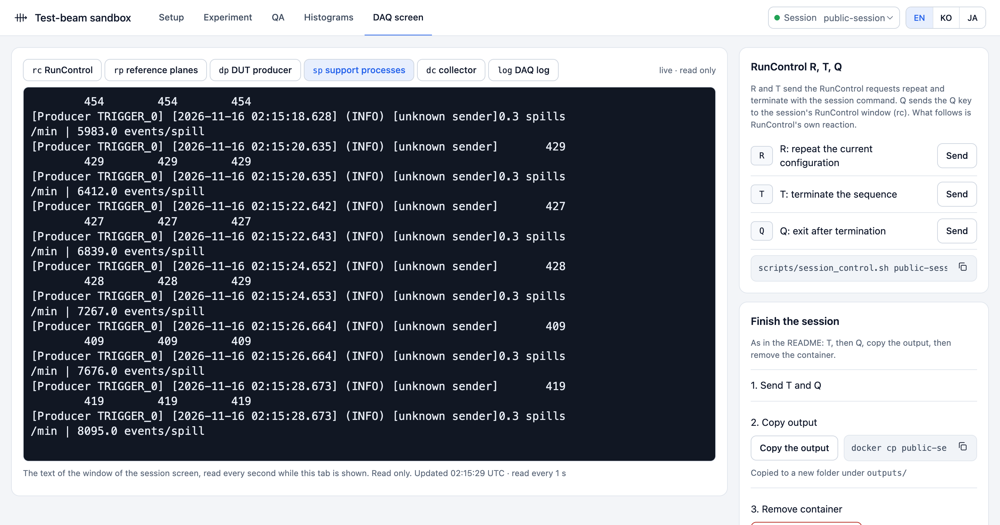

[English](trigger-board-surface.md) | [Korean](ko/trigger-board-surface.md) | [Japanese](ja/trigger-board-surface.md)

# Public trigger board call surface

This system produces synthetic responses, not measurements from real equipment. The build uses the [official Corryvreckan repository](https://gitlab.cern.ch/corryvreckan/corryvreckan) at master commit `22fca3e43ceec7ba6263a5cf179cd57d5fff42fe`.

The table lists what the unchanged public `TriggerProducer.py` at commit [`bfe26c7`](https://github.com/eudaq/eudaq/blob/bfe26c7b73844344b2cbfa37ab853f2a0cb1f23e/user/ITS3/python/TriggerProducer.py) uses from its board module, the source lines, and what the virtual board does.

| Source interface | Lines | Virtual behavior |
|---|---|---|
| `find_trigger()` | 32 | Finds the virtual board |
| `TriggerBoard(port)`, `tb.con.port` | 32, 128 | Accepts only virtual and records its port |
| `DacAddrCh.keys()`, `DacAddrCh(name)`, `.channel`, `.address`, `str()` | 33, 35, 37, 38 | Accepts the DAC names |
| `DacVoltage(text).value` | 36 | Accepts the DAC value |
| `tb.set_dac(val=, channel=, address=)` | 38 | Records the DAC value without changing decisions |
| `TriggerConditionParser().get_cmd_sequence(trg, veto)` | 53–56 | Validates trigger and veto expressions |
| `tb.write_trg_logic(seq)` | 57 | Sends the condition for the next run |
| `tb.latch_and_read_cnts()` | 107, 110 | Reads the 256 unsigned counters |
| `CounterCondition(text)`, `.name`, `.count(dc)` | 59, 108, 115 | Names a condition and sums its matching counts |
