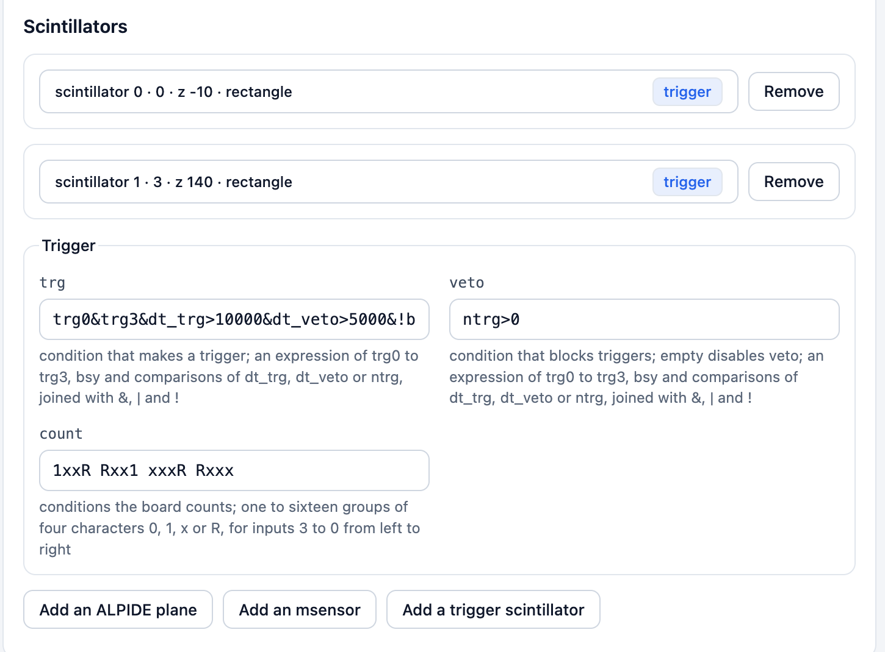

[English](trigger.md) | [Korean](ko/trigger.md) | [Japanese](ja/trigger.md)

# Trigger

This system produces synthetic responses, not measurements from real equipment. The build uses the [official Corryvreckan repository](https://gitlab.cern.ch/corryvreckan/corryvreckan) at master commit `22fca3e43ceec7ba6263a5cf179cd57d5fff42fe`.

## Scintillators

A setup has at most 4 plates, numbered from `0` without gaps. Their stated positions are actual: hidden position offsets do not apply, and the analysis geometry does not include them. The default setup has channels `0` and `3` at `1.1, -2.1, -10` and `1.1, -2.1, 140` mm.



| Section | Item | Default | Accepted values |
|---|---|---|---|
| `[scintillator N]` | `channel` | required | unique `0` to `3` |
| `[scintillator N]` | `position_mm` | required | centre x, y, z in mm, downstream of the beam source |
| `[scintillator N]` | `shape` | `rectangle` | `rectangle` or `disc` |
| `[scintillator N]` | `size_mm` | `30, 20` | rectangle width and height or disc diameter, `1` to `200` mm |
| `[scintillator N]` | `hole_mm` | `0` | central hole width and height or diameter, smaller than the plate |
| `[trigger]` | `trg` | `trg0&trg3&dt_trg>10000&dt_veto>5000&!bsy` | nonempty trigger expression using existing channels |
| `[trigger]` | `veto` | `ntrg>0` | trigger expression, or empty to disable veto |

## Trigger condition

```text
expr    := and ('|' and)*
and     := unary ('&' unary)*
unary   := '!' unary | atom
atom    := '(' expr ')' | 'trg0' | 'trg1' | 'trg2' | 'trg3' | 'bsy' | compare
compare := ('dt_trg' | 'dt_veto' | 'ntrg') ('>' | '<' | '>=' | '<=' | '==') INT
INT     := 0 – 1000000000000
```

Whitespace is ignored. For each particle while the beam is on, `trgN` indicates whether the particle crosses the active part of channel N; `ntrg` counts fired channels. `dt_trg` and `dt_veto` are the numbers of 100.5 MHz clock cycles (9.95 ns per cycle) since the previous accepted trigger and veto, or `2**62` when absent. `bsy` is true until the longest participating device gate has elapsed since the previous trigger. The trigger expression is evaluated first, then the veto expression; a particle cannot veto its own trigger. An empty veto expression disables veto. The default requires both plates, more than 10000 clock cycles (99.5 µs) since a trigger, more than 5000 clock cycles (49.75 µs) since any plate signal, and not busy.

The virtual board described here is this sandbox's model. Its simplifications are a one-cycle input pulse, evaluation per particle, and `bsy` as the longest device gate. It does not create accidental coincidences between separate particles within two cycles.

## Trigger producer

`TRIGGER_0` runs the public trigger producer unchanged with the virtual trigger board. The producer sets the condition on the board, the board passes it to the session core for the next run, and the producer reads the counters through the board.

A setup with scintillators adds `TRIGGER_0` to `init.ini` and its items to `a.conf` and `b.conf`:

| File | Item | Value | Purpose |
|---|---|---|---|
| `init.ini` | `port` | `auto` | board port |
| `init.ini` | `CHn_GAIN`, `CHn_THR` | `0.8`, `1.0` for each channel with a plate | DAC values; recorded only, they do not affect decisions |
| `init.ini` | `spill_counter_sampling_period_s` | `180` | spill sampling period in seconds |
| `init.ini` | `spill_counter_threshold` | `5` | spill threshold in counts |
| `a.conf`, `b.conf` | `EUDAQ_DC` | `dc` | collector |
| `a.conf`, `b.conf` | `trg`, `veto`, `count` | from the setup file | trigger expression, veto expression, counter conditions |
| `a.conf`, `b.conf` | `read_interval` | `2` | counter reading interval in seconds |

The board counts a 256-bin histogram of the current and previous inputs in every 100.5 MHz cycle, including idle cycles, across runs. A setup gives 1 to 16 count conditions of four characters each; the characters represent inputs 3, 2, 1, 0 from left to right. `1` means high in this cycle, `0` low, `x` either, and `R` a rising edge: high now and low in the previous cycle. `xxxx` counts cycles, `xxxR` counts input 0 pulses, and `1xxR` counts cycles in which input 3 is high and input 0 rises. A condition may refer to an input without a scintillator.

The producer prints the condition names and the counts of each reading interval in the `sp` and `log` windows, stores status events with the counters in the raw data, and shows a spill status. To change the conditions for the next run:

```sh
scripts/session_control.sh NAME set trigger count "1xx1 xxx1"
```

## Effect on the data

With no scintillators, every particle while the beam is on is a trigger. In one comparison of runs with at least `10000` events, the default setup delivered `205.4` events/s and `70.1` % of events had a track; the same setup without scintillators delivered `221.9` events/s and `66.7` % had a track.
