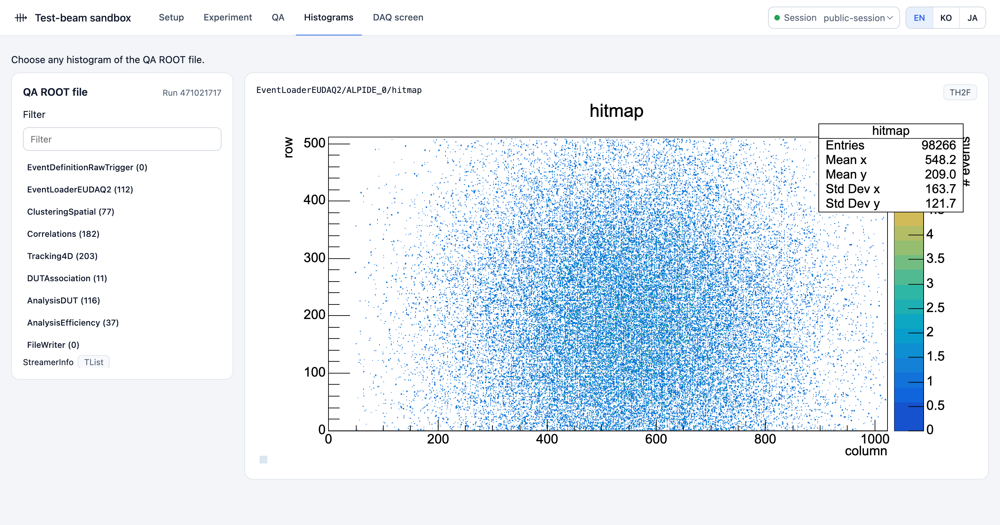

[English](virtual-alpide-board.md) | [Korean](ko/virtual-alpide-board.md) | [Japanese](ja/virtual-alpide-board.md)

# Virtual ALPIDE board

This system produces synthetic responses, not measurements from real equipment. The build uses the [official Corryvreckan repository](https://gitlab.cern.ch/corryvreckan/corryvreckan) at master commit `22fca3e43ceec7ba6263a5cf179cd57d5fff42fe`.

## Interface

The unchanged public EUDAQ producer imports `virtual_alpide/alpidedaqboard.py`. Registers retain written integer values; reading an unwritten value returns 0. `event_read` encodes source pixels in the format expected by the public converter. Power and temperature values are placeholders. No real board or device file is opened. A fixed virtual Git worktree supplies the producer identity `cfb0e422af953a0fec8ad98a8541a98cf6c6c1b3` and an empty diff. Outside a Git worktree, the public producer fails when it tries to create BORE.

## Response

The example response uses `virtual_alpide/response.json`. Raising `ITHR` from 0 to 255 decreases efficiency from 1 to 0 and mean cluster size from 2 to 1. `STROBE_LENGTH` is a gate in units of 25,000 ps. Trigger numbers are preserved and ps timestamps are floored to 12,500 ps ticks. A missing source or wrong serial fails StartRun. The socket timeout is 3 seconds and the stop drain timeout is 12 seconds. Run `tests/scripts/run_alpide_board_e2e.sh` for checks.

